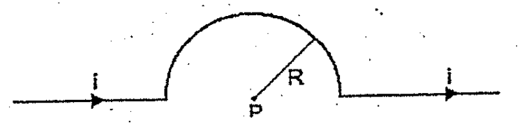
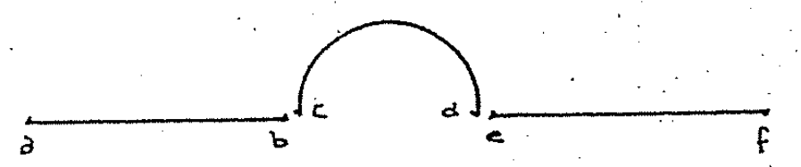
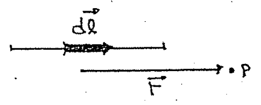
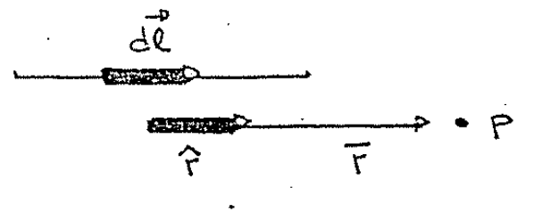
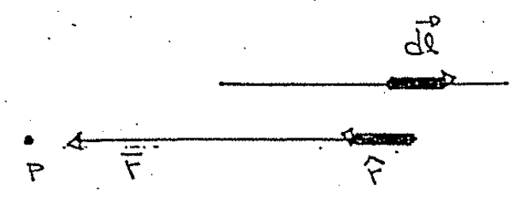
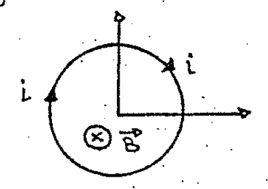
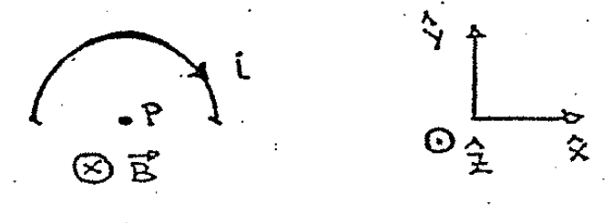

# Biot–Savart — Anibal Kasero: hilo con bucle semicircular

## Enunciado

Un hilo muy largo tiene un bucle semicircular de radio R como indica la figura.
Si por él circula una corriente i, hallar el B en centro P.

Rta.:

```math
B_P=\frac{\mu_0i}{4R}\quad\text{entrante}
```



## Desarrollo

Vamos a utilizar en este problema nuevamente el principio de superposición.
Dividimos al hilo en tres partes y calculamos el campo que cada una ejerce en el
punto P.



Comencemos con el segmento lineal ab.



Vemos que el elemento $`d\vec l`$ es paralelo al vector $`\vec r`$ y como el
versor $`\hat r`$ lo construimos con $`\vec r`$, $`d\vec l`$ resulta paralelo a
$`\hat r`$.



Cuando queremos hallar $`\vec B`$ con la ley de Biot nos encontramos con el
producto vectorial:

```math
d\vec B=\frac{\mu_0i}{4\pi}\frac{d\vec l\times\hat r}{r^2}
```

Y este producto nos da cero por el paralelismo entre el $`d\vec l`$ y
$`\hat r`$. El segmento ab NO contribuye al campo en P.

Lo mismo nos ocurre con el segmento ef, ahora los vectores $`d\vec l`$ y
$`\hat r`$ son antiparalelos:



Nuevamente el producto vectorial nos da cero y este segmento tampoco contribuye
al campo $`\vec B`$ en el punto P.

Ahora vamos a ver la contribución del tramo semicircular. No tenemos necesidad
de realizar todo el cálculo que nos pide la ley de Biot. Podemos usar el hecho
de que ya conocemos el campo $`\vec B`$ que genera una espira circular en su
centro (punto P). Esto ya lo calculamos en el ejercicio162)c)

```math
B=\frac{\mu_0i}{2R}
```

Y el campo era entrante según el eje $`\hat z`$.



Como nuestro hilo conductor contiene solo la mitad de la espira, el campo
provocado valdrá exactamente la mitad:

```math
\vec B=\frac{\mu_0i}{4R}(-\hat z)
```



La respuesta es que el campo total de todo el hilo vale

```math
\vec B=\frac{\mu_0i}{4R}\quad\text{(entrante)}
```

## Procedencia y observaciones

- Original: `2015/Resueltos Fisica II Anibal Kaseros Ley de Biot-Sabat.pdf`,
  páginas27–28 y página29 hasta el separador. SHA-256:
  `b4aeb8cc9f1fa04835d4817a067976cc3d3c07d57e18ca5dabd898b67e09d41e`.
- OCR español auxiliar y cotejo visual. Se conservan los siete dibujos y sus
  etiquetas, la referencia162)c) y el enunciado «en centro P».
- En el primer dibujo de página29 el campo entrante se describe «según el eje
  z»; el segundo dibujo define z saliente y la fórmula usa −z. Se preservan
  ambos contextos sin unificar silenciosamente sus signos.
