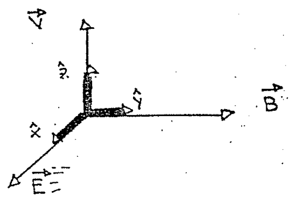

# Biot–Savart — Anibal Kasero: campos eléctrico y magnético con fuerza nula

## Enunciado

Sobre un electrón en movimiento actúan un campo eléctrico $`\vec E`$ y un campo
magnético $`\vec B`$. En un momento dado el electrón no «siente» fuerza. Trace
en tal caso los vectores $`\vec E`$, $`\vec B`$ y $`\vec v`$.

## Desarrollo

Pensemos en una carga q cualquiera (positiva por ejemplo). Si esta carga se
encuentra en presencia de un campo eléctrico sentirá una fuerza $`\vec F_e`$ que
es:

```math
\vec F_e=q\vec E
```

Si además la carga está en movimiento con una velocidad $`\vec V`$ y tenemos un
campo magnético, entonces sentirá una fuerza $`\vec F_m`$ que se calcula con:

```math
\vec F_m=q\vec V\times\vec B
```

Tenemos que elegir direcciones de modo tal que la fuerza neta sobre q valga
cero. La fuerza neta la hallamos con:

```math
\vec F=\vec F_e+\vec F_m
```

```math
\vec F=0\quad\longrightarrow\quad\vec F_e+\vec F_m=0
\quad\longrightarrow\quad q\vec E+q\vec V\times\vec B=0
```

```math
q\vec E=-q\vec V\times\vec B\qquad\vec E=-\vec V\times\vec B
```

Podemos usar el signo menos para permutar el producto vectorial porque
recordamos de álgebra que:

```math
\vec a\times\vec b=-\vec b\times\vec a
```

Nos queda la relación entre las magnitudes $`\vec V`$, $`\vec E`$, $`\vec B`$:

```math
\vec E=\vec B\times\vec V
```

Esto quiere decir que el campo $`\vec E`$ es el resultado de un producto
vectorial entre $`\vec B`$ y $`\vec V`$, por lo tanto el vector $`\vec E`$ será
perpendicular tanto a $`\vec B`$ como a $`\vec V`$.



Si nuestra partícula se mueve con una velocidad en la dirección $`\hat z`$ y
tenemos un campo $`\vec B`$ dirigido según $`\hat y`$ entonces tendremos que
elegir nuestro campo $`\vec E`$ en el eje $`\hat x`$.

Este es solo un ejemplo, y en este caso para los módulos tenemos la relación:

```math
|\vec E|=|\vec B\times\vec V|\quad\longrightarrow\quad
|\vec E|=|\vec B|\,|\vec V|\mathop{\mathrm{sen}}\nolimits\theta
```

Siendo $`\theta=\pi/2`$

```math
E=BV
```

## Procedencia y cierre del cuadernillo

- Original: `2015/Resueltos Fisica II Anibal Kaseros Ley de Biot-Sabat.pdf`,
  páginas PDF/manuscritas60–61; página PDF62 revisada y vacía, salvo ruido de
  escaneo. SHA-256:
  `b4aeb8cc9f1fa04835d4817a067976cc3d3c07d57e18ca5dabd898b67e09d41e`.
- OCR español auxiliar y cotejo visual de las tres páginas finales. Figura
  original con todas sus etiquetas. Las ecuaciones pertenecen a la solución
  fuente.
- La numeración inicial está retocada. Se conserva el cambio de electrón del
  enunciado a carga positiva de ejemplo en el desarrollo, sin sustituir el
  texto.

[Anterior: positron helice](biot-savart-kasero-positron-helice.md)
