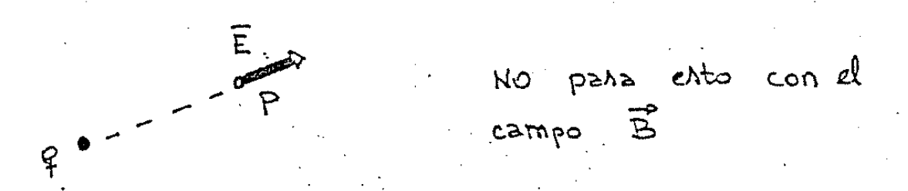
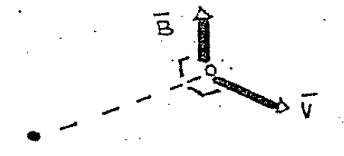
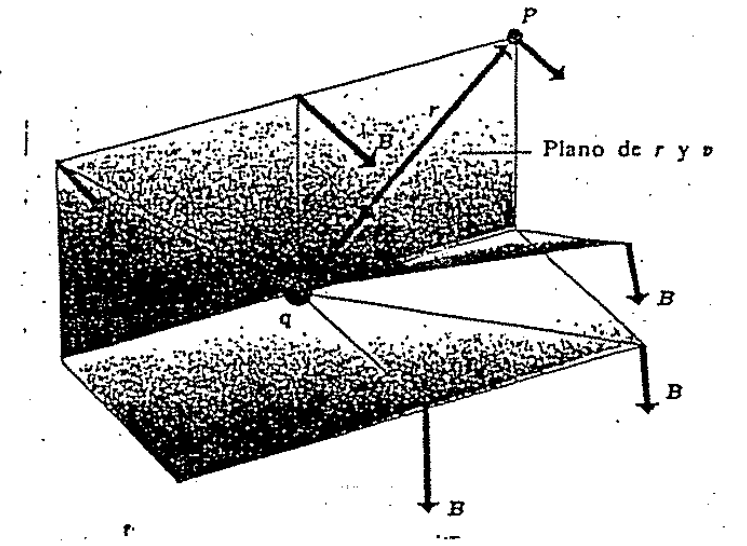
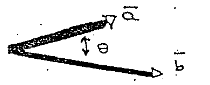

# Ley de Biot–Savart — Anibal Kasero: campo de una carga móvil

## Portada

RESUELTOS

MATERIA: Física II

TÍTULO: Ley de Biot - Savart

AUTOR: Anibal Kasero

## 8\_ LEY DE BIOT-SAVART

En el cuadernillo anterior aprendimos a encontrar el campo magnético de ciertos
conductores (alambres rectos, espiras circulares) usando la ley de Ampere.

Ahora queremos aprender una fórmula más general, como cuando estudiamos el campo
eléctrico, lo hallábamos usando la ley de Gauss y también lo hicimos con una
fórmula más general

```math
dE=k\frac{dq}{r^2}
```

## Campo magnético de una carga móvil

Empecemos con el campo $`\vec B`$ creado por una sola carga puntual móvil. Los
experimentos demuestran que este campo es proporcional a la carga q y a la
magnitud de su velocidad v, e inversamente proporcional al cuadrado de la
distancia r a la carga.

La dirección del campo magnético en un punto P NO está sobre la línea desde la
carga hasta P. Esto lo diferencia del campo eléctrico $`\vec E`$ en donde SÍ
está sobre la línea.



$`\vec B`$ resulta ser perpendicular al plano que contiene a esta línea y al
vector velocidad $`\vec v`$.



El valor del campo B es proporcional al seno del ángulo θ entre las direcciones
de $`\vec B`$ y $`\vec v`$.

Entonces el módulo del campo $`\vec B`$ en el punto P lo hallamos con la
fórmula:

```math
B=k'\frac{qv\mathop{\mathrm{sen}}\nolimits\theta}{r^2}
```

donde k′ es una constante de proporcionalidad y será

```math
k'=\frac{\mu_0}{4\pi}\qquad\text{siendo}\quad
\mu_0=4\pi\cdot10^{-7}\;\mathrm{Wb}/\mathrm{Am}
```

Entonces el campo B queda

```math
B=\frac{\mu_0}{4\pi}\frac{qv\mathop{\mathrm{sen}}\nolimits\theta}{r^2}
```

## Expresión vectorial

En la figura vemos todo lo hablado hasta ahora:



Ahora tenemos que reunir en una única ecuación el módulo y la dirección de
$`\vec B`$. Esto se puede hacer usando el producto vectorial, ya que como se
sabe de álgebra:

```math
|\vec a\times\vec b|=|\vec a|\,|\vec b|\mathop{\mathrm{sen}}\nolimits\theta
```



También introducimos un versor (vector unitario) $`\hat r`$, este versor
$`\hat r`$ será:

```math
\hat r=\frac{\vec r}{|\vec r|}
```

Con todo esto tenemos la expresión completa:

```math
\vec B=\frac{\mu_0}{4\pi}\frac{q\vec v\times\hat r}{r^2}
```

[Campo de un elemento de corriente](biot-savart-kasero-elemento-corriente.md).

## Procedencia y observaciones

- Original: `2015/Resueltos Fisica II Anibal Kaseros Ley de Biot-Sabat.pdf`.
  SHA-256: `b4aeb8cc9f1fa04835d4817a067976cc3d3c07d57e18ca5dabd898b67e09d41e`.
  Portada y páginas manuscritas 2–4, correspondientes a páginas PDF 1–4 de 62.
- La portada escribe «Anibal Kasero» y «Ley de Biot - Savart»; el nombre del
  archivo difiere. No consta año impreso en estas páginas; 2015 es la carpeta.
- OCRmyPDF en español sobre copia, Poppler y cotejo visual de las cuatro
  páginas. El manuscrito se transcribe por lectura visual; las cuatro figuras
  conservan sus etiquetas originales. Se unen palabras partidas al final de
  línea.
- Errata del original conservada: el texto define θ entre B y v. No se cambia
  por r y v. La unidad está escrita «Wb/Am»; se mantiene esa notación.
- Este apunte cubre solo las primeras cuatro páginas. Las páginas 5–7 se
  transcriben en el apunte enlazado; las páginas 8–62 continúan pendientes; el
  cuadernillo no se declara completo.
