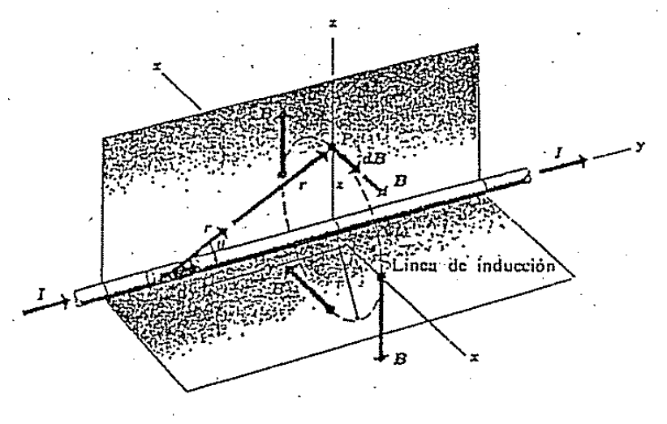
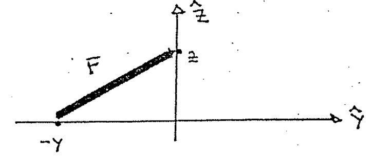

# Biot–Savart — Anibal Kasero: conductor infinito

## Enunciado

Use la Ley de Biot – Savart para calcular el B generado por un conductor
infinito con corriente i a una distancia r del mismo. Dibuje. ¿Obtuvo el
resultado esperado?

## Desarrollo

El campo $`\vec B`$ de un hilo con corriente i ya lo conocemos y lo teníamos
calculado con la ley de Ampere:

```math
B=\frac{\mu_0i}{2\pi r}
```

Ahora queremos llegar nuevamente a esta expresión pero a través de la ley de
Biot, es decir por medio de una integración directa. Veamos un esquema



Vamos a calcular el campo en el punto P, que está situado a una distancia z del
cable. En la figura vemos un genérico elemento $`d\vec l`$ (de longitud dy) cuya
distancia al punto P está dada por r.

Imaginemos un conductor de longitud total 2L, con su punto medio en el origen.
La ley de Biot es:

```math
d\vec B=\frac{\mu_0}{4\pi}\frac{i\,d\vec l\times\hat r}{r^2}
```

Y en el diagrama podemos ver que:

```math
d\vec l=dy\,\hat j
```

Y para construir el versor $`\hat r`$ notemos que dibujando solo el plano YZ
tenemos:



El vector $`\vec r`$ tiene componentes: $`\vec r=(-y,z)`$ o bien
$`\vec r=-y\hat j+z\hat k`$. Entonces el versor se construye con:

```math
\hat r=\frac{\vec r}{|\vec r|}=\frac{\vec r}{r}
=\frac{-y\hat j+z\hat k}{(y^2+z^2)^{1/2}}
```

Ahora queremos el producto vectorial entre el elemento $`d\vec l`$ y $`\hat r`$.
Recordemos que el producto vectorial es distributivo con respecto a la suma:

```math
d\vec l\times\hat r=dy\,\hat j\times\left(\frac{-y\hat j+z\hat k}{(y^2+z^2)^{1/2}}\right)
```

```math
d\vec l\times\hat r=\frac{dy\cdot y}{(y^2+z^2)^{1/2}}\,\hat j\times\hat j
+\frac{dy\cdot z}{(y^2+z^2)^{1/2}}\,\hat j\times\hat k
```

Las flechas del original señalan $`\hat j\times\hat j=0`$ y
$`\hat j\times\hat k=\hat i`$.

```math
d\vec l\times\hat r=\frac z{(y^2+z^2)^{1/2}}\,dy\,\hat i
```

La ley de Biot queda:

```math
d\vec B=\frac{\mu_0}{4\pi}\,i\cdot\frac1{r^2}\cdot d\vec l\times\hat r
=\frac{\mu_0i}{4\pi}\cdot\frac1{y^2+z^2}\cdot\frac{z\,dy\,\hat i}{(y^2+z^2)^{1/2}}
```

```math
d\vec B=\frac{\mu_0i}{4\pi}\cdot\frac{z\,dy}{(y^2+z^2)^{3/2}}\,\hat i
```

Integramos:

```math
\vec B=\int_{-L}^{L}\frac{\mu_0i}{4\pi}\cdot\frac{z\,dy}{(y^2+z^2)^{3/2}}\,\hat i
```

Todo lo que NO contenga la variable y (variable de integración) puede salir
fuera. Los límites van desde un extremo a otro: −L a L.

```math
\vec B=\frac{\mu_0i}{4\pi}\,z\hat i\int_{-L}^{L}\frac{dy}{(y^2+z^2)^{3/2}}
```

Buscamos en una tabla de integrales:

```math
\vec B=\frac{\mu_0i}{4\pi}\,z\hat i\left.\frac y{z^2(z^2+y^2)^{1/2}}\right|_{-L}^{L}
```

Luego de aplicar la regla de Barrow nos queda:

```math
\vec B=\frac{\mu_0i}{4\pi}\,z\hat i\frac{2L}{z^2(z^2+L^2)^{1/2}}
=\frac{\mu_0i}{2\pi z}\frac L{(z^2+L^2)^{1/2}}\,\hat i
```

Lo único que nos falta es pedir que el hilo sea infinito, esto equivale a tomar
el límite cuando $`L\to\infty`$. Queda una indeterminación $`\infty/\infty`$.

```math
\vec B=\frac{\mu_0i}{2\pi z}\,\hat i\frac L{L\left(z^2/L^2+1\right)^{1/2}}
```

Tomé L² factor común en el denominador.

Ahora como $`z^2/L^2\to0`$ nos queda:

```math
\vec B=\frac{\mu_0i}{2\pi z}\,\hat i
```

Como la situación física tiene simetría axial sobre el eje $`\hat y`$ (es decir
que se ve lo mismo en todos los lugares alrededor del eje $`\hat y`$),
$`\vec B`$ tiene la misma magnitud en todos los puntos de un círculo con centro
en el conductor y situado en un plano perpendicular al mismo, y su DIRECCIÓN es
en todos los puntos tangente a ese círculo como mostramos en la figura original.

Por lo tanto en todos los puntos de un círculo de radio r que rodea al conductor
(representado con una línea a trazos en la figura) la magnitud B está dada por
(su módulo)

```math
B=\frac{\mu_0i}{2\pi r}
```

A esta relación llegaron Biot y Savart a partir de observaciones experimentales,
antes de descubrirse la forma diferencial del $`d\vec B`$ que conocemos como ley
de Biot-Savart.

También a la misma fórmula llegamos si usamos la ley de Ampere como hicimos en
el cuadernillo anterior.

## Procedencia y observaciones

- Original: `2015/Resueltos Fisica II Anibal Kaseros Ley de Biot-Sabat.pdf`,
  páginas PDF y manuscritas14–18 de62. SHA-256:
  `b4aeb8cc9f1fa04835d4817a067976cc3d3c07d57e18ca5dabd898b67e09d41e`.
- OCR español auxiliar y cotejo visual de las cinco páginas. Dos figuras
  originales conservan sus etiquetas; ecuaciones transcritas como LaTeX.
- Errata conservada: en la expansión del producto vectorial el primer término
  aparece positivo, aunque el paréntesis anterior contiene −y. El original lo
  anula mediante j×j = 0. No se corrige silenciosamente.
- El número de ejercicio está retocado; no se asigna por conjetura. La notación
  de los ejes y los versores se conserva, sin cambiar z por r en los pasos
  intermedios.
