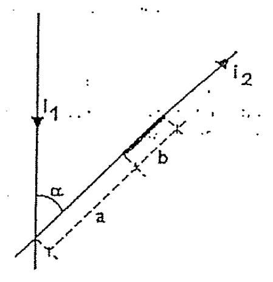
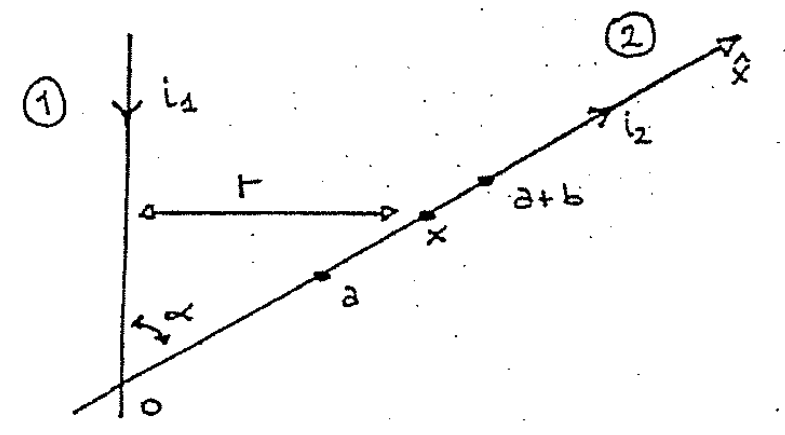
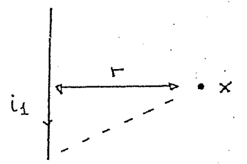
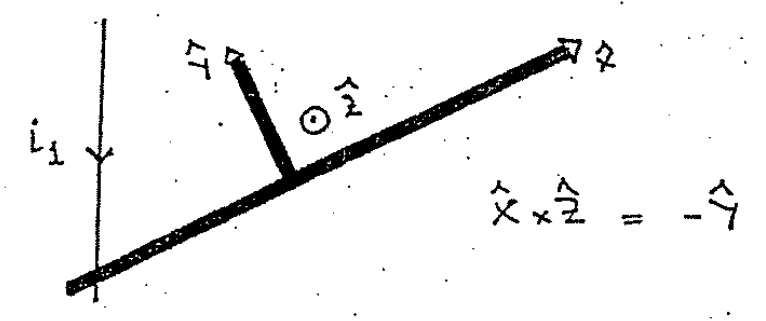
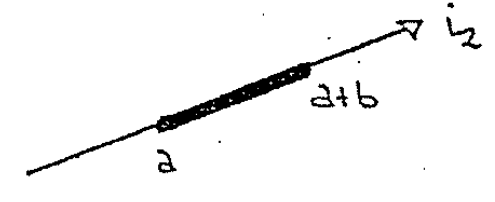
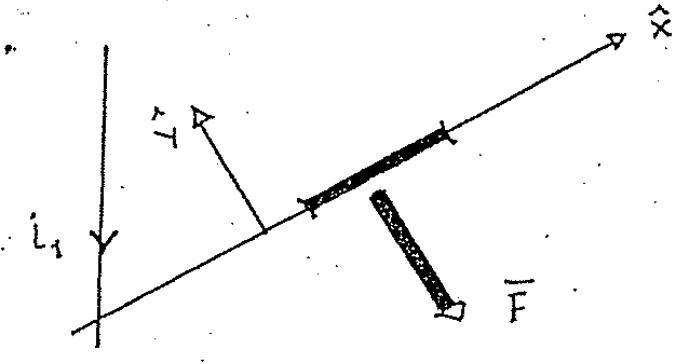

# Biot–Savart — Anibal Kasero: fuerza entre conductores coplanares

## Enunciado

Dos conductores coplanares se disponen como indica la figura y en vacío.
Considere a los conductores lineales. Determine la fuerza que aparece sobre el
tramo B del conductor con i₂ como consecuencia del $`\vec B`$ generado por la
corriente i₁.

Rta.:

```math
F=\frac{\mu_0i_1i_2}{2\pi\mathop{\mathrm{sen}}\nolimits\alpha}\ln\left(\frac{a+b}a\right)
```



## Desarrollo

Este problema NO es sencillo, vamos a elegir un sistema de referencia en donde
el eje $`\hat x`$ coincida con el conductor que lleva i₂.



El conductor con corriente i₁ genera un campo magnético en cada valor o en cada
punto del conductor con i₂ (eje $`\hat x`$). Vamos a hallar el campo del cable
en el punto x del cable②.



El campo del conductor lineal en un punto que dista a una distancia r del mismo
ya lo conocemos:

```math
B_1=\frac{\mu_0i_1}{2\pi r}
```

El valor r lo podemos expresar en función de x:

```math
\mathop{\mathrm{Sen}}\nolimits\alpha=\frac rx\quad\longrightarrow\quad
r=x\mathop{\mathrm{sen}}\nolimits\alpha
```

```math
B_1=\frac{\mu_0i_1}{2\pi\mathop{\mathrm{sen}}\nolimits\alpha\,x}
```

Este campo NO es uniforme, depende del valor de x. Entonces para poder encontrar
la fuerza que ejerce el conductor1 sobre el2 tenemos que usar una expresión
diferencial:

```math
d\vec F=i_2\,d\vec l\times\vec B_1
```

Esta expresión ya la conocemos de unidades anteriores (guía de Magnetismo).
Tenemos de aclarar quienes son los vectores $`d\vec l`$ y $`\vec B_1`$. El
vector $`\vec B_1`$ es el campo y ya conocemos su módulo, y en cuanto a la
dirección vimos en ejercicios anteriores que es saliente, en $`\hat z`$.

```math
\vec B_1=\frac{\mu_0i_1}{2\pi\mathop{\mathrm{sen}}\nolimits\alpha\,x}\hat z
```

Y el vector $`d\vec l`$ es un segmento diferencial del conductor② y en su misma
dirección, podemos poner:

```math
d\vec l=dx\cdot\hat x
```

Entonces la fuerza queda:

```math
d\vec F=i_2\,dx\,\hat x\times\frac{\mu_0i_1}{2\pi\mathop{\mathrm{sen}}\nolimits\alpha\,x}\hat z
=\frac{\mu_0i_1i_2}{2\pi\mathop{\mathrm{sen}}\nolimits\alpha}\frac{dx}x(\hat x\times\hat z)
```

El sistema de referencia que elegimos es:



```math
\hat x\times\hat z=-\hat y
```

La fuerza apunta en el sentido negativo de $`\hat y`$.

```math
d\vec F=\frac{\mu_0i_1i_2}{2\pi\mathop{\mathrm{sen}}\nolimits\alpha}\frac{dx}x(-\hat y)
```

La fuerza total la obtenemos a través de una integración

```math
\vec F=\int\frac{\mu_0i_1i_2}{2\pi\mathop{\mathrm{sen}}\nolimits\alpha}\frac{dx}x(-\hat y)
```

Los límites de integración serán justamente los valores límites del intervalo en
el cual queremos la fuerza.



```math
\vec F=\frac{\mu_0i_1i_2}{2\pi\mathop{\mathrm{sen}}\nolimits\alpha}\int_a^{a+b}\frac{dx}x(-\hat y)
```

La integración es sencilla y luego de evaluar los límites nos queda:

```math
\vec F=\frac{\mu_0i_1i_2}{2\pi\mathop{\mathrm{sen}}\nolimits\alpha}\ln\left(\frac{a+b}a\right)(-\hat y)
```

Entonces, es como que el cable se siente repelido en ese segmento:



## Procedencia y observaciones

- Original: `2015/Resueltos Fisica II Anibal Kaseros Ley de Biot-Sabat.pdf`,
  página36 desde el segundo enunciado, páginas37–39 y página40 hasta el
  separador. SHA-256:
  `b4aeb8cc9f1fa04835d4817a067976cc3d3c07d57e18ca5dabd898b67e09d41e`.
- OCR español auxiliar y cotejo visual completo del desarrollo. Seis figuras
  originales y ecuaciones transcritas como LaTeX. La numeración inicial está
  retocada.
- El texto del enunciado escribe «tramo B» aunque la figura lo rotula b;
  «Tenemos de aclarar» se conserva literalmente. No se reescribe el razonamiento
  ni se añade una solución diferente.

[Anterior: horquilla](biot-savart-kasero-horquilla.md) ·
[Siguiente: flujo rectangulo](biot-savart-kasero-flujo-rectangulo.md)
