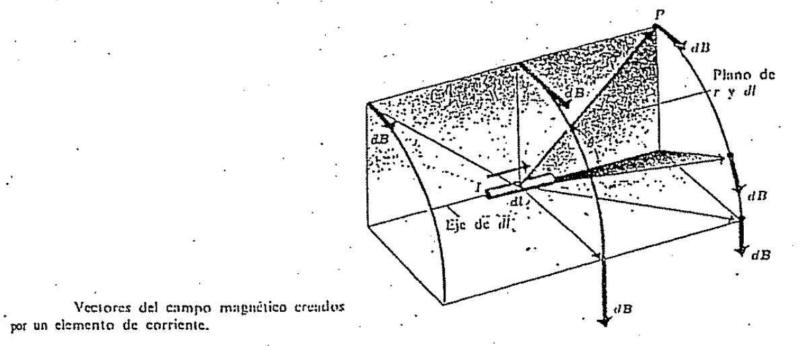
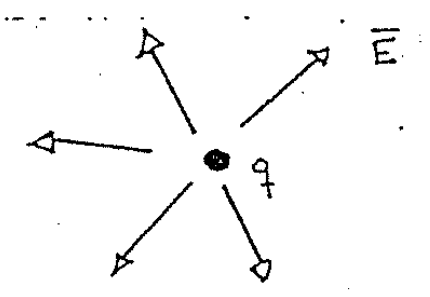
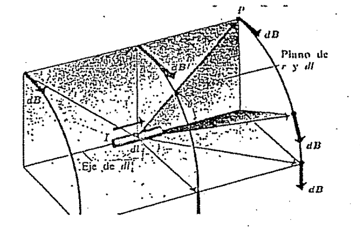

# Ley de Biot — Anibal Kasero: campo de un elemento de corriente

Vamos ahora a usar esta fórmula para encontrar el campo producido por un
conductor.

## Campo magnético de un elemento de corriente — Ley de Biot

El campo magnético creado en un punto cualquiera por la corriente de un
conductor es la resultante (suma vectorial) de los campos debida a todas las
cargas móviles del conductor.

Se puede dividir el conductor en cortos segmentos dl. El volumen de un segmento
es igual a A dl, donde A es el área de su sección transversal.

Si hay n cargas q por unidad de volumen, la carga móvil total dQ en el elemento
es

```math
dQ=nqA\,dl
```

Entonces las cargas móviles equivalen a una sola carga dQ que se mueve en
conjunto con una velocidad $`\vec v`$.

Si usamos la ecuación del campo $`\vec B`$ para una carga móvil encontramos que
el módulo queda:

```math
dB=\frac{\mu_0}{4\pi}\frac{dQ\,v\mathop{\mathrm{sen}}\nolimits\theta}{r^2}
```

```math
dB=\frac{\mu_0}{4\pi}\frac{nqvA\,dl\mathop{\mathrm{sen}}\nolimits\theta}{r^2}
```

Pero el producto nqvA es igual a la corriente i del conductor (recordá cuando
definimos corriente eléctrica).

Entonces nos queda

```math
dB=\frac{\mu_0}{4\pi}\frac{i\,dl\mathop{\mathrm{sen}}\nolimits\theta}{r^2}
```

Si nuevamente usamos el producto vectorial para tener en cuenta la dirección y
sentido de $`\vec B`$ llegamos a la **Ley de Biot**

```math
d\vec B=\frac{\mu_0}{4\pi}\frac{i\,d\vec l\times\hat r}{r^2}
```

donde $`d\vec l`$ es un vector de magnitud dl y dirección y sentido coincidente
con i.

Vemos en la figura la dirección del campo dB creado por el diferencial dl.



Para calcular el campo resultante $`\vec B`$ en cualquier punto del espacio,
debido a la corriente de un circuito completo, tenemos que integrar la ley de
Biot a lo largo de todo el circuito:

```math
\vec B=\frac{\mu_0}{4\pi}\int\frac{i\,d\vec l\times\hat r}{r^2}
```

Vamos a hacer algunos comentarios sobre el campo $`\vec B`$ antes de ir a los
ejercicios.

Las líneas de campo que describen el campo eléctrico $`\vec E`$ irradian de la
carga q.



Pero las líneas de campo magnético son de carácter totalmente diferente, son
círculos en planos perpendiculares a $`\vec v`$ o a $`i\,d\vec l`$ con centro en
$`\vec v`$ o $`i\,d\vec l`$.



## Superposición y verificación experimental

También digamos que el principio de superposición, utilizado para calcular el
campo eléctrico total creado por varias cargas, también sirve en el caso del
campo magnético.

«El campo magnético total creado por varias cargas móviles es la suma vectorial
de los campos creados por las cargas individuales».

Finalmente digamos que es imposible verificar experimentalmente la ecuación

```math
d\vec B=\frac{\mu_0}{4\pi}\frac{i\,d\vec l\times\hat r}{r^2}
```

porque es imposible obtener un elemento aislado dl de un circuito por el que
pasa una corriente. Solo el campo resultante $`\vec B`$ dado por la integral

```math
\vec B=\frac{\mu_0}{4\pi}\int\frac{i\,d\vec l\times\hat r}{r^2}
```

puede medirse experimentalmente.

Bueno, pasemos a aplicar esta ley para hallar distintos campos magnéticos en los
ejercicios.

[Ejercicio: espira circular](biot-savart-kasero-espira-circular.md).

## Procedencia y observaciones

- Original: `2015/Resueltos Fisica II Anibal Kaseros Ley de Biot-Sabat.pdf`,
  páginas PDF y manuscritas 5–8 de 62. Autor de portada: Anibal Kasero. SHA-256:
  `b4aeb8cc9f1fa04835d4817a067976cc3d3c07d57e18ca5dabd898b67e09d41e`.
- OCRmyPDF en español sobre copia y cotejo visual de todas las páginas de este
  lote. Las tres figuras son recortes del original con etiquetas conservadas;
  las ecuaciones se transcriben como LaTeX.
- Se conserva «campos debida» y la descripción «con centro en v o i dl», sin
  reformularla. No se añaden valores ni límites a la integral del original.
- El documento continúa desde la página 9; no se declara completo.

[Campo de una carga móvil y expresión vectorial](biot-savart-kasero-carga-movil.md).
