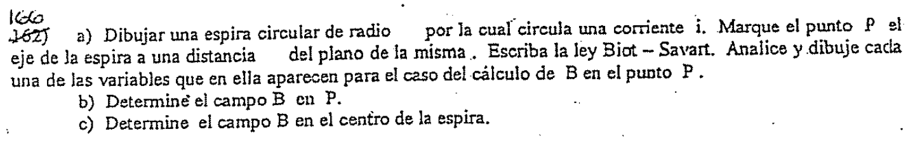
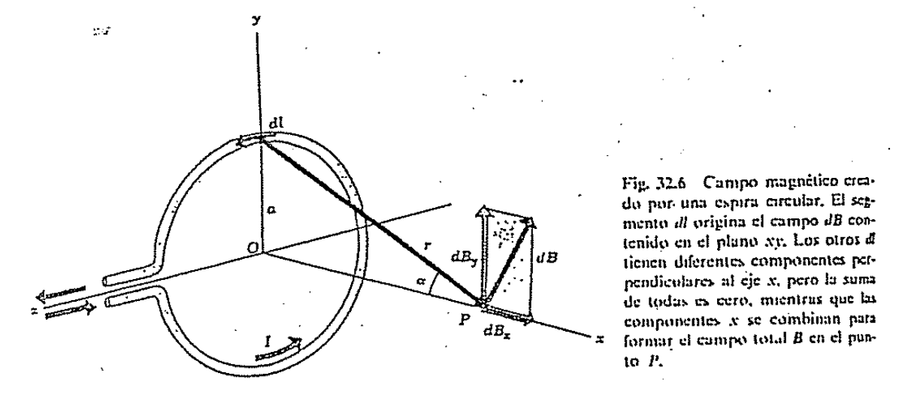
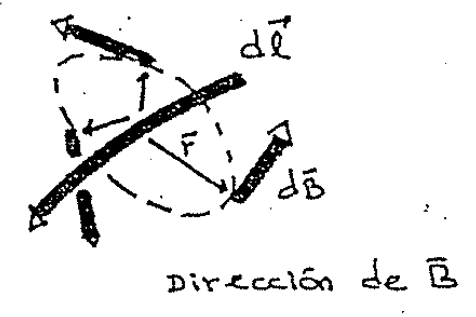
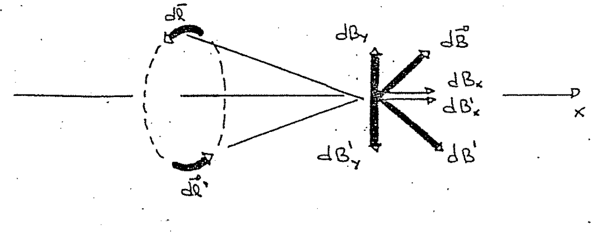
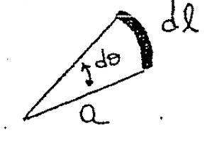
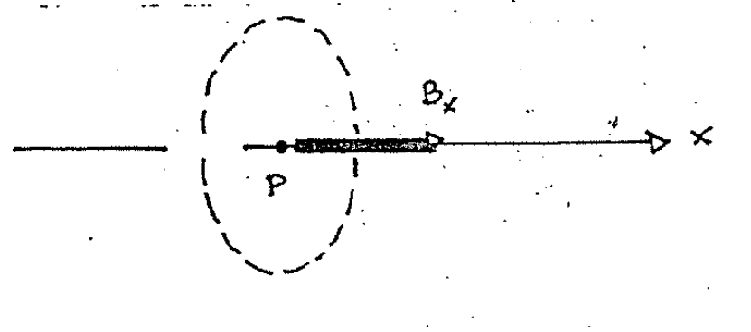

# Biot–Savart — Anibal Kasero: espira circular

## Enunciado

a) Dibujar una espira circular de radio [espacio vacío] por la cual circula una
corriente i. Marque el punto P el eje de la espira a una distancia \[espacio
vacío\] del plano de la misma. Escriba la ley Biot – Savart. Analice y dibuje
cada una de las variables que en ella aparecen para el caso del cálculo de B en
el punto P.

b) Determine el campo B en P.

c) Determine el campo B en el centro de la espira.



## a) Gráfico y direcciones

El gráfico de la espira y el punto P donde queremos el campo $`\vec B`$ es el
siguiente.



Fig. 32.6 Campo magnético creado por una espira circular. El segmento dl origina
el campo dB contenido en el plano xy. Los otros dl tienen diferentes componentes
perpendiculares al eje x, pero la suma de todas es cero, mientras que las
componentes x se combinan para formar el campo total B en el punto P.

En la figura vemos un trocito de espira $`d\vec l`$ y el campo $`d\vec B`$ que
provoca. Podemos darnos cuenta de que los vectores $`d\vec l`$ y $`\vec r`$,
siendo $`\vec r`$ el vector que va desde el elemento $`d\vec l`$ hasta el punto
P, son perpendiculares.

El elemento de campo $`d\vec B`$ está en el plano XY, recordemos de la guía
anterior que el campo $`d\vec B`$ tendería a enrollarse en torno al $`d\vec l`$.
Veamos esto dibujando un elemento de conductor $`d\vec l`$:



## b) Campo en P

Vamos a aplicar ahora la ley de Biot para calcular explícitamente el campo
$`\vec B`$. Como el radio de la espira es a y la distancia al punto P es x, es
fácil ver cuanto vale r:

```math
r=(x^2+a^2)^{1/2}
```

La ley de Biot era:

```math
d\vec B=\frac{\mu_0}{4\pi}\frac{i\,d\vec l\times\hat r}{r^2}
```

Tomando módulo, vimos en el resumen teórico que nos quedaba:

```math
dB=\frac{\mu_0}{4\pi}\frac{i\,dl}{r^2}\mathop{\mathrm{sen}}\nolimits\theta
```

siendo θ el ángulo entre $`d\vec l`$ y $`\hat r`$, que como son perpendiculares,
entonces $`\mathop{\mathrm{sen}}\nolimits\theta=1`$.

```math
dB=\frac{\mu_0}{4\pi}\frac{i\,dl}{r^2}
```

Sustituyamos r²:

```math
dB=\frac{\mu_0i}{4\pi}\frac{dl}{x^2+a^2}
```

Tenemos dos componentes que son dBx y dBy:

```math
dB_x=dB\cdot\mathop{\mathrm{sen}}\nolimits\alpha
```

```math
dB_y=dB\cdot\cos\alpha
```

Los senos y cosenos de α los hallamos del triángulo formado:

```math
\mathop{\mathrm{Sen}}\nolimits\alpha=\frac a{(x^2+a^2)^{1/2}}
\qquad;\qquad
\cos\alpha=\frac x{(x^2+a^2)^{1/2}}
```

Las componentes de los campos quedan:

```math
dB_x=\frac{\mu_0i}{4\pi}\frac{dl}{x^2+a^2}\cdot\frac a{(x^2+a^2)^{1/2}}
=\frac{\mu_0ia\,dl}{4\pi(x^2+a^2)^{3/2}}
```

```math
dB_y=\frac{\mu_0i}{4\pi}\frac{dl}{x^2+a^2}\cdot\frac x{(x^2+a^2)^{1/2}}
=\frac{\mu_0i}{4\pi}\frac{x\,dl}{(x^2+a^2)^{3/2}}
```

Debido a la simetría con respecto al eje $`\hat x`$, la componente total del
campo en $`\hat y`$ es cero. Es fácil darnos cuenta porque para cada elemento
$`d\vec l`$ en la espira, hay otro que está «enfrente» de él y crea un campo en
$`\hat y`$ que compensa al otro. De esta manera, también vemos que la componente
$`\hat x`$ del campo NO se anula.



La componente $`\hat x`$ total la obtenemos integrando el dBx:

```math
B_x=\int dB_x=\int\frac{\mu_0ia\,dl}{4\pi(x^2+a^2)^{3/2}}
```

En esta integración todo es constante, porque la integral recorre toda la
longitud de la espira. Y desde cualquier punto de esta la cuenta
$`\frac{\mu_0ia}{4\pi(x^2+a^2)^{3/2}}`$ es la misma.

Puede pensarse que la variable dl es: a dθ porque el arco y el radio están
relacionados por

```math
l=a\theta\quad\longrightarrow\quad dl=a\,d\theta
```



Entonces:

```math
B_x=\int_0^{2\pi}\frac{\mu_0ia\cdot a\,d\theta}{4\pi(x^2+a^2)^{3/2}}
```

Sale todo

```math
B_x=\frac{\mu_0ia^2}{4\pi(x^2+a^2)^{3/2}}\int_0^{2\pi}d\theta
=\frac{\mu_0ia^2\,2\pi}{4\pi(x^2+a^2)^{3/2}}
```

```math
B_x=\frac{\mu_0ia^2}{2(x^2+a^2)^{3/2}}\qquad;\qquad B_y=0
```

## c) Campo en el centro

Esta cuenta es ahora simple, porque la distancia desde el centro al punto P era
x, pero si el punto P lo corremos al centro entonces el valor de x es cero: x =
0\.



Usamos la fórmula del ítem b) poniendo x = 0:

```math
B_x=\frac{\mu_0ia^2}{2(a^2)^{3/2}}=\frac{\mu_0i}{2a}
```

El valor de By sigue siendo By = 0.

## Procedencia y observaciones

- Original: `2015/Resueltos Fisica II Anibal Kaseros Ley de Biot-Sabat.pdf`,
  páginas PDF y manuscritas 9–13 de 62. SHA-256:
  `b4aeb8cc9f1fa04835d4817a067976cc3d3c07d57e18ca5dabd898b67e09d41e`.
- OCR español auxiliar y cotejo visual de las cinco páginas. Se conservan cinco
  figuras y el pie impreso de la figura32.6. El enunciado tiene dos espacios sin
  el símbolo del radio ni la distancia; no se rellenan con a y x de la solución.
- Se conserva «Marque el punto P el eje» del enunciado. La numeración inicial
  aparece retocada: se conserva en el recorte, sin asignar un número por
  conjetura.
- El desarrollo corresponde al manuscrito original; no es una solución añadida.
