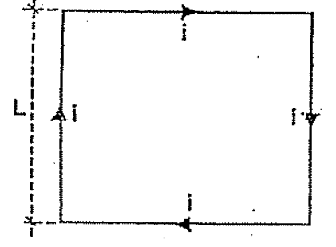
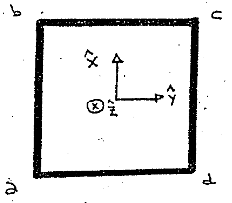
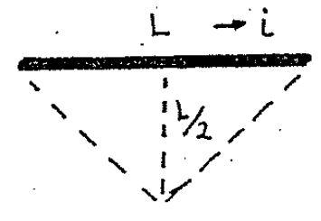
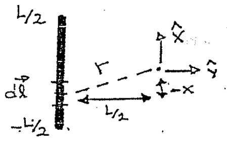

# Biot–Savart — Anibal Kasero: espira cuadrada

## Enunciado

Una espira cuadrada de alambre de lado l, lleva una corriente i. Determine el
valor del campo magnético B en el centro de la espira.

Rta.:

```math
B=\frac{2\sqrt2\mu_0i}{\pi L}
```



## Desarrollo

En este ejercicio podemos utilizar el principio de superposición, usado para
calcular el campo eléctrico total de varias cargas, también sirve en el caso del
campo magnético.

«El campo magnético total creado por varios conductores con corriente, es la
suma vectorial de los campos creados por las cargas o conductores individuales».

Pensemos primero en un sistema de referencia y elegimos la dirección $`\hat z`$
entrante en el plano.



Ahora aislemos el segmento bc y veamos el esquema que nos muestra el campo en el
centro:



Este esquema es exactamente el mismo que nos dieron en el problema anterior,
entonces ya sabemos que este segmento bc contribuye al campo total con:

```math
\vec B_{bc}=\frac{\mu_0i}{\pi L}\frac{\sqrt2}2\hat z
```

Ahora pensemos en el segmento ab:



Entonces:

```math
d\vec l=dx\cdot\hat x\qquad;\qquad\vec r=-x\hat x+(-L/2)\hat y
```

Si formamos el versor $`\hat r`$ que figura en la ley de Biot:

```math
\hat r=\frac{-x\hat x-(L/2)\hat y}{\left(x^2+(L/2)^2\right)^{1/2}}
```

Ahora tendríamos que formar el producto vectorial

```math
d\vec l\times\hat r=dx\,\hat x\times\frac{-x\hat x-(L/2)\hat y}{\left(x^2+(L/2)^2\right)^{1/2}}
```

Haciendo la distributiva solo resulta NO nulo el producto entre los versores
$`\hat x`$ e $`\hat y`$, siendo el resultado en la dirección $`\hat z`$. La
cuenta es exactamente la misma que en el problema164 y vemos que la dirección es
la misma:

«Los cuatro tramos contribuyen con la misma magnitud y en la misma dirección y
sentido».

Entonces la respuesta es cuatro veces la contribución de un solo segmento:

```math
\vec B=4\cdot\frac{\mu_0i}{\pi L}\frac{\sqrt2}2\hat z
=2\sqrt2\frac{\mu_0i}{\pi L}\hat z
```

## Procedencia y observaciones

- Original: `2015/Resueltos Fisica II Anibal Kaseros Ley de Biot-Sabat.pdf`,
  página22 desde el segundo enunciado y páginas23–24 completas. SHA-256:
  `b4aeb8cc9f1fa04835d4817a067976cc3d3c07d57e18ca5dabd898b67e09d41e`.
- OCR español auxiliar y cotejo visual de las tres páginas. Cuatro figuras del
  original y fórmulas transcritas sin resolver nuevamente el ejercicio.
- Se conserva la diferencia entre l del texto y L de la figura/respuesta, la
  referencia literal «problema164» y los signos de los vectores del manuscrito.
  La numeración inicial del enunciado está retocada.

[Anterior: segmento recto](biot-savart-kasero-segmento-recto.md) ·
[Siguiente: fuerza alambre axial](biot-savart-kasero-fuerza-alambre-axial.md)
