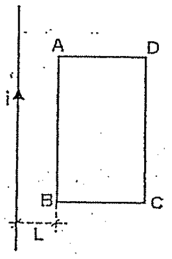
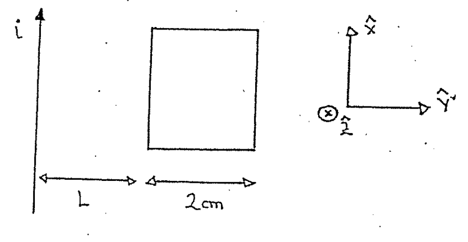
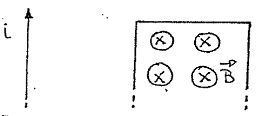
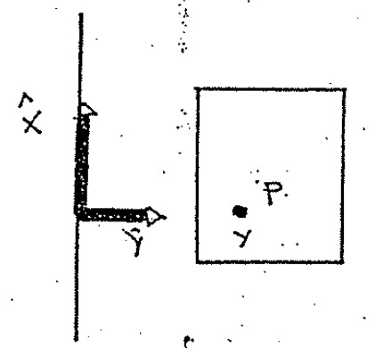
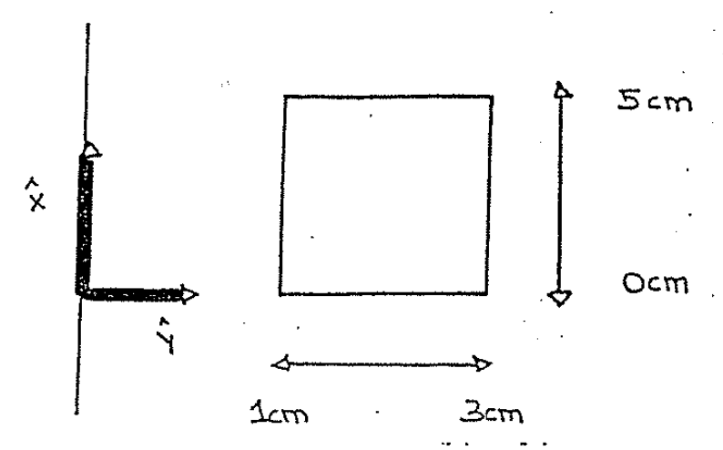

# Biot–Savart — Anibal Kasero: flujo a través de un rectángulo

## Enunciado

Por el conductor rectilíneo de la figura pasa una corriente i = 10 A. Calcular
el flujo total que atraviesa el área ABCD.

Datos: AD = 2 cm; CD = 5 cm; L = 1 cm.

Rta.:

```math
\phi=1{,}1\cdot10^{-7}\;\mathrm{Wb}
```



## Desarrollo

Cambiamos ahora de tema. Vamos a buscar un FLUJO. Los flujos se calculaban
integrando el campo (multiplicado la normal a la superficie) en toda la
superficie:

```math
\phi=\int_S\vec B\cdot\hat n\,ds
```

Si la dirección del campo es paralela a la normal a la superficie, el producto
escalar queda sencillo:

```math
\vec B\cdot\hat n=B
```

La integración se simplifica:

```math
\phi=\int_S B\,ds
```

Si además el campo es uniforme en toda la superficie (es decir que es constante)
podrá salir fuera de la integral

```math
\phi=B\int_S ds\quad\longrightarrow\quad\phi=B\cdot S
```

Vamos a comenzar nuestro problema definiendo un sistema de referencia:



Elegimos el $`\hat z`$ entrante porque está en la dirección del campo generado
por el conductor.



El campo, en un punto P cualquiera dentro de la superficie depende de la
distancia al cable:



El punto P está a una distancia y del cable. La expresión del campo ya la
conocemos:

```math
\vec B=\frac{\mu_0i}{2\pi y}\hat z
```

La normal a la superficie también la podemos elegir entrante: $`\hat n=\hat z`$.
Ahora planteamos la integral:

```math
\phi=\int_S\vec B\cdot\hat n\,ds
=\int_S\frac{\mu_0i}{2\pi y}\hat z\cdot\hat z\,ds
```

```math
\phi=\frac{\mu_0i}{2\pi}\int_S\frac{ds}y
```

Ahora pensemos ¿Quién es ds? ds es un cachito de superficie y como la superficie
es bidimensional, ds se compone de dos diferenciales:

```math
ds=dx\,dy
```

La integral es en realidad una integral doble!! No nos asustemos por una
integral doble, la podemos realizar muy simplemente. Vamos a poner el vértice
del sistema de referencia como sigue:



Los valores de x e y varían entre:

```math
0\lt x\lt5\;\mathrm{cm}\qquad1\;\mathrm{cm}\lt y\lt3\;\mathrm{cm}
```

La integral resulta:

```math
\phi=\frac{\mu_0i}{2\pi}\iint\frac{dx\,dy}y
```

Y la integral la hacemos por separado en x e y:

```math
\phi=\frac{\mu_0i}{2\pi}
\left(\int_{1\mathrm{cm}}^{3\mathrm{cm}}\frac{dy}y\right)
\left(\int_0^{5\mathrm{cm}}dx\right)
```

```math
\phi=\frac{\mu_0i}{2\pi}\cdot\ln\left(\frac{3\mathrm{cm}}{1\mathrm{cm}}\right)\cdot(5\mathrm{cm})
```

Recordemos que

```math
\mu_0=4\pi\cdot10^{-7}\;\frac{\mathrm{Wb}}{\mathrm{A}\,\mathrm m}
```

```math
\phi=\frac{4\pi\cdot10^{-7}\;\frac{\mathrm{Wb}}{\mathrm{A}\,\mathrm m}}{2\pi}
\cdot10\;\mathrm A\cdot1{,}1\cdot0{,}05\;\mathrm m
```

```math
\phi=1{,}1\cdot10^{-7}\;\mathrm{Wb}
```

## Procedencia y observaciones

- Original: `2015/Resueltos Fisica II Anibal Kaseros Ley de Biot-Sabat.pdf`,
  página40 desde el segundo enunciado, páginas41–43 y página44 hasta el
  separador. SHA-256:
  `b4aeb8cc9f1fa04835d4817a067976cc3d3c07d57e18ca5dabd898b67e09d41e`.
- OCR español auxiliar y cotejo visual completo. Cinco figuras del original,
  integrales, límites y sustitución numérica transcritos sin recalcular.
- Se conserva el uso del signo integral simple con subíndice S antes de
  explicitar la integral doble. La normal se elige entrante como en el
  manuscrito.

[Anterior: conductores coplanares](biot-savart-kasero-conductores-coplanares.md)
·
[Siguiente: bobina dos conductores](biot-savart-kasero-bobina-dos-conductores.md)
