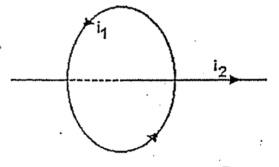
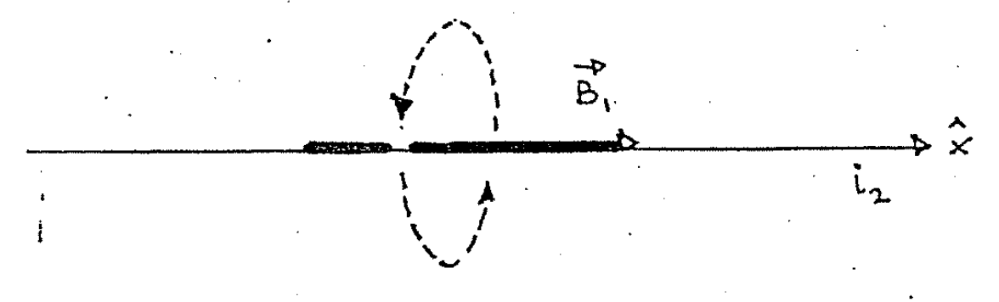

# Biot–Savart — Anibal Kasero: fuerza sobre un alambre axial

## Enunciado

Una espira lleva una corriente i₁ = 5 A y tiene un radio de 10 cm. Si se coloca
un alambre recto y largo en el eje de la espira y éste lleva una corriente i₂ =
1 A como muestra la figura, determine la fuerza que ejerce la espira sobre el
alambre por unidad de longitud.

Rta.: F = 0.



## Desarrollo

El conductor rectilíneo recibe una fuerza que es el resultado del campo
magnético creado por la espira. Sabemos que la fuerza sentida por el conductor
está dada por:

```math
d\vec F=i_2\,d\vec l_2\times\vec B_1
```

Siendo $`d\vec l_2`$ un trocito de conductor recto y $`\vec B_1`$ el campo
magnético generado por la espira. Vamos a plantear el siguiente sistema de
referencia.



En el ejercicio162 (carilla13) ya hicimos el cálculo del campo de la espira en
cualquier punto del eje de la misma. La dirección resultó ser el eje $`\hat x`$

```math
\vec B_1=\frac{\mu_0i_1a^2}{2(x^2+a^2)^{3/2}}\hat x
```

En nuestro sistema de referencia el elemento $`d\vec l_2`$ también se halla
sobre el eje $`\hat x`$:

```math
d\vec l_2=dx\cdot\hat x
```

Entonces la expresión diferencial de la fuerza queda:

```math
d\vec F=i_2\,dx\,\hat x\times\frac{\mu_0i_1a^2}{2(x^2+a^2)^{3/2}}\hat x
```

```math
d\vec F=\frac{\mu_0i_1i_2a^2\,dx}{2(x^2+a^2)^{3/2}}\,\hat x\times\hat x
```

Como el producto vectorial es nulo, la fuerza es nula.

```math
d\vec F=0\quad\longrightarrow\quad\vec F=0
```

Este problema también lo hicimos en la guía anterior usando la ley de Ampere,
era el problema159 y en lugar de una espira usamos un solenoide (que básicamente
es lo mismo, son muchas espiras).

## Procedencia

- Original: `2015/Resueltos Fisica II Anibal Kaseros Ley de Biot-Sabat.pdf`,
  páginas PDF y manuscritas25–26. SHA-256:
  `b4aeb8cc9f1fa04835d4817a067976cc3d3c07d57e18ca5dabd898b67e09d41e`.
- OCR español auxiliar y cotejo visual de ambas páginas. Dos figuras originales;
  fórmulas y solución transcritas del manuscrito. Las referencias162/159 se
  mantienen literalmente; la numeración del enunciado está retocada.
