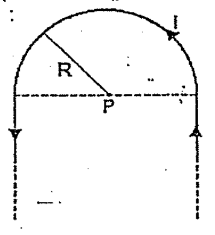
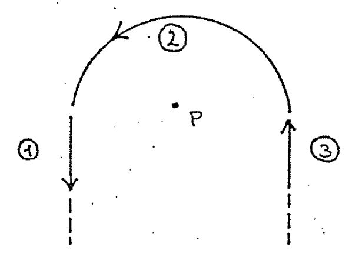
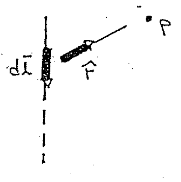
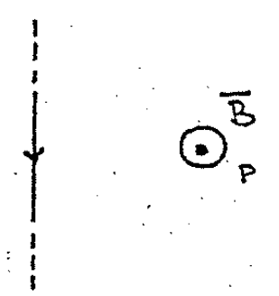
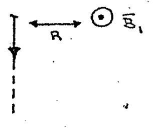
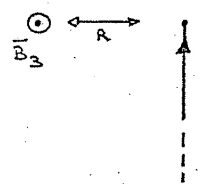

# Biot–Savart — Anibal Kasero: conductor en horquilla

## Enunciado

Un hilo largo se curva en forma de horquilla como muestra la figura. Calcular la
expresión para el $`\vec B`$ en P, situado en el centro de la
semicircunferencia.



## Desarrollo

Otra vez, pensamos al conductor como compuesto por tres partes, una semicircular
y dos lineales. Los cables verticales (lineales) se extienden al ∞.



El conductor② genera un campo que ya lo conocemos.

```math
\vec B_2=\frac{\mu_0i}{4R}(\hat z)
```

Ahora pasemos al conductor lineal①, este SÍ contribuye al campo, porque al ser
vertical el producto vectorial NO se hace cero.



Ya NO son paralelos $`d\vec l`$ y $`\hat r`$.

Aunque el campo① NO es nulo, igualmente NO necesitamos hacer toda la cuenta con
la ley de Biot, porque en el ejercicio163) ya la hicimos. El campo generado por
un conductor infinito en un punto P que dista a una distancia R del mismo es:

```math
\vec B=\frac{\mu_0i}{2\pi R}\hat z
```



El campo es saliente en el punto P, recordemos que el campo se enrolla en torno
al cable como lo vimos en la ley de Ampere.

En nuestro ejercicio el conductor① (si bien se extiende al infinito hacia abajo)
podemos pensar que contiene la MITAD de longitud y entonces contribuye con la
mitad de campo.

```math
\vec B_1=\frac{\mu_0i}{4\pi R}(\hat z)
```



Lo mismo ocurre con el conductor rectilíneo③. Incluso la dirección también es
saliente y su magnitud es la misma.

```math
\vec B_3=\frac{\mu_0i}{4\pi R}(\hat z)
```



Ahora solo nos falta sumar las tres contribuciones:

```math
\vec B_P=\vec B_1+\vec B_2+\vec B_3
```

```math
\vec B_P=\frac{\mu_0i}{4\pi R}(\hat z)+\frac{\mu_0i}{4R}(\hat z)
+\frac{\mu_0i}{4\pi R}(\hat z)
```

```math
\vec B_P=\frac{\mu_0i}R\left(\frac1{4\pi}+\frac14+\frac1{4\pi}\right)(\hat z)
```

```math
\vec B_P=\frac{\mu_0i}R\left(\frac14+\frac1{2\pi}\right)\hat z
```

Extraemos un 2 del denominador

```math
\vec B_P=\frac{\mu_0i}{2R}\left(\frac12+\frac1\pi\right)\hat z
```

## Procedencia

- Original: `2015/Resueltos Fisica II Anibal Kaseros Ley de Biot-Sabat.pdf`,
  página33 desde el segundo enunciado, páginas34–35 y página36 hasta el
  separador. SHA-256:
  `b4aeb8cc9f1fa04835d4817a067976cc3d3c07d57e18ca5dabd898b67e09d41e`.
- OCR español auxiliar y cotejo visual de todo el desarrollo. Seis figuras
  originales, referencia literal163), ecuaciones y razonamiento del manuscrito
  conservados. No se reemplaza la explicación de «mitad de longitud» por otra.
