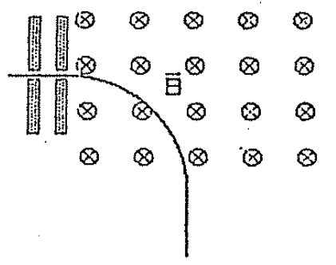

# Biot–Savart — Anibal Kasero: masa de un ión acelerado

## Enunciado174

Un ión que parte del reposo en el vacío es acelerado por dos placas paralelas
entre los que existe una d.d.p. de1000V como indica la figura. Al salir de la
segunda placa el ión se mueve bajo la acción de un B =0,1Wb/m² normal al plano
de la trayectoria. Si el radio de curvatura de la trayectoria es de0,3m. Cuál
será la masa del ión si su carga es la del electrón. (−1,6·10⁻¹⁹C)

Rta.:

```math
m=\frac{qR^2B^2}{2V}\qquad m=7{,}2\cdot10^{-26}\;\mathrm{kg}
```



## Desarrollo

Cuando el ión sale de la diferencia de potencial (generada por algún campo
eléctrico) adquiere una energía que estará dada por:

```math
E=qV
```

Siendo q la carga del ión y V el potencial. Esta energía producida por el campo
eléctrico se traduce en energía cinética, entonces podemos escribir la siguiente
igualdad:

```math
\frac12mv^2=qV
```

De esta expresión podemos obtener el valor de la velocidad con la cual el ion
ingresa al campo magnético:

```math
v^2=\frac{2qV}m\qquad v=\left(\frac{2qV}m\right)^{1/2}
```

Ahora, una vez dentro de la zona de campo B el ion siente una fuerza que será:

```math
F=qBv
```

El sentido y dirección de esta fuerza es perpendicular a la velocidad porque
recordemos que en realidad se calculaba con el producto vectorial

```math
\vec F=q\vec v\times\vec B
```

Entonces esta fuerza (perpendicular a v) provoca un movimiento circular, siendo

```math
\vec F=m\vec a
```

con a la aceleración centrípeta!

```math
a=\frac{v^2}R
```

Llegamos a la fórmula:

```math
qBv=\frac{mv^2}R
```

En esta fórmula usamos los valores que antes hallamos para la velocidad v y nos
queda la última expresión:

```math
qB\left(\frac{2qV}m\right)^{1/2}=\frac mR\left(\frac{2qV}m\right)
```

Simplificamos q y m,

```math
qB\left(\frac{2qV}m\right)^{1/2}=\frac{m\,2qV}{Rm}
```

\[En esta línea el original tacha el q exterior de la izquierda y el q y los dos
m que se cancelan a la derecha.\]

```math
B\left(\frac{2qV}m\right)^{1/2}=\frac{2V}R
```

Elevamos al cuadrado!

```math
B^2\frac{2qV}m=\frac{4V^2}{R^2}\quad\longrightarrow\quad
\frac{B^2q}m=\frac{2V}{R^2}
```

De aquí obtenemos el valor de la masa m de nuestro ión:

```math
m=\frac{qR^2B^2}{2V}
```

Para obtener su valor numérico sustituimos los datos.

```math
m=\frac{1{,}6\cdot10^{-19}\;\mathrm C\cdot(0{,}3)^2\cdot
(0{,}1\;\mathrm{Wb}/\mathrm m^2)^2}{2\cdot1000\;\mathrm V}
=7{,}2\cdot10^{-26}\;\mathrm{kg}
```

## Procedencia y observaciones

- Original: `2015/Resueltos Fisica II Anibal Kaseros Ley de Biot-Sabat.pdf`,
  página49 desde el enunciado174, páginas50–51 y página52 hasta el separador.
  SHA-256: `b4aeb8cc9f1fa04835d4817a067976cc3d3c07d57e18ca5dabd898b67e09d41e`.
- OCR español auxiliar y cotejo visual. Figura original y todas las ecuaciones
  legibles transcritas, incluidas las cancelaciones descritas por separado.
- El enunciado da carga negativa; el manuscrito sustituye su magnitud positiva.
  Se conservan ambos sin cambiar el signo ni agregar una resolución propia.
- En la sustitución final no figura unidad junto a0,3; no se completa esa unidad
  dentro de la ecuación, aunque el enunciado indique metros.

[Anterior: bobina dos conductores](biot-savart-kasero-bobina-dos-conductores.md)
· [Siguiente: particula alfa](biot-savart-kasero-particula-alfa.md)
