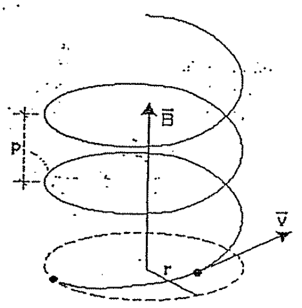
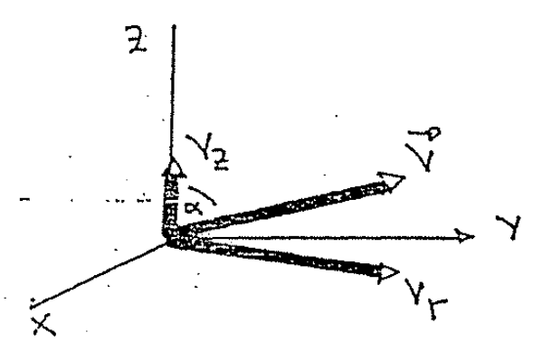
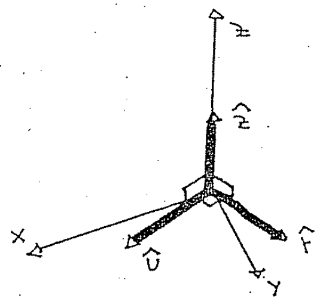
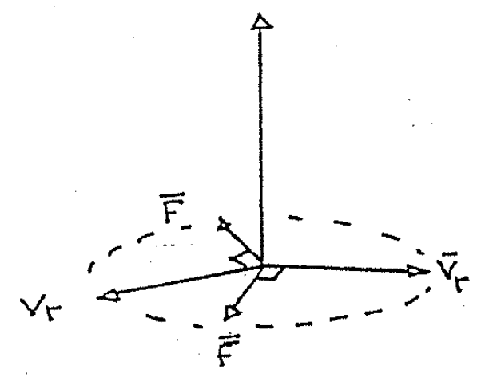
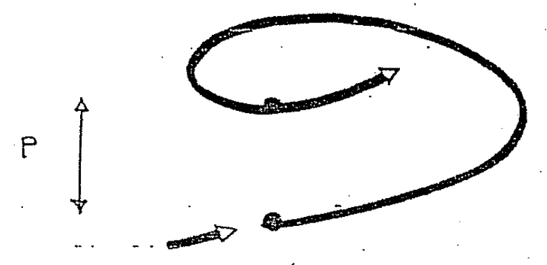

# Biot–Savart — Anibal Kasero: trayectoria helicoidal de un positrón

## Enunciado

Un positrón (mₑ₊ =9,11×10⁻³¹kg; q =1,6×10⁻¹⁹C) de2keV se dispara en un
$`\vec B`$ uniforme de0,10Wb/m² y su $`\vec v`$ forma un ángulo de89° con el
$`\vec B`$. Cerciórese de que la trayectoria será una hélice, con su eje en la
dirección de $`\vec B`$. Encuentre el período τ, el paso p y el radio r de la
hélice.

Rtas.:

```math
\tau=3{,}57\cdot10^{-10}\;\mathrm s\qquad
p=0{,}16\;\mathrm{mm}\qquad r=1{,}49\;\mathrm{mm}
```



## Descomposición de la velocidad y fuerza

Acá tenemos un problema complicado, vamos a comenzar con un buen sistema de
referencia.



El vector velocidad $`\vec V`$ NO es perpendicular al campo magnético, ya que el
ángulo α NO es90°.

Podemos elegir el eje $`\hat z`$ en la dirección del campo magnético. De la
figura que hicimos vemos que podemos descomponer la velocidad en dos
componentes: una componente en $`\hat z`$ llamada Vz y otra componente que
podemos llamar Vr y está en el plano XY.

Entonces escribimos la velocidad como:

```math
\vec V=V_z\hat z+V_r\hat r
```

Siendo $`\hat r`$ un versor cualquiera en el plano XY! Ahora veamos el campo
magnético: está sobre el eje $`\hat z`$, entonces podemos escribir:

```math
\vec B=B\hat z
```

Y ahora SÍ podemos hallar la fuerza que siente la partícula (el positrón)

```math
\vec F=q\vec V\times\vec B=q(V_z\hat z+V_r\hat r)\times B\hat z
```

```math
\vec F=qV_zB(\hat z\times\hat z)+qV_rB(\hat r\times\hat z)
```

El primer producto vectorial da0, porque son el mismo versor, mientras que el
segundo producto vectorial da1 (en módulo) porque el módulo de
$`\vec A\times\vec B`$ se halla con:

```math
|\vec A\times\vec B|=|\vec A|\,|\vec B|\mathop{\mathrm{sen}}\nolimits\alpha
```

Entonces en este caso:

```math
|\hat r\times\hat z|=|\hat r|\,|\hat z|\mathop{\mathrm{sen}}\nolimits90^\circ
```

El ángulo entre los versores es90° porque son perpendiculares y los módulos de
los versores valen1. Entonces:

```math
|\hat r\times\hat z|=1
```

De esta manera la fuerza $`\vec F`$ nos queda

```math
\vec F=qV_rB(\hat r\times\hat z)\qquad\text{y en módulo}\quad F=qV_rB
```

El original llama $`\hat u`$ al producto $`\hat r\times\hat z`$.

¿Qué dirección tiene esta fuerza! La dirección será perpendicular tanto a
$`\hat z`$ como a $`\hat r`$:



En la figura vemos que el versor $`\hat u`$, resultado de $`\hat r\times\hat z`$
también queda en el plano XY.

Conclusión: la fuerza $`\vec F`$ está en el plano XY y vale qVrB!

## Radio y período

Entonces en el plano XY nos encontramos con un movimiento circular, la fuerza
será perpendicular a la velocidad Vr.



En el plano XY la ecuación es:

```math
F=\frac{mV_r^2}R\quad\longrightarrow\quad qV_rB=\frac{mV_r^2}R
```

```math
qBR=mV_r
```

Y obtenemos el radio de la circunferencia:

```math
R=\frac{mV_r}{qB}
```

Ahora, mirando la primera figura que hicimos vemos que

```math
V_r=V\mathop{\mathrm{sen}}\nolimits\alpha
```

```math
R=\frac{mV\mathop{\mathrm{sen}}\nolimits\alpha}{qB}
```

Aún NO podemos hallar el valor de R porque NO conocemos la velocidad V, para
esto tenemos el dato de la energía del positrón:2keV, este será su energía
cinética.

```math
E_c=\frac{mV^2}2\quad\longrightarrow\quad V=\left(\frac{2E_c}m\right)^{1/2}
```

```math
2\;\mathrm{keV}=2000\;\mathrm{eV}=2000\cdot1{,}6\cdot10^{-19}\;\mathrm J
=3{,}2\cdot10^{-16}\;\mathrm J
```

```math
V=\left(\frac{2\cdot3{,}2\cdot10^{-16}\;\mathrm J}{9{,}11\cdot10^{-31}\;\mathrm{kg}}\right)^{1/2}
=26{,}5\cdot10^6\;\mathrm m/\mathrm s
```

Ahora SÍ el radio:

```math
R=\frac{9{,}11\cdot10^{-31}\;\mathrm{kg}\cdot26{,}5\cdot10^6\;\mathrm m/\mathrm s
\cdot\mathop{\mathrm{Sen}}\nolimits(89^\circ)}{1{,}6\cdot10^{-19}\;\mathrm C
\cdot0{,}1\;\mathrm{Wb}/\mathrm m^2}=1{,}5\;\mathrm{mm}
```

El período otra vez con la fórmula:

```math
T=\frac{2\pi R}{V_r}
```

(La velocidad es la del movimiento circular.)

```math
T=\frac{6{,}28\cdot1{,}5\cdot10^{-3}\;\mathrm m}{26{,}5\cdot10^6\;\mathrm m/\mathrm s
\cdot\mathop{\mathrm{sen}}\nolimits(89^\circ)}=3{,}57\cdot10^{-10}\;\mathrm{seg}
```

## Avance axial y paso

No nos tenemos que olvidar que había una componente de la velocidad en la
dirección $`\hat z`$, Vz. Lo que NO hay es fuerza en esta dirección, eso quiere
decir que en el eje $`\hat z`$ la velocidad Vz NO varía. Tenemos un MRU.

Mientras el positrón «gira» en el plano XY avanza con velocidad uniforme en
$`\hat z`$. El movimiento es Helicoidal.



Durante el tiempo en que da una vuelta (T) avanza una distancia p, esta
distancia p entre un bucle y otro se llama paso y se la calcula con la velocidad
Vz.

```math
p=V_z\cdot T\qquad\text{siendo}\quad V_z=V\cos\alpha
```

```math
p=V\cos\alpha\,T\qquad V_z=V\cdot\cos(89)
```

```math
p=26{,}5\cdot10^6\;\mathrm m/\mathrm s\cdot\cos(89^\circ)\cdot3{,}57\cdot10^{-10}\;\mathrm s
```

```math
p=1{,}6\cdot10^{-4}\;\mathrm m=0{,}16\;\mathrm{mm}
```

## Procedencia y observaciones

- Original: `2015/Resueltos Fisica II Anibal Kaseros Ley de Biot-Sabat.pdf`,
  página54 desde el segundo enunciado y páginas55–59 completas. SHA-256:
  `b4aeb8cc9f1fa04835d4817a067976cc3d3c07d57e18ca5dabd898b67e09d41e`.
- OCR español auxiliar y cotejo visual de las seis páginas. Cinco figuras
  originales; fórmulas transcritas sin reemplazarlas por capturas.
- La respuesta impresa da r=1,49mm; el manuscrito redondea R=1,5mm. Usa τ en el
  enunciado y T en el desarrollo. Se conservan ambas notaciones y valores.
- Se conserva «este será su energía cinética» y el cos(89) sin grado en esa
  línea, mientras la sustitución posterior sí lleva89°. No se agrega el signo
  omitido.

[Anterior: particula alfa](biot-savart-kasero-particula-alfa.md) ·
[Siguiente: campos fuerza nula](biot-savart-kasero-campos-fuerza-nula.md)
