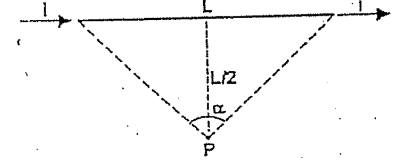
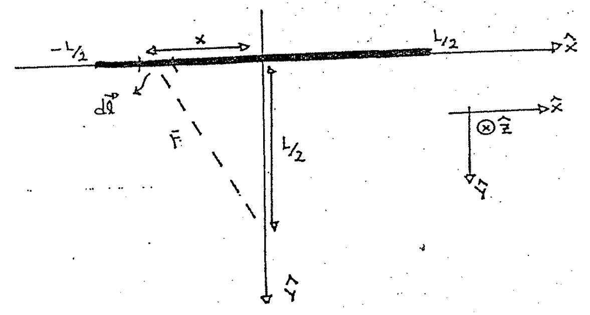
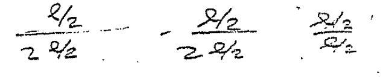

# Biot–Savart — Anibal Kasero: segmento recto de longitud L

## Enunciado

Demuestre que el campo magnético B producido por el segmento L del alambre que
lleva una corriente i, en el punto P es,

```math
B=\frac{\sqrt2}{2}\cdot\frac{\mu_0i}{\pi L}
```

Dato: α = 90°.



## Desarrollo

El ejercicio es semejante al anterior y podemos aprovecharlo para repasar las
cuentas que hicimos. Comencemos con un gráfico más específico:



La ley de Biot nos dice la forma diferencial del campo $`\vec B`$

```math
d\vec B=\frac{\mu_0i}{4\pi}\frac{d\vec l\times\hat r}{r^2}
```

Solo tendremos que tener cuidado al elegir los vectores $`d\vec l`$ y
$`\hat r`$. Según el sistema de referencia el vector $`d\vec l`$ es un trocito
diferencial del eje $`\hat x`$, entonces:

```math
d\vec l=dx\cdot\hat x
```

El vector $`\vec r`$ también lo vemos en el gráfico:

```math
\vec r=-x\hat x+\frac L2\hat y
```

Ahora podemos construir el versor $`\hat r`$:

```math
\hat r=\frac{\vec r}r=\frac{-x\hat x+(L/2)\hat y}{\left(x^2+(L/2)^2\right)^{1/2}}
```

Formemos el producto vectorial $`d\vec l\times\hat r`$:

```math
d\vec l\times\hat r=\hat x\,dx\times\frac{-x\hat x+(L/2)\hat y}{\left(x^2+(L/2)^2\right)^{1/2}}
```

```math
d\vec l\times\hat r=dx\,\hat x\times\frac{-x\hat x}{\left(x^2+(L/2)^2\right)^{1/2}}
+\frac{dx\,\hat x\times(L/2)\hat y}{\left(x^2+(L/2)^2\right)^{1/2}}
```

```math
d\vec l\times\hat r=\frac{-dx\cdot x}{\left(x^2+(L/2)^2\right)^{1/2}}\,\hat x\times\hat x
+\frac{(L/2)\,dx}{\left(x^2+(L/2)^2\right)^{1/2}}\,\hat x\times\hat y
```

Las flechas del original indican $`\hat x\times\hat x=0`$ y
$`\hat x\times\hat y=\hat z`$.

```math
d\vec l\times\hat r=\frac{(L/2)\,dx}{\left(x^2+(L/2)^2\right)^{1/2}}\,\hat z
```

El valor de r² es $`x^2+(L/2)^2`$. Juntamos todo en la fórmula,

```math
d\vec B=\frac{\mu_0i}{4\pi}\frac{(L/2)\,dx\,\hat z}{\left(x^2+(L/2)^2\right)^{1/2}}
\cdot\frac1{x^2+(L/2)^2}
```

```math
d\vec B=\frac{\mu_0i}{4\pi}\frac{(L/2)\,dx}{\left(x^2+(L/2)^2\right)^{3/2}}\,\hat z
```

Integramos sobre toda la longitud del conductor:

```math
\vec B=\int_{-L/2}^{L/2}\frac{\mu_0i}{4\pi}\frac{(L/2)\,dx}{\left(x^2+(L/2)^2\right)^{3/2}}\,\hat z
```

```math
\vec B=\frac{\mu_0i}{4\pi}\frac L2\hat z\int_{-L/2}^{L/2}\frac{dx}{\left(x^2+(L/2)^2\right)^{3/2}}
```

```math
\vec B=\frac{\mu_0i}{4\pi}\frac L2\hat z\left.\frac x{(L/2)^2\left(x^2+(L/2)^2\right)^{1/2}}\right|_{-L/2}^{L/2}
```

```math
\vec B=\frac{\mu_0i}{4\pi(L/2)}\left(
\frac{L/2}{\left((L/2)^2+(L/2)^2\right)^{1/2}}
-\frac{-L/2}{\left((L/2)^2+(L/2)^2\right)^{1/2}}
\right)\hat z
```

\[Anotación editorial: debajo de esta cuenta hay un borrador tachado; se
conserva el recorte para no atribuirle una simplificación por conjetura.\]



```math
\vec B=\frac{\mu_0i}{4\pi(L/2)}\,(L/2)\left(\frac2{\left(2(L/2)^2\right)^{1/2}}\right)\hat z
```

```math
\vec B=\frac{\mu_0i}{4\pi}\frac2{2^{1/2}(L/2)}\hat z
=\frac{4\mu_0i}{4\pi\sqrt2\,L}\hat z
```

```math
\vec B=\frac{\mu_0i}{\pi L}\frac{\sqrt2}2\hat z
```

## Procedencia y observaciones

- Original: `2015/Resueltos Fisica II Anibal Kaseros Ley de Biot-Sabat.pdf`,
  páginas PDF/manuscritas19–21 y comienzo de22 hasta el separador. SHA-256:
  `b4aeb8cc9f1fa04835d4817a067976cc3d3c07d57e18ca5dabd898b67e09d41e`.
- OCR español auxiliar y cotejo visual del desarrollo completo. La numeración
  inicial está retocada; no se reconstruye. Se conserva el esquema y el sistema
  de referencia del original, y se transcriben las ecuaciones legibles.
- El borrador tachado de página21 queda como evidencia visual, no como una
  ecuación validada. El texto y la solución final no se modifican por ese
  tachado.

[Ejercicio siguiente: espira cuadrada](biot-savart-kasero-espira-cuadrada.md).

[Anterior: conductor infinito](biot-savart-kasero-conductor-infinito.md) ·
[Siguiente: espira cuadrada](biot-savart-kasero-espira-cuadrada.md)
