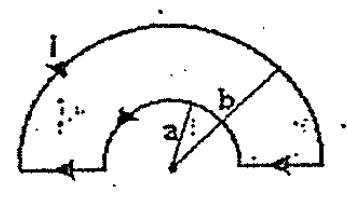
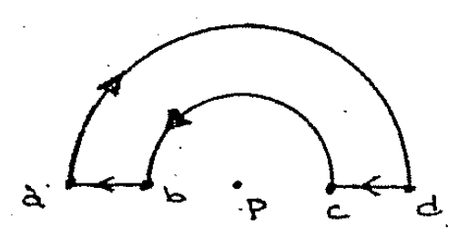
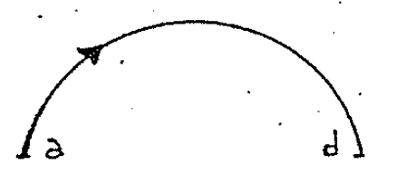
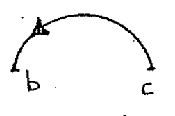

# Biot–Savart — Anibal Kasero: semicírculos concéntricos

## Enunciado

Calcular el campo magnético B en el punto P.

Rta.:

```math
B_P=\frac{\mu_0i}4\frac{b-a}{ab}\quad\text{saliente}
```



## Desarrollo

Vamos otra vez a usar el principio de superposición. Dividimos todo nuestro
conductor en cuatro tramos, dos lineales y dos semicirculares y concéntricos.



Como en el ejercicio anterior los tramos lineales dc y ba NO van a contribuir al
campo en el punto P. El campo va a estar dado por las contribuciones solamente
de los segmentos semicirculares.

Vamos a comenzar con el semicírculo de radio b, su campo será exactamente el
mismo que encontramos en el ejercicio anterior incluso su dirección ya que la
corriente va en sentido horario.



```math
\vec B_{ab}=\frac{\mu_0i}{4b}(-\hat z)
```

Siendo b el radio y $`(-\hat z)`$ significa entrante en el eje $`\hat z`$.

Ahora el campo generado por el conductor bc



El valor del campo es con la misma expresión, solo que ahora el radio de este
semicírculo es R = a.

```math
B_{cb}=\frac{\mu_0i}{4a}
```

Pero como la corriente va en «sentido antihorario» la dirección del campo será
contraria al caso anterior, ahora el campo será saliente en $`\hat z`$:

```math
\vec B_{cb}=\frac{\mu_0i}{4a}\hat z
```

La flecha del original indica «radio R» en el denominador a.

Como el principio de superposición nos dice que el campo total está dado por la
suma vectorial de los campos individuales, en este caso tenemos:

```math
\vec B=\vec B_{ab}+\vec B_{cb}
=\frac{\mu_0i}{4b}(-\hat z)+\frac{\mu_0i}{4a}(\hat z)
```

```math
\vec B=\left(\frac{\mu_0i}{4a}-\frac{\mu_0i}{4b}\right)\hat z
=\frac{\mu_0i}4\left(\frac1a-\frac1b\right)\hat z
```

```math
\vec B=\frac{\mu_0i}4\frac{b-a}{ab}\hat z
```

Finalmente digamos que como $`b\gt a`$ entonces la cuenta $`(b-a)/(ab)`$ es
positiva, con lo cual el sentido del campo es saliente en $`\hat z`$.

## Procedencia y observaciones

- Original: `2015/Resueltos Fisica II Anibal Kaseros Ley de Biot-Sabat.pdf`,
  página29 desde el segundo enunciado, páginas30–31 y comienzo de32 hasta el
  separador. SHA-256:
  `b4aeb8cc9f1fa04835d4817a067976cc3d3c07d57e18ca5dabd898b67e09d41e`.
- OCR español auxiliar y cotejo visual del desarrollo completo. Cuatro figuras
  originales, ecuaciones transcritas como LaTeX y numeración retocada no
  inferida.
- Se conserva el subíndice ab que el manuscrito usa para el arco exterior aunque
  el esquema lo rotula ad. También conserva el cambio textual bc a cb en las
  fórmulas. No se renombran los tramos para hacerlos coincidir.

[Anterior: bucle semicircular](biot-savart-kasero-bucle-semicircular.md) ·
[Siguiente: semicirculos opuestos](biot-savart-kasero-semicirculos-opuestos.md)
