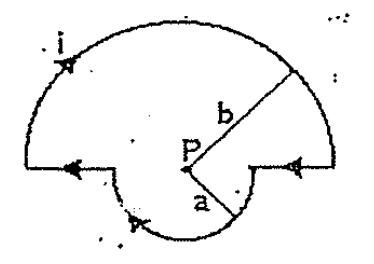
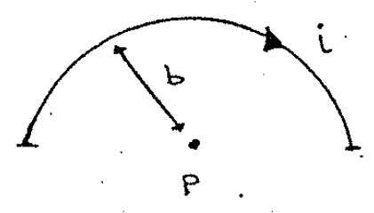
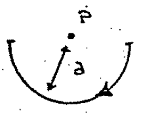

# Biot–Savart — Anibal Kasero: semicírculos opuestos

## Enunciado

Calcular el campo magnético B en el punto P.

Rta.:

```math
B_P=\frac{\mu_0i}4\frac{a+b}{ab}\quad\text{entrante}
```



## Desarrollo

La situación es prácticamente la misma que antes. Los tramos lineales NO
contribuyen al campo en el punto P, solo tendremos el semicírculo superior y el
inferior.

Comenzamos con el semicírculo superior, radio b y sentido horario para la
corriente, su campo es:



```math
\vec B=\frac{\mu_0i}{4b}(-\hat z)
```

Ahora el semicírculo inferior, radio a y sentido también horario para la
corriente, su campo tendrá también la dirección y sentido $`(-\hat z)`$:

```math
\vec B=\frac{\mu_0i}{4a}(-\hat z)
```



Ahora si sumamos ambas contribuciones tenemos el campo total.

```math
\vec B_P=\frac{\mu_0i}{4b}(-\hat z)+\frac{\mu_0i}{4a}(-\hat z)
```

```math
\vec B_P=\left(\frac{\mu_0i}{4b}+\frac{\mu_0i}{4a}\right)(-\hat z)
=\frac{\mu_0i}4\left(\frac1b+\frac1a\right)(-\hat z)
```

```math
\vec B_P=\frac{\mu_0i}4\frac{a+b}{ab}(-\hat z)
```

El campo total es entrante.

## Procedencia

- Original: `2015/Resueltos Fisica II Anibal Kaseros Ley de Biot-Sabat.pdf`,
  página32 desde el segundo enunciado y página33 hasta el separador. SHA-256:
  `b4aeb8cc9f1fa04835d4817a067976cc3d3c07d57e18ca5dabd898b67e09d41e`.
- OCR español auxiliar y cotejo visual de ambos sectores; tres figuras
  originales y ecuaciones transcritas. La numeración retocada no se infiere.
