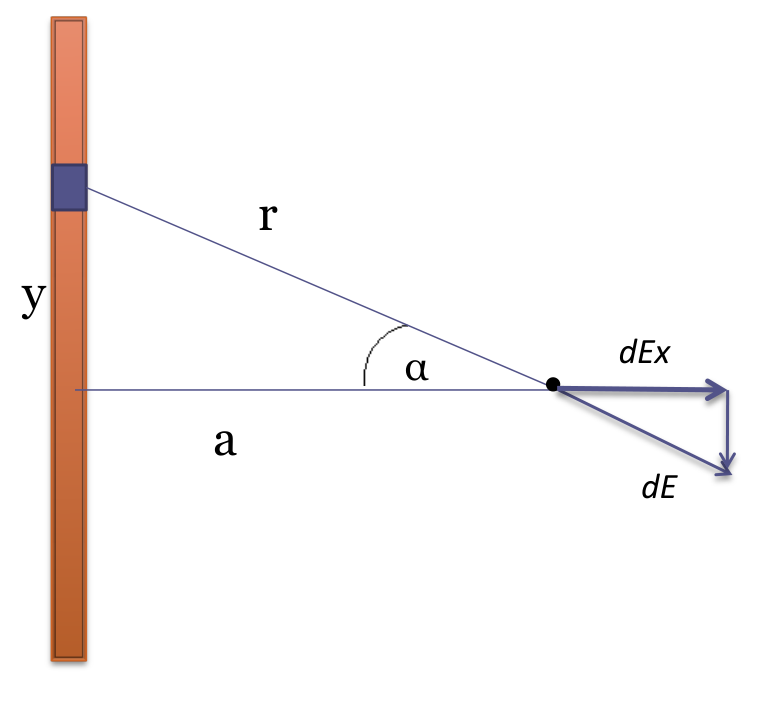
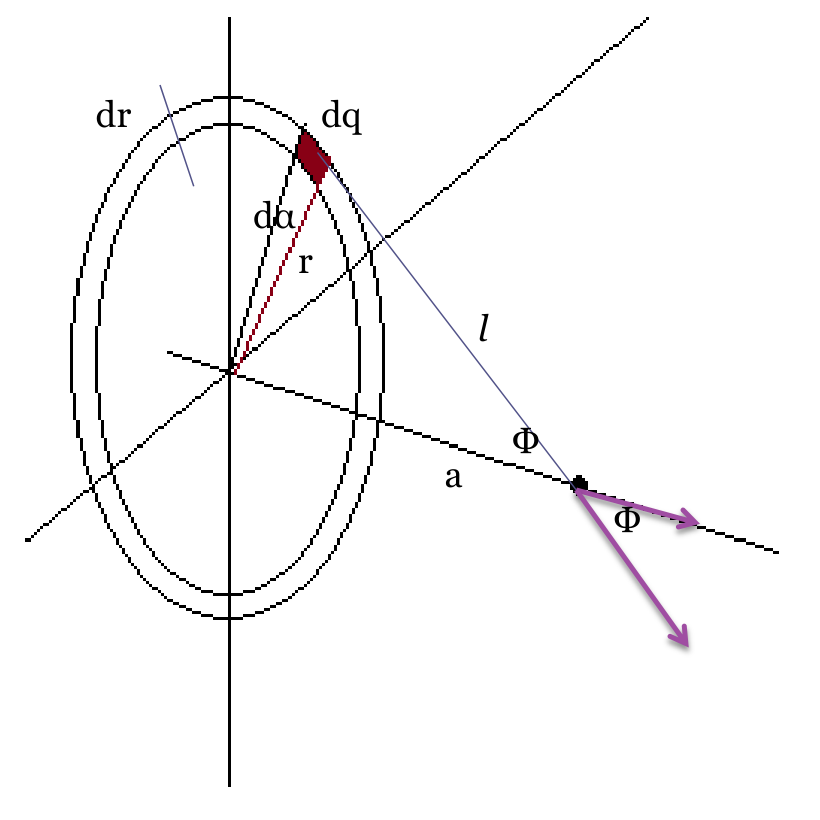

# Cálculo del campo eléctrico para distribuciones continuas de cargas

CALCULO DEL CAMPO ELECTRICO PARA DISTRIBUCIONES CONTINUAS DE CARGAS

## Calculo del campo eléctrico creado por un hilo infinito

## Calculo del campo eléctrico creado por un plano infinito

## Procedencia y observaciones de transcripción

- Original: `2015/UNIDAD 1 Fuerza electrica y campo electrico-1.pdf`,
  páginas14–15 de41. No constan autor ni fecha propios en estas páginas.
- SHA-256: `1130cc5160c8a6f87578f071f70595c679fb1535a8899aa02e13c9b0d093da07`.
- Herramientas: PyMuPDF y Poppler para extracción y localización; cotejo visual
  de las dos diapositivas y todos los rótulos. Diagramas originales conservados
  por render PyMuPDF.
- Las dos diapositivas contienen títulos y diagramas, sin una derivación ni un
  resultado algebraico adicional. No se completan con fórmulas ajenas a la
  fuente. Se conserva Φ en ambos rótulos del segundo diagrama.
