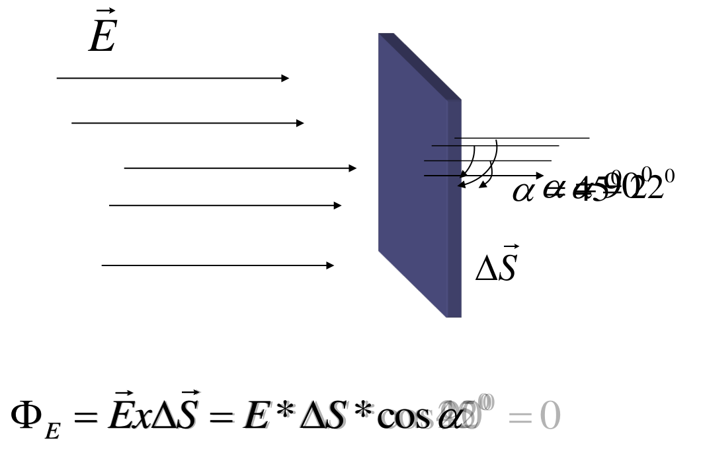
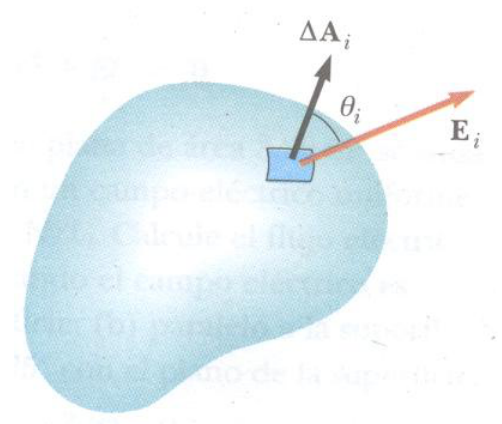

# Flujo de campo eléctrico

Este concepto se origina en la Teoría de los Fluidos, donde flujo significa la
rapidez con que un fluido pasa a través de una superficie imaginaria.

El flujo de un campo vectorial Φ involucra: el campo vectorial y una superficie
en la cual el flujo es evaluado.

Para obtener el flujo a través de una superficie representamos a la superficie
mediante el vector superficie

Para una superficie plana el vector superficie tendrá un modulo igual al área de
la superficie $`|\Delta S|`$ y como dirección perpendicular a esta superficie



$`\alpha=22^0`$

```math
\Phi_E=\vec E x\Delta\vec S=E*\Delta S*\cos22^0
```

$`\alpha=45^0`$

```math
\Phi_E=\vec E x\Delta\vec S=E*\Delta S*\cos45^0
```

$`\alpha=90^0`$

```math
\Phi_E=\vec E x\Delta\vec S=E*\Delta S*\cos90^0=0
```

```math
\Phi_E=\vec E x\Delta\vec S=E*\Delta S*\cos\alpha
```

Si la superficie es curva o el campo eléctrico varía punto a punto sobre la
superficie, el flujo se obtiene dividiendo la superficie en pequeños elementos,
tan pequeños que puedan considerarse planos, y que el campo eléctrico no varíe
en su superficie

El flujo total será la suma de todas las contribuciones de flujo a través de
cada uno de los elementos de superficie

```math
\Phi E_T=\sum_{i=1}^n\Phi E_i
```



```math
\Phi E_T=\sum_{i=1}^n\Phi E_i
```

En el limite en que el tamaño de cada elemento se aproxima a cero y el numero de
elementos a infinito, la suma se convierte en una integral

```math
\Phi E=\oint\vec E x d\vec S
```

## Procedencia y observaciones de transcripción

- Original: `2015/UNIDAD 1 Fuerza electrica y campo electrico-1.pdf`,
  páginas26–29 de41. No constan autor ni fecha propios en estas páginas.
- SHA-256: `1130cc5160c8a6f87578f071f70595c679fb1535a8899aa02e13c9b0d093da07`.
- Herramientas: PyMuPDF y Poppler, cotejo visual de las cuatro diapositivas y
  contraste de los cuatro estados algebraicos de la página27 con su capa
  textual. Figuras y recorte superpuesto originales por render PyMuPDF.
- La página27 superpone los estados22,45,90 y genérico en un mismo lugar; se
  conserva el recorte y se transcriben por separado las expresiones recuperables
  de la capa textual. Se mantienen el superíndice0, los asteriscos y la letra x
  entre vectores, sin reemplazarla silenciosamente por un producto escalar.
- Se conservan ΦE con E fuera del subíndice en las páginas28–29, la sumatoria
  repetida y el círculo del signo integral de la página29. No se corrige la
  notación del original.
