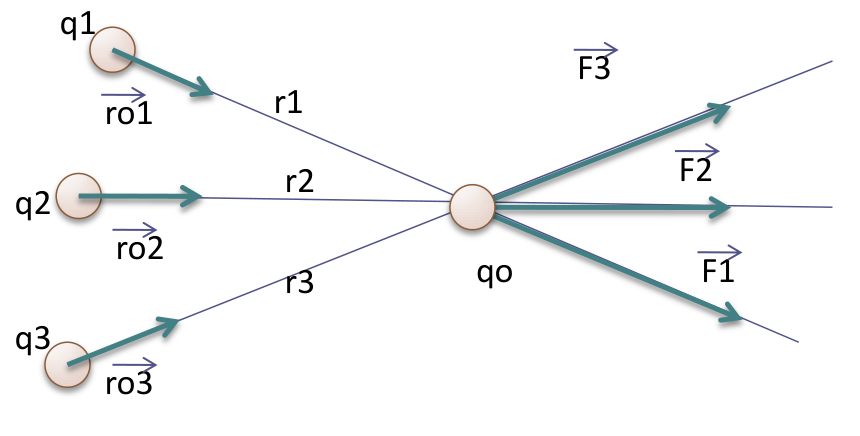
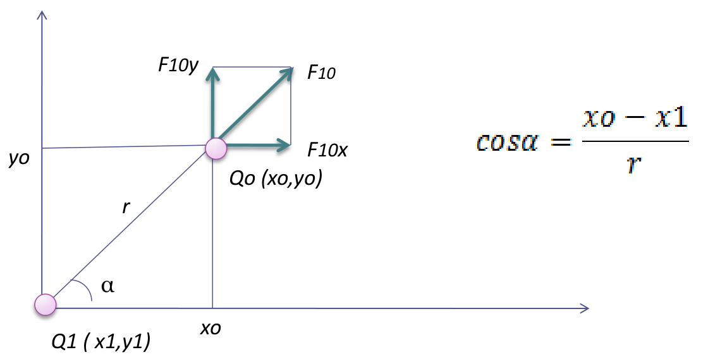

# Unidad 1: fuerza y campo eléctrico — principio de superposición

UNIDAD 1

FUERZA Y CAMPO ELECTRICO

## Principio de superposición



```math
\vec F_o=\vec F_{o1}+\vec F_{o2}+\ldots+\vec F_{on}
```

```math
\sum\vec F_{oi}=Kq_o\sum\frac{q_i}{r_i^2}\vec r_{oi}
```

En caso de conocer las coordenadas espaciales de cada carga qi y qo

Las coordenadas de la fuerza será:

\=



```math
\cos\alpha=\frac{x_o-x_1}{r}
```

```math
F_{10x}=k.\frac{q_o.q_1}{r^2}.\cos\alpha
```

```math
F_{10x}=k.\frac{q_o.q_1(x_o-x_1)}{r^3}
```

Como r es:

```math
r=\sqrt{(x_o-x_1)^2+(y_o-y_1)^2}
```

tenemos

```math
F_{10x}=k.\frac{q_o.q_1(x_o-x_1)}{\big((x_o-x_1)^2+(y_o-y_1)^2\big)^{3/2}}
```

Si analizamos la componente en y tenemos

```math
F_{10x}=k.\frac{q_o.q_1}{r^2}.\mathop{\mathrm{sen}}\nolimits\alpha
```

```math
F_{oy1}=k.\frac{q_o.q_1(y_o-y_1)}{\big((x_o-x_1)^2+(y_o-y_1)^2\big)^{3/2}}
```

Aplicando el principio de superposición para n cargas tendremos:

```math
\sum_{i=1}^n F_{oxi}=k\frac{q_o.q_i(x_o-x_i)}{\big((x_o-x_i)^2+(y_o-y_i)^2\big)^{3/2}}
```

```math
\sum_{i=1}^n F_{oyi}=k\frac{q_o.q_i(y_o-y_i)}{\big((x_o-x_i)^2+(y_o-y_i)^2\big)^{3/2}}
```

```math
F_o=\sqrt{\left(\sum F_{oxi}\right)^2+\left(\sum F_{oyi}\right)^2}
```

```math
\alpha=\mathop{\mathrm{arctg}}\nolimits\frac{\sum F_{ox}}{\sum F_{oy}}
```

Si las cargas se encuentran en el espacio

```math
\sum_{i=1}^n F_x=k\frac{q_o.q_i(x_o-x_i)}{\big((x_o-x_i)^2+(y_o-y_i)^2+(z_o-z_i)^2\big)^{3/2}}
```

```math
\sum_{i=1}^n F_y=k\frac{q_o.q_i(y_o-y_i)}{\big((x_o-x_i)^2+(y_o-y_i)^2+(z_o-z_i)^2\big)^{3/2}}
```

```math
\sum_{i=1}^n F_z=k\frac{q_o.q_i(z_o-z_i)}{\big((x_o-x_i)^2+(y_o-y_i)^2+(z_o-z_i)^2\big)^{3/2}}
```

La fuerza total será:

```math
F=\sqrt{\left(\sum F_{xi}\right)^2+\left(\sum F_{yi}\right)^2+\left(\sum F_{zi}\right)^2}
```

La dirección de la fuerza se obtiene atreves de los cosenos directores

```math
\cos\alpha=\frac{F_x}{F}
```

```math
\cos\beta=\frac{F_y}{F}
```

```math
\cos\gamma=\frac{F_z}{F}
```

## Procedencia y observaciones de transcripción

- Original: `2015/UNIDAD 1 Fuerza electrica y campo electrico-1.pdf`, páginas1–6
  de41. La primera es la portada; las siguientes contienen superposición y
  componentes de la fuerza. No constan autor ni fecha propios en estas páginas.
- SHA-256: `1130cc5160c8a6f87578f071f70595c679fb1535a8899aa02e13c9b0d093da07`.
- Herramientas: PyMuPDF4LLM con imágenes y Poppler; comparación de muestra con
  Docling y cotejo visual de todas las expresiones y ambos diagramas. Las
  fórmulas en imágenes se transcriben en LaTeX; la extracción de texto sola las
  omite.
- Se conserva el signo igual aislado de la página3. En la página4 la expresión
  del seno mantiene el índice **10x**, aunque el texto diga componente y; la
  siguiente usa **oy1**. Se conservan K/k, sumatorias solo a la izquierda de las
  fórmulas de componentes, el cociente **ΣFox/ΣFoy** del arco tangente, «Las
  coordenadas de la fuerza será» y «atreves». No se corrigen silenciosamente.
- La relación del coseno forma parte del diagrama original y también se
  transcribe como ecuación para que no dependa de la imagen.
