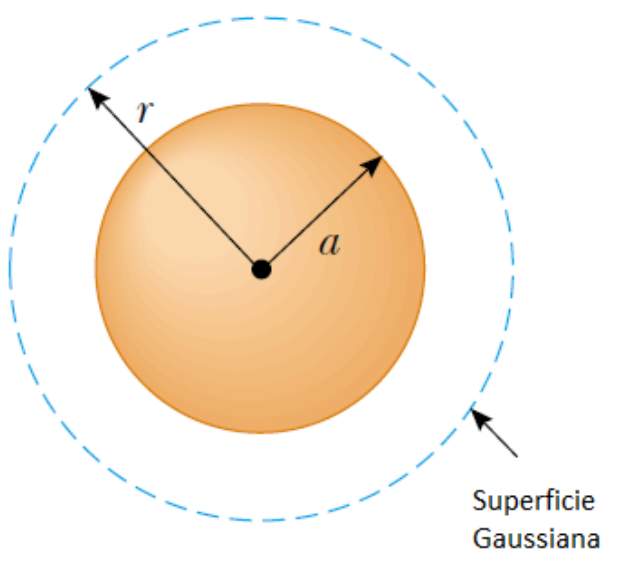
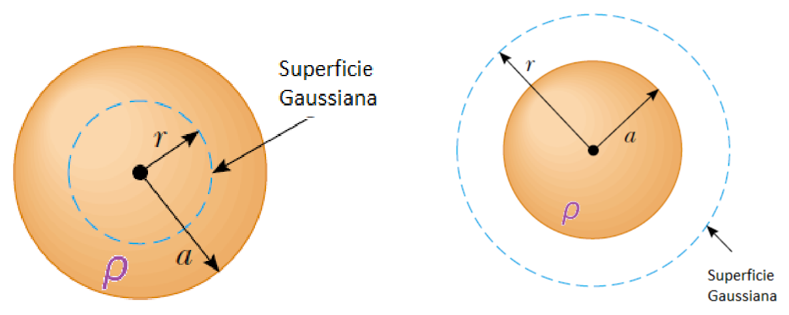
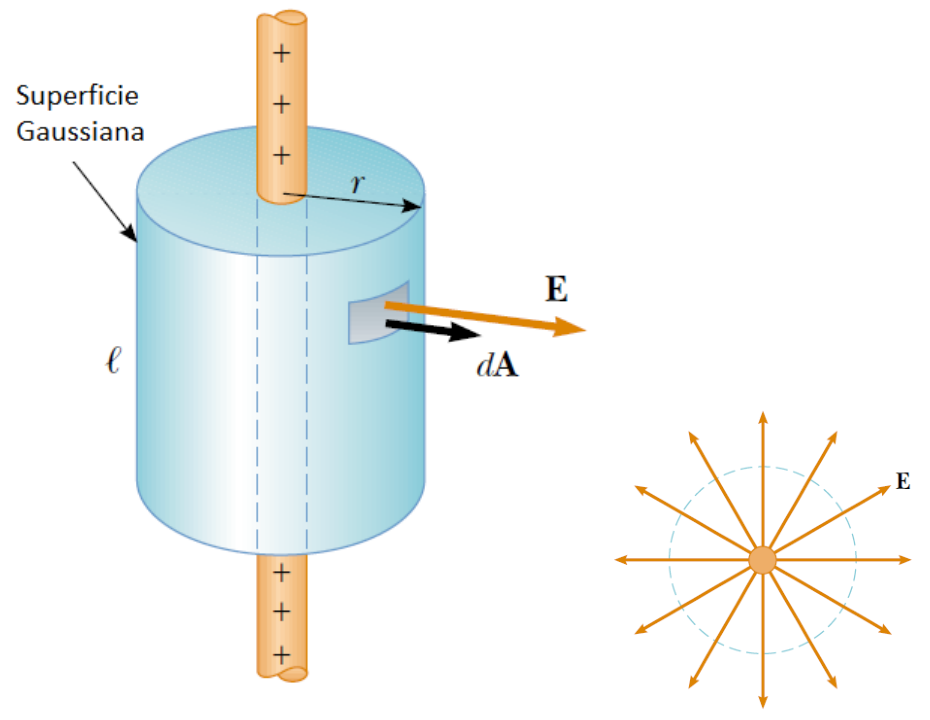
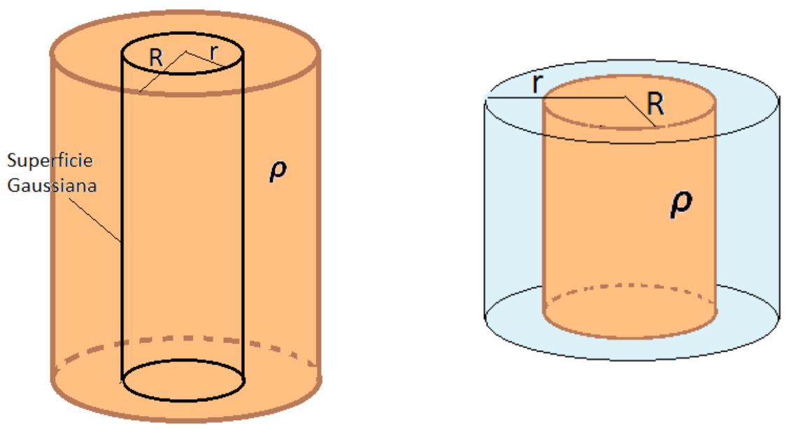
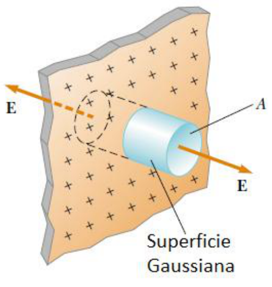
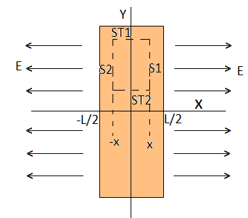
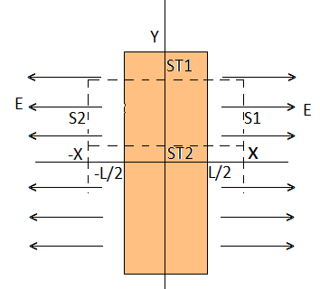
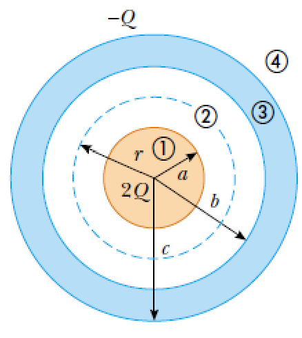

# Aplicaciones de la ley de Gauss

Determinación de campos eléctricos de distribuciones con simetría .-

Se utilizará la ley de Gauss para determinar el campo eléctrico conociendo como
es la distribución de carga.-

Dado que el campo está dentro de la integral,

```math
\mathop{∯}\vec E.\overrightarrow{ds}=\frac Q{\varepsilon o}
```

Para poder extraer el campo de la integral se debe seleccionar una superficie
gaussiana que cumpla con:

- Debe pasar por el punto donde se quiere calcular el campo
- Debe contener a la carga de interés
- Debe respetar la simetría de la distribución de carga.-

## Esfera conductora con carga Q y de radio a



## Distribución de cargas con simetría esférica de radio a y densidad volumétrica de carga ρ. carga total Q



## Hilo muy largo con densidad de carga uniforme λ



## Distribución de carga con simetría cilíndrica de radio R y densidad volumétrica constante ρ. Carga total Q



## Lamina cargada plana e infinita



## Distribución de cargas con simetría rectangular de espesor L y densidad volumétrica constante ρ. Carga total Q





## Diagrama final sin encabezado



## Procedencia y observaciones de transcripción

- Original: `2015/UNIDAD 1 Fuerza electrica y campo electrico-1.pdf`,
  páginas32–38 y41 de41. La página41 contiene solo el diagrama final, sin texto
  extraíble. No constan autor ni fecha propios.

- SHA-256: `1130cc5160c8a6f87578f071f70595c679fb1535a8899aa02e13c9b0d093da07`.

- Herramientas: PyMuPDF y Poppler; cotejo visual de las ocho diapositivas,
  ecuación, geometrías y etiquetas. Figuras originales conservadas por render
  PyMuPDF.

- Las páginas33–38 presentan los títulos y diagramas, sin resultados algebraicos
  de campo adicionales: no se completan como ejercicios resueltos. Tampoco se
  inventa un enunciado para el diagrama sin título de la página41. Se conserva
  «Lamina» sin tilde del encabezado.

- Compatibilidad de publicación: el símbolo de integral de superficie cerrada se
  escribe mediante el carácter Unicode ∯, conservando el glifo original; GitHub
  mostraba literalmente el comando oiint.
