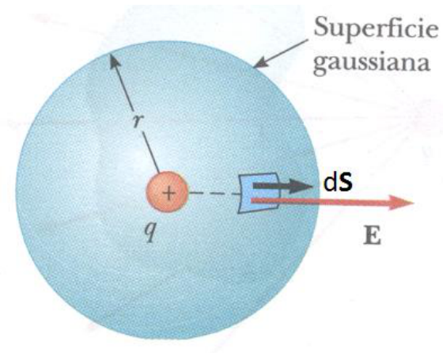

# Ley de Gauss: demostración de la igualdad

“El flujo del campo eléctrico atraves de una superficie cerrada es igual al
cociente entre la carga neta encerrada por dicha superficie y εo “

```math
\mathop{∯}\vec E.\overrightarrow{ds}=\frac Q{\varepsilon o}
```

## Demostración de la igualdad en la ley de Gauss



```math
\Phi=\mathop{∯}\vec E.\overrightarrow{ds}
```

```math
\vec E=\frac q{4\pi\varepsilon o}\frac{\overrightarrow{ro}}{r^2}
```

```math
\Phi=\mathop{∯}\vec E.\overrightarrow{ds}=\mathop{∯}\frac q{4\pi\varepsilon o}\frac{\overrightarrow{ro}}{r^2}.\overrightarrow{ds}
```

Ordenando resulta:

```math
\Phi=\frac q{4\pi\varepsilon o}\mathop{∯}\frac{\overrightarrow{ro}}{r^2}.\overrightarrow{ds}
```

Teniendo en cuenta la definición de ángulo sólido

```math
\Phi=\frac q{4\pi\varepsilon o}\mathop{∯} d\Omega
```

Como el ángulo sólido está subtendido desde el punto donde está la carga y es
sobre toda la superficie cerrada resulta:

```math
\Phi=\frac q{4\pi\varepsilon o}.4\pi=\frac q{\varepsilon o}
```

## Procedencia y observaciones de transcripción

- Original: `2015/UNIDAD 1 Fuerza electrica y campo electrico-1.pdf`,
  páginas30–31 de41. No constan autor ni fecha propios en estas páginas.

- SHA-256: `1130cc5160c8a6f87578f071f70595c679fb1535a8899aa02e13c9b0d093da07`.

- Herramientas: PyMuPDF y Poppler; cotejo visual de las dos diapositivas, todas
  las ecuaciones y los rótulos del diagrama. Figura original por render PyMuPDF.

- Se conserva «atraves», Q/q, la forma εo, el vector ro y las integrales dobles
  con círculo del original. No se agrega una normalización del vector ni se
  corrigen silenciosamente factores o símbolos.

- Compatibilidad de publicación: el símbolo de integral de superficie cerrada se
  escribe mediante el carácter Unicode ∯, conservando el glifo original; GitHub
  mostraba literalmente el comando oiint.
