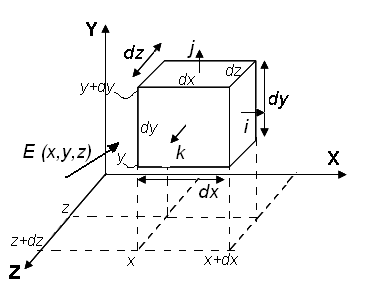

# Ley de Gauss en forma diferencial



```math
\Delta\Phi_{y1}=\vec E(x,y,z)\left[-\Delta x\Delta z\,\vec j\right]=-\vec E_y(x,y,z)\Delta x.\Delta z
```

```math
\Delta\Phi_{y2}=\vec E(x,y+\Delta y,z)\left[\Delta x\Delta z\,\vec j\right]=\vec E_y(x,y+\Delta y,z)\Delta x.\Delta z
```

```math
\Delta\Phi_{y2}=\vec E(x,y+\Delta y,z)\left[-\Delta x\Delta z\,\vec j\right]=-\vec E_y(x,y+\Delta y,z)\Delta x.\Delta z
```

```math
\Delta\Phi_y=\left[\vec E(x,y+\Delta y,z)-\vec E_y(x,y,z)\right]\Delta x\Delta z
```

Dividiendo y multiplicando por Δy

```math
\Delta\Phi_y=\frac{\left[\vec E(x,y+\Delta y,z)-\vec E_y(x,y,z)\right]}{\Delta y}\Delta x\Delta y\Delta z
```

```math
\Delta\Phi_x=\frac{\left[\vec E(x+\Delta x,y,z)-\vec E_x(x,y,z)\right]}{\Delta x}\Delta x\Delta y\Delta z
```

```math
\Delta\Phi_z=\frac{\left[\vec E(x,y,z+\Delta z)-\vec E_z(x,y,z)\right]}{\Delta z}\Delta x\Delta y\Delta z
```

El flujo total sera:

```math
\Delta\Phi=\Delta\Phi_x+\Delta\Phi_y+\Delta\Phi_z
```

De acuerdo a la ley de gauss

```math
\Delta\Phi=\frac{\rho\Delta x\Delta y\Delta z}{\varepsilon_0}
```

```math
\left(\frac{\left[\vec E(x+\Delta x,y,z)-\vec E_x(x,y,z)\right]}{\Delta x}+\frac{\left[\vec E(x,y+\Delta y,z)-\vec E_y(x,y,z)\right]}{\Delta y}+\frac{\left[\vec E(x,y,z+\Delta z)-\vec E_z(x,y,z)\right]}{\Delta z}\right)\Delta x\Delta y\Delta z=\frac{\rho\Delta x\Delta y\Delta z}{\varepsilon_0}
```

Tomando limite para $`\Delta x\to0\quad\Delta y\to0\quad\Delta z\to0`$ resulta

```math
\frac{\partial E_x}{\partial x}+\frac{\partial E_y}{\partial y}+\frac{\partial E_z}{\partial z}=\frac\rho{\varepsilon_0}
```

Que representa la divergencia del campo eléctrico

Usando el operador nabla:

```math
\nabla.\vec E=\frac\rho{\varepsilon_0}
```

## Procedencia y observaciones de transcripción

- Original: `2015/UNIDAD 1 Fuerza electrica y campo electrico-1.pdf`,
  páginas39–40 de41. No constan autor ni fecha propios.
- SHA-256: `1130cc5160c8a6f87578f071f70595c679fb1535a8899aa02e13c9b0d093da07`.
- Herramientas: PyMuPDF y Poppler; cotejo visual de ambas diapositivas, cada
  término y el diagrama, conservado por extracción de la imagen incrustada con
  PyMuPDF. Las expresiones de fuente privada se transcriben en LaTeX.
- Se conserva la repetición de ΔΦy2 con signo negativo en la tercera línea de la
  página39. También las flechas en los componentes y la ausencia de subíndice en
  el primer E de cada diferencia finita; no se armonizan con la notación de las
  derivadas del final. Se mantienen «sera» y «limite» sin tildes del original.
