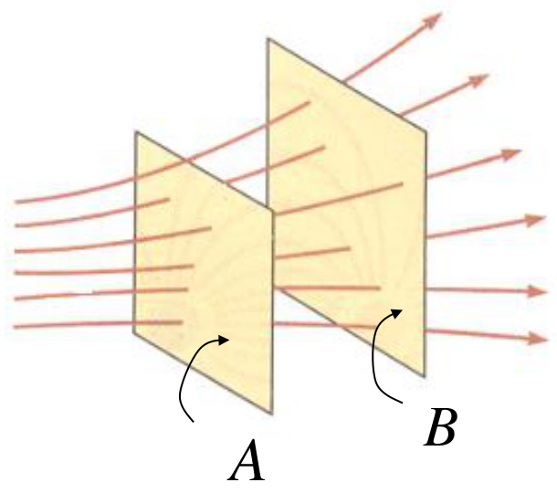
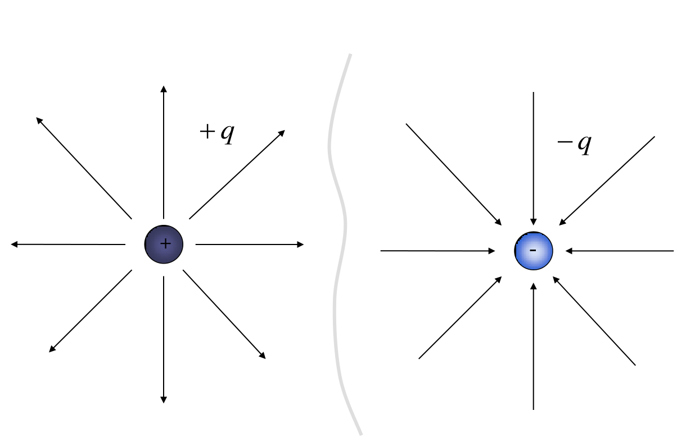
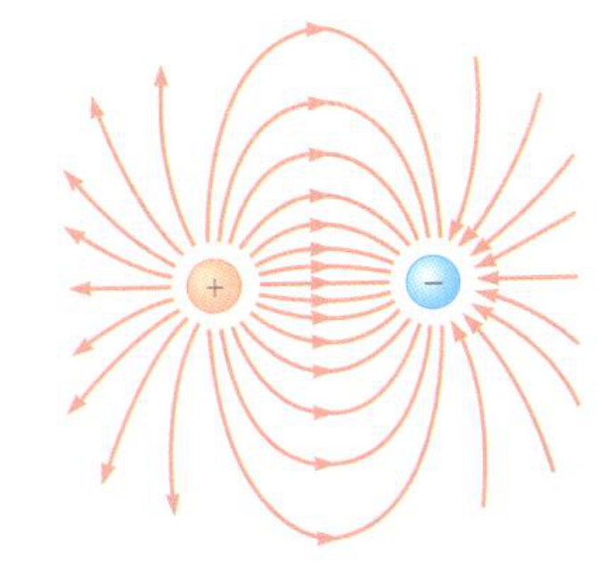
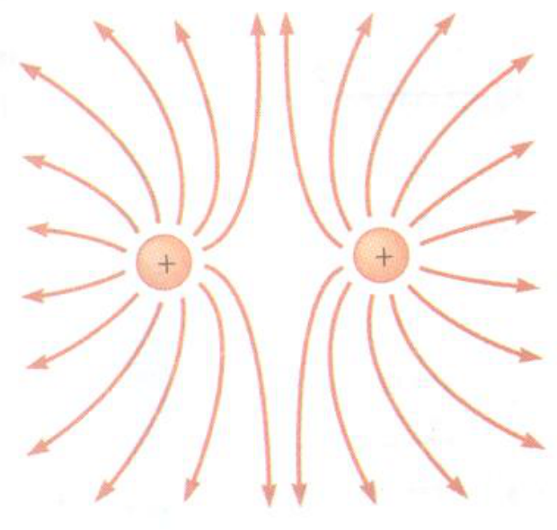
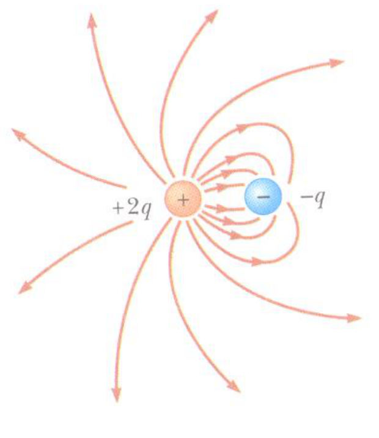
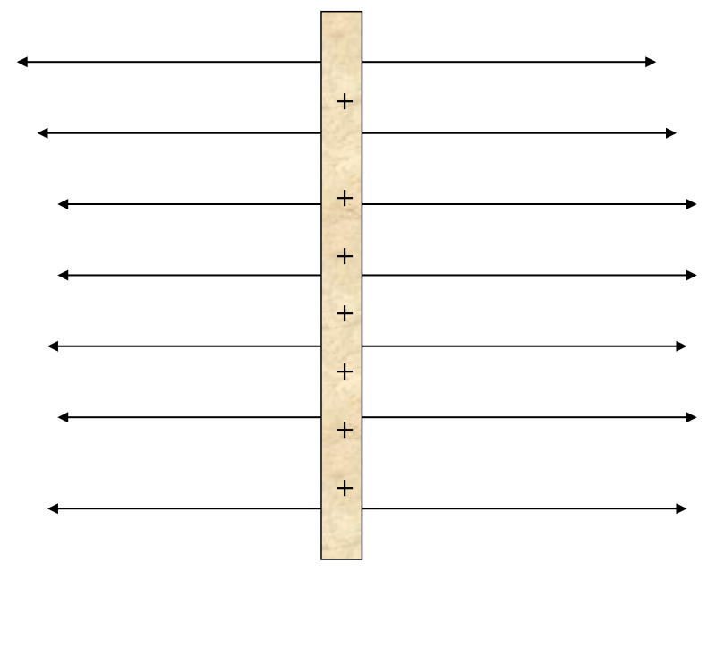

# Líneas de campo eléctrico

Es una representación grafica, no son reales, permiten visualizar el campo
eléctrico.

El vector del campo eléctrico es tangente a la línea de campo eléctrico en cada
punto.

El número de líneas de campo eléctrico por unidad de superficie perpendicular a
dichas líneas es proporcional a la magnitud del campo en esa región del espacio.

En donde las líneas están muy cercanas, el campo es grande y en donde están
separadas es pequeño.

La misma cantidad de líneas atraviesan las superficie A y B

Pero los efectos del campo eléctrico son mayores en la superficie A ya que hay
mayor densidad de líneas de campo

## Líneas de campo eléctrico de una carga puntual

## Líneas de campo eléctrico de un dipolo eléctrico

Las líneas de campo salen de la carga positiva y mueren en la carga negativa, el
espacio entre las dos cargas tiene mayor campo eléctrico

## Líneas de campo eléctrico de dos cargas puntuales positivas

En el espacio entre las dos cargas el campo eléctrico total es nulo

La carga positiva es el doble de la carga negativa

## Una varilla larga cargada

Para una varilla cargada uniformemente el campo es normal a la varilla y
constante

## Procedencia y observaciones de transcripción

- Original: `2015/UNIDAD 1 Fuerza electrica y campo electrico-1.pdf`,
  páginas16–22 de41. No constan autor ni fecha propios en estas páginas.
- SHA-256: `1130cc5160c8a6f87578f071f70595c679fb1535a8899aa02e13c9b0d093da07`.
- Herramientas: PyMuPDF y Poppler; cotejo visual del texto, los seis diagramas,
  signos y sentidos de flechas. Figuras originales por render PyMuPDF.
- Se conserva «las superficie», la afirmación sobre campo nulo «en el espacio
  entre las dos cargas» y la de campo «constante» de la varilla. No se limita ni
  corrige silenciosamente el alcance de esas frases.
