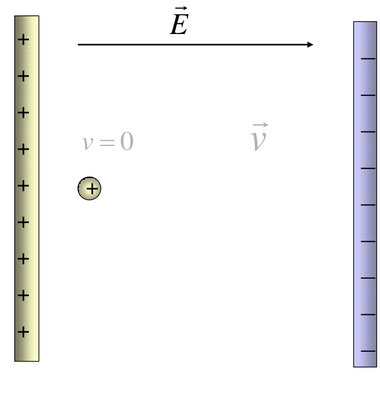

# Movimiento de una partícula cargada en un campo eléctrico uniforme



$`v=0`$

```math
\vec F_e=q\vec E=m\vec a\quad\Rightarrow
```

```math
\vec a=\frac{q\vec E}{m}
```

```math
\vec E=cte\Rightarrow\vec a=cte
```

```math
x=\frac12at^2=\frac12\frac{qE}{m}t^2
```

```math
v=at=\frac{qE}{m}t
```

## Procedencia y observaciones de transcripción

- Original: `2015/UNIDAD 1 Fuerza electrica y campo electrico-1.pdf`, página23
  de41. No constan autor ni fecha propios en esta página.
- SHA-256: `1130cc5160c8a6f87578f071f70595c679fb1535a8899aa02e13c9b0d093da07`.
- Herramientas: PyMuPDF y Poppler; cotejo visual de todas las expresiones y del
  diagrama original, conservado por render PyMuPDF.
- La ecuación de aceleración y el rótulo v=0 aparecen en gris en el original y
  se conservan. Se mantiene la flecha final de la primera expresión y la
  notación cte. No se agregan condiciones iniciales o derivaciones que no
  figuren en la diapositiva.
