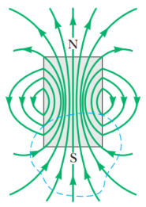

# Resumen de Física II — leyes de Ampere y Gauss para el magnetismo

## Ley de Ampere

Consideremos un alambre que lleva una corriente I, que produce un campo
magnético B en trayectorias circulares centrado en el alambre. Se evalúa el
producto $`B\cdot ds`$ para un elemento de longitud ds pequeño de la trayectoria
circular de la línea del campo, y sume los productos para todos los elementos en
toda la trayectoria circular cerrada.

$`B\cdot ds=Bds`$ , al ser B y ds paralelos. La magnitud de B es constante en el
círculo. Por lo tanto, la suma de los productos Bds a lo largo de la trayectoria
cerrada, equivale a la integral lineal de Bds

```math
\oint\vec B\cdot d\vec s=B\oint ds=\frac{\mu_0 I}{2\pi r}(2\pi r)=\mu_0 I
```

Esta ecuación es válida para la trayectoria cerrada de cualquier forma y donde I
es la corriente total estable que pasa a través de cualquier superficie limitada
por la trayectoria cerrada.

“La integral de línea de $`\vec B\cdot\overrightarrow{ds}`$ alrededor de
cualquier trayectoria cerrada es igual a $`\mu_0I`$ , donde I es la corriente
total estable que pasa a través de cualquier superficie limitada por la
trayectoria cerrada”.

```math
\oint\vec B\cdot d\vec s=\mu_0 I
```

## Ley de Gauss para el magnetismo

Imagine un elemento de área dA sobre una superficie de forma arbitraria. Si el
campo magnético en este elemento es B, el flujo magnético a través del elemento
es BdA, donde dA es un vector perpendicular a la superficie y que tiene una
magnitud igual al área dA. Debido a eso, el flujo magnético total $`\phi_B`$ a
través de la superficie es

```math
\Phi_B=\int\vec B\cdot d\vec A
```

Considere el caso de un plano de área A en un campo uniforme B que forma un
ángulo u con dA. El flujo magnético a través del plano en este caso es

```math
\Phi_B=BA\cos\theta
```

Si el campo magnético es paralelo al plano (u=90°) el flujo a través del plano
es igual a cero. Si el campo es perpendicular al plano (u=0) el flujo a través
del plano es BA. La unidad del flujo magnético es $`T\cdot m^2`$ la cual se
define como un weber (Wb).

La ley de Gauss en el magnetismo establece que el flujo magnético neto a través
de cualquier superficie cerrada siempre es igual a cero:

```math
\oint\vec B\cdot d\vec A=0
```



## ley de Ampere en el vacío. Forma integral y diferencial

### Forma integral

```math
\oint_C\vec H\cdot d\vec l=\iint_S\vec J\cdot d\vec S=I_{\mathrm{enc}}
```

Donde H es el campo magnético e $`I_{enc}`$ es la corriente encerrada en la
curva _C_ . Un caso particular de interés es cuando el medio es el vacío
$`\vec B=\mu_0\vec H`$

```math
\oint_C\vec B\cdot d\vec l=\mu_0 I_{\mathrm{enc}}
```

Donde B es la densidad de flujo magnético y μ0 es la permeabilidad magnética del
vacío.

### Forma diferencial

A partir del teorema de Stokes, esta ley también se puede expresar de forma
diferencial:

```math
\nabla\times\vec H=\vec J
```

## Procedencia y observaciones

- Original: `2015/Resumen-Fisca-2.pdf`, páginas [33, 34]; sectores delimitados
  por encabezados. SHA-256:
  `b9903f972224365c1a74b5d2732c9a34675c9b719da4c9c2d28e4a0f34e0b0cc`.
- PyMuPDF4LLM, Poppler y cotejo visual completo de los sectores; ecuaciones de
  imagen transcritas a LaTeX, figuras originales preservadas.
- Se conservan las denominaciones H/B y las integrales tal como están impresas.
