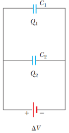
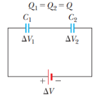

# Resumen de Física II — asociación de condensadores

## Combinación en paralelo

Las diferencias de potencial individuales a través de capacitores conectados en
paralelo son las mismas e iguales a la diferencia de potencial aplicada a través
de la combinación.

```math
\Delta V_1=\Delta V_2=\Delta V
```

La carga total en capacitores conectados en paralelo es la suma de las cargas en
los capacitores individuales.

```math
Q_{\mathrm{tot}}=Q_1+Q_2
```



El capacitor equivalente debe almacenar carga Q tot cuando se conecte a la
batería a un voltaje V.

```math
Q_{\mathrm{tot}}=C_{\mathrm{eq}}\Delta V
```

entonces

```math
C_{\mathrm{eq}}\Delta V=C_1\Delta V_1+C_2\Delta V_2
```

Cancelamos las diferencias de potenciales por ser las mismas y no queda que

```math
C_{\mathrm{eq}}=C_1+C_2
```

La capacitancia equivalente de una combinación de capacitores en paralelo es la
suma algebraica de las capacitancias individuales y mayor que cualquiera de las
capacitancias individuales.

## Combinación en serie

La carga negativa que sale de la placa izquierda de C2 hace que se acumulen
cargas negativas en la placa derecha de C1. Como resultado, todas las placas
derechas terminan con una carga -Q y las izquierdas con una carga +Q. Por lo
tanto, las cargas de los capacitores conectados en serie son iguales.



```math
Q_1=Q_2=Q
```

el voltaje total Vtot a través de la combinación se divide entre los dos
capacitores:

```math
\Delta V_{\mathrm{tot}}=\Delta V_1+\Delta V_2
```

La diferencia de potencial total aplicada a cualquier cantidad de capacitores
conectados en serie es la suma de las diferencias de potencial presentes entre
cada uno de los capacitores individuales. Una vez que está totalmente cargado,
el capacitor equivalente deberá tener una carga igual a -Q en su placa derecha y
una carga de +Q en su placa izquierda. Al aplicar la definición de capacitancia

```math
\Delta V_{\mathrm{tot}}=\frac Q{C_{\mathrm{eq}}}
```

Como Vtot es igual a la suma de los voltajes, y remplazando estos por su
equivalente tenemos

```math
\frac Q{C_{\mathrm{eq}}}=\frac{Q_1}{C_1}+\frac{Q_2}{C_2}
```

Cancelamos las cargas al ser las mismas y nos queda

```math
\frac1{C_{\mathrm{eq}}}=\frac1{C_1}+\frac1{C_2}
```

El inverso de la capacitancia equivalente es igual a la suma algebraica de los
inversos de las capacitancias individuales. La capacitancia equivalente de una
combinación en serie siempre es menor que cualquiera de las capacitancias
individuales incluidas en la combinación.

## Procedencia y observaciones

- Original: `2015/Resumen-Fisca-2.pdf`, página13 desde «Asociación» y comienzo14
  hasta «Energía». SHA-256:
  `b9903f972224365c1a74b5d2732c9a34675c9b719da4c9c2d28e4a0f34e0b0cc`.
- PyMuPDF4LLM, Poppler y cotejo visual completo de ambos sectores. Dos circuitos
  originales. Se restituyen las dos ecuaciones que la extracción perdió entre «a
  un voltaje V» y «Cancelamos», comprobadas en página13.
- Se preserva «no queda que» del texto, sin cambiarlo por «nos queda que».
