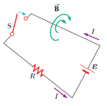

# Resumen de Física II — inducción mutua y autoinducción

Considere un circuito formado por un interruptor, un resistor y una fuente de
fem. Cuando se cierra el interruptor la corriente aumenta con el tiempo hasta su
valor maximo, el flujo magnético debido a esta corriente, a través de la espira
del circuito, también aumenta. Este flujo creciente genera una fem inducida y
una corriente inducida en el circuito cuya dirección debe generar un campo
magnético opuesto al cambio del flujo magnetico. Por lo tanto, la dirección de
la fem inducida es en sentido opuesto a la dirección de la fem de la batería, lo
que da como resultado un incremento gradual, en vez de instantáneo, de la
corriente hasta que alcance su valor de equilibrio final. Este efecto se llama
autoinducción debido a que el flujo cambiante a través del circuito y la fem
inducida resultante surge del circuito mismo. La fem $`\mathcal E_L`$
establecida en este caso se llama fem autoinducida.



La fem inducida es igual al negativo de la rapidez de cambio en el tiempo del
flujo magnético. Éste es proporcional al campo magnético que en su momento es
proporcional a la corriente en el circuito. Debido a eso, una fem autoinducida
siempre es proporcional a la rapidez de cambio en el tiempo de la corriente.
Para cualquier espira de alambre, se puede escribir esta proporcionalidad como

```math
\mathcal E_L=-L\frac{dI}{dt}
```

donde L es una constante de proporcionalidad llamada inductancia de la espira
que depende de la geometría de la espira y de otras características físicas. Si
considera una bobina con espacios cerrados de N vueltas que lleva una corriente
I, la ley de Faraday dice que $`\mathcal E_L=-N d\phi_B/dt`$ , Al combinar esta
expresión anterior tenemos que:

```math
L=\frac{N\Phi_B}{I}
```

donde se supone que pasa el mismo flujo magnético a través de cada una de las
vueltas y L es la inductancia de toda la bobina. También se escribe la
inductancia como la relación

```math
L=-\frac{\mathcal E_L}{dI/dt}
```

La resistencia mide la oposición a la corriente, mientras que la inductancia es
una medida de oposición a un cambio en la corriente. La unidad del SI para la
inductancia es el Henry (H), $`V\cdot s/A`$

## Procedencia y observaciones

- Original: `2015/Resumen-Fisca-2.pdf`, páginas [37, 38]; sectores delimitados
  por encabezados. SHA-256:
  `b9903f972224365c1a74b5d2732c9a34675c9b719da4c9c2d28e4a0f34e0b0cc`.
- PyMuPDF4LLM, Poppler y cotejo visual completo de los sectores; ecuaciones de
  imagen transcritas a LaTeX, diagramas originales preservados.
- El título original nombra inducción mutua; el sector desarrolla autoinducción.
  Se conservan «maximo» y «magnetico».
