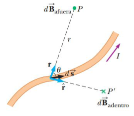

# Resumen de Física II — ley de Biot y Savart

## Unidad Temática 6. Campo de Inducción magnética. Propiedades

## Ley de Biot y Savart

El valor del campo magnético en algún punto del espacio, en función de la
corriente que dicho campo produce, está dada por la expresión

```math
d\vec B=\frac{\mu_0}{4\pi}\frac{I\,d\vec s\times\hat{\mathbf r}}{r^2}
```

donde µ0 es una constante llamada permeabilidad del espacio libre
$`\mu_0=4\pi\times10^{-7}T\cdot m/A`$ Esta expresión se basa en las siguientes
observaciones experimentales para el campo magnético dB en un punto P asociado
con un elemento de longitud ds de un alambre por el que pasa una corriente
estable I

- El vector dB es perpendicular tanto a ds (que apunta en la dirección de la
  corriente) como al vector unitario r, dirigido desde ds hacia P.

- La magnitud de dB es inversamente proporcional a $`r^2`$ , donde r es la
  distancia de ds a P.

- La magnitud de dB es proporcional a la corriente y a la magnitud ds del
  elemento de longitud ds.

- La magnitud de dB es proporcional a sen u, donde u es el ángulo entre los
  vectores ds y $`\vec r`$ .



Observe que el campo dB es creado en un punto por la corriente en sólo un
pequeño elemento de longitud ds del conductor. El campo magnético total B que se
crea en algún punto por una corriente de tamaño finito, es suma de las
contribuciones de todos los elementos de corriente I ds que forman la corriente.
Por lo tanto integramos para evaluar B

```math
\vec B=\frac{\mu_0 I}{4\pi}\int\frac{d\vec s\times\hat{\mathbf r}}{r^2}
```

## Procedencia y observaciones

- Original: `2015/Resumen-Fisca-2.pdf`, páginas [32]; sectores delimitados por
  encabezados. SHA-256:
  `b9903f972224365c1a74b5d2732c9a34675c9b719da4c9c2d28e4a0f34e0b0cc`.
- PyMuPDF4LLM, Poppler y cotejo visual completo de los sectores; ecuaciones de
  imagen transcritas a LaTeX, figuras originales preservadas.
- Se conserva «la corriente que dicho campo produce», y u en el texto frente a θ
  en el dibujo.
