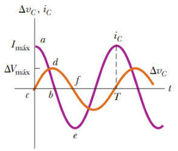
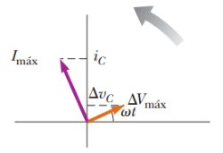

# Resumen de Física II — capacitores en corriente alterna

Suponga circuito de CA formado por un capacitor conectado a las terminales de
una fuente de CA. La regla de la espira de Kirchhoff aplicada a este circuito
nos da

```math
\Delta v-\frac qC=0
```

al sustituir $`V_{max}\mathop{\mathrm{sen}}\nolimits\omega t`$ para $`\Delta v`$
y reordenar

```math
q=C\Delta V_{\mathrm{máx}}\mathop{\mathrm{sen}}\nolimits\omega t
```

donde q es la carga instantánea en el condensador. Al derivar esta ecuación
respecto al tiempo se obtiene la corriente instantánea del circuito:

```math
i_C=\frac{dq}{dt}=\omega C\Delta V_{\mathrm{máx}}\cos\omega t
```

Si usamos la identidad trigonométrica
$`\cos\omega t=\mathop{\mathrm{sen}}\nolimits(\omega t+\pi/2)`$

```math
i_C=\omega C\Delta V_{\mathrm{máx}}\mathop{\mathrm{sen}}\nolimits\left(\omega t+\frac\pi2\right)
```

Al comparar esta expresión con $`\Delta v`$=
$`V_{max}\mathop{\mathrm{sen}}\nolimits\omega t`$ , se observa que la corriente
está π/2 rad =90° fuera de fase con el voltaje.

La corriente en el circuito alcanza su valor máximo cuando ωt =±1:

```math
I_{\mathrm{máx}}=\omega C\Delta V_{\mathrm{máx}}=\frac{\Delta V_{\mathrm{máx}}}{(1/\omega C)}
```





el denominador debe desempeñar el papel de resistencia, con unidades en ohms. La
combinación 1/ωC se representa con el símbolo $`X_C`$ y se define como la
reactancia capacitiva:

```math
I_{\mathrm{máx}}=\frac{\Delta V_{\mathrm{máx}}}{X_C}
```

Expresamos el voltaje instantáneo en las terminales del condensador como

```math
\Delta v_C=\Delta V_{\mathrm{máx}}\mathop{\mathrm{sen}}\nolimits\omega t=I_{\mathrm{máx}}X_C\mathop{\mathrm{sen}}\nolimits\omega t
```

## Procedencia y observaciones

- Original: `2015/Resumen-Fisca-2.pdf`, páginas [48]; sectores delimitados por
  encabezados. SHA-256:
  `b9903f972224365c1a74b5d2732c9a34675c9b719da4c9c2d28e4a0f34e0b0cc`.
- PyMuPDF4LLM, Poppler y cotejo visual completo de los sectores; ecuaciones de
  imagen transcritas a LaTeX, figuras originales preservadas.
- El original dice que el máximo ocurre cuando ωt=±1, sin cos visible; se
  conserva sin corregirlo.
