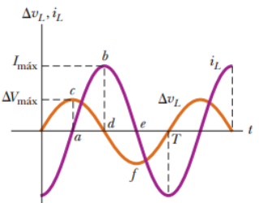
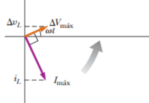

# Resumen de Física II — inductores en corriente alterna

Consideremos un circuito de CA formado por un solo inductor conectado a las
terminales de una fuente de CA. $`\mathcal E_L=L(di/dt)`$ es el voltaje
instantáneo autoinducido en las terminales del inductor, aplicando la regla de
la espira de Kirchhoff a este circuito tenemos

```math
\Delta v-L\frac{di_L}{dt}=0
```

Cuando sustituye $`V_{max}\mathop{\mathrm{sen}}\nolimits\omega t`$ en
$`\Delta v`$ y reordenando, proporciona

```math
\Delta v=L\frac{di_L}{dt}=\Delta V_{\mathrm{máx}}\mathop{\mathrm{sen}}\nolimits\omega t
```

Al resolver esta ecuación para $`di_L`$

```math
di_L=\frac{\Delta V_{\mathrm{máx}}}L\mathop{\mathrm{sen}}\nolimits\omega t\,dt
```

La integración de esta expresión da la corriente instantánea $`i_L`$ del
inductor como función del tiempo:

```math
i_L=\frac{\Delta V_{\mathrm{máx}}}L\int \mathop{\mathrm{sen}}\nolimits\omega t\,dt=-\frac{\Delta V_{\mathrm{máx}}}{\omega L}\cos\omega t
```

Aplicamos la identidad trigonométrica
$`\cos\omega t=-\mathop{\mathrm{sen}}\nolimits(\omega t-p/2)`$

```math
i_L=\frac{\Delta V_{\mathrm{máx}}}{\omega L}\mathop{\mathrm{sen}}\nolimits\left(\omega t-\frac\pi2\right)
```

La corriente instantánea $`i_L`$ en el inductor y el voltaje instantáneo $`v_L`$
en las terminales del inductor están fuera de fase en π/2 rad = 90°. la
corriente en un circuito inductivo alcanza su valor máximo cuando cos ωt =±1





```math
I_{\mathrm{máx}}=\frac{\Delta V_{\mathrm{máx}}}{\omega L}
```

ωL se mide en ohms y, al depender de ω, ofrece oposición a la corriente para
diferentes frecuencias. A ωL se denomina reactancia inductiva $`X_L`$ , en
consecuencia

```math
I_{\mathrm{máx}}=\frac{\Delta V_{\mathrm{máx}}}{X_L}
```

Cuanto mayor es la rapidez de cambio de la corriente en el inductor, mayor es la
fuerza contraelectromotriz. Mayor fuerza contraelectromotriz se traduce en un
aumento en la reactancia y una disminución en la corriente.

El voltaje instantáneo en los extremos del inductor es

```math
\Delta v_L=-L\frac{di_L}{dt}=-\Delta V_{\mathrm{máx}}\mathop{\mathrm{sen}}\nolimits\omega t=-I_{\mathrm{máx}}X_L\mathop{\mathrm{sen}}\nolimits\omega t
```

## Procedencia y observaciones

- Original: `2015/Resumen-Fisca-2.pdf`, páginas [47]; sectores delimitados por
  encabezados. SHA-256:
  `b9903f972224365c1a74b5d2732c9a34675c9b719da4c9c2d28e4a0f34e0b0cc`.
- PyMuPDF4LLM, Poppler y cotejo visual completo de los sectores; ecuaciones de
  imagen transcritas a LaTeX, figuras originales preservadas.
- Se conserva p/2 en la identidad del párrafo frente a π/2 de la fórmula, y los
  signos negativos de la expresión final del voltaje.
