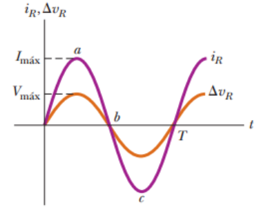
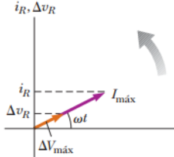

# Resumen de Física II — corriente alterna y resistencia

## Unidad Temática 9. Corriente Alterna

## Corriente Alterna. Amplitud. Fase. Frecuencia

Un circuito de CA está conformado por elementos de circuito y una fuente de
energía que proporciona un voltaje alterno v. Este voltaje, que varía con el
tiempo, está descrito por

```math
\Delta v=\Delta V_{\mathrm{máx}}\mathop{\mathrm{sen}}\nolimits\omega t
```

donde $`V_{max}`$ es el máximo voltaje de salida de la fuente de CA, o la
amplitud de voltaje. El voltaje es positivo durante una mitad del ciclo y
negativo durante la otra mitad. De la misma manera, la corriente en cualquier
circuito conductor para una fuente de CA es una corriente alternante que también
varía senoidalmente con el tiempo.

La frecuencia angular ω está dada por

```math
\omega=2\pi f=\frac{2\pi}T
```

donde f es la frecuencia de la fuente y T el periodo. La fuente determina la
frecuencia de la corriente en cualquier circuito conectado a ella.

## Comportamiento de la resistencia con la corriente alterna

Considere un circuito CA simple formado por un resistor y una fuente de CA. En
cualquier instante, la suma algebraica de los voltajes alrededor de una espira
cerrada en un circuito debe ser cero, por lo tanto

```math
\Delta v-i_RR=0
```

Al reagrupar esta expresión y sustituir
$`V_{max}\mathop{\mathrm{sen}}\nolimits\omega t`$ por v la corriente instantánea
en el resistor es

```math
i_R=\frac{\Delta v}R=\frac{\Delta V_{\mathrm{máx}}}R\mathop{\mathrm{sen}}\nolimits\omega t=I_{\mathrm{máx}}\mathop{\mathrm{sen}}\nolimits\omega t
```

donde Imáx es la corriente máxima:

```math
I_{\mathrm{máx}}=\frac{\Delta V_{\mathrm{máx}}}R
```

El voltaje instantáneo a través del resistor es

```math
\Delta v_R=i_RR=I_{\mathrm{máx}}R\mathop{\mathrm{sen}}\nolimits\omega t
```

En la gráfica del voltaje y la corriente en función del tiempo para este
circuito, en el punto a, la corriente tiene un valor máximo en la dirección
positiva. Entre los puntos a y b, la corriente decrece en magnitud. En b, la
corriente es por el momento cero; por lo tanto empieza a aumentar en la
dirección negativa entre los puntos b y c. En c, la corriente ha llegado a su
valor máximo en la dirección negativa.

La corriente y el voltaje están sincronizados entre sí porque ambos varían como
sen ωt y alcanzan sus valores máximos al mismo tiempo. Se dice que están en
fase.



Un diagramas de fasores es una gráfica que está compuesta por vectores cuya
longitud es proporcional al valor máximo de la variable que representa y que
gira en sentido contrario a las manecillas del reloj con una rapidez angular
igual a la frecuencia angular asociada con la variable. La proyección del fasor
sobre el eje vertical representa el valor instantáneo de la cantidad que
representa.

Para el circuito resistivo sencillo el valor promedio de la corriente en todo un
ciclo es cero, es decir, la corriente se mantiene en la dirección positiva el
mismo tiempo y a la misma magnitud que en la dirección negativa.



## Procedencia y observaciones

- Original: `2015/Resumen-Fisca-2.pdf`, páginas [46, 47]; sectores delimitados
  por encabezados. SHA-256:
  `b9903f972224365c1a74b5d2732c9a34675c9b719da4c9c2d28e4a0f34e0b0cc`.
- PyMuPDF4LLM, Poppler y cotejo visual completo de los sectores; ecuaciones de
  imagen transcritas a LaTeX, figuras originales preservadas.
- Se conserva «Un diagramas» del original.
