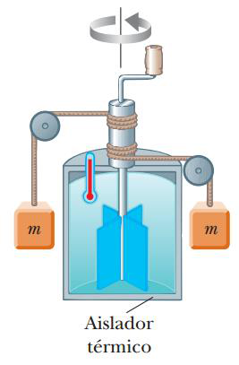

# Resumen de Física II — calor, equivalente mecánico y capacidad calorífica

## Calor

La energía interna es toda la energía de un sistema que se asocia con sus
componentes microscópicos, átomos y moléculas, cuando se ve desde un marco de
referencia en reposo respecto del centro de masa del sistema. La energía interna
incluye la energía cinética del movimiento aleatorio traslacional, rotacional y
vibratorio de las moléculas; la energía potencial vibratoria asociada con
fuerzas entre los átomos en las moléculas; y la energía potencial eléctrica
asociada con fuerzas entre moléculas.

El **calor** es la transferencia de energía a través de la frontera de un
sistema debida a una diferencia de temperatura entre el sistema y sus
alrededores.

La caloría (cal), se define como la cantidad de transferencia de energía
necesaria para elevar la temperatura de 1 g de agua de 14.5°C a 15.5°C. La
unidad térmica británica (Btu), es la cantidad de transferencia de energía que
se requiere para elevar la temperatura de 1 lb de agua de 63°F a 64°F.

## El equivalente mecánico del calor



Cuando una fuerza no conservativa está presente en un sistema mecánico, la
energía mecánica en el sistema no se conserva, esta se transforma en energía
interna. Considere un contenedor de agua térmicamente aislado. Sobre el agua se
invierte trabajo mediante una rueda de paletas giratoria, que se impulsa
mediante bloques que caen con una rapidez constante. Si la pérdida de energía en
los cojinetes y a través de las paredes es despreciable, la pérdida en energía
potencial del sistema bloques-Tierra mientras los bloques caen es igual al
trabajo invertido por la rueda de paletas sobre el agua. Si los dos bloques caen
una distancia h, la pérdida de energía potencial es 2mgh, donde m es la masa de
un bloque; esta energía hace que la temperatura del agua aumente debido a la
fricción entre las paletas y el agua. Al variar las condiciones del experimento,
Joule encontró que la pérdida en energía mecánica es proporcional al producto de
la masa del agua y el aumento en la temperatura del agua. La constante de
proporcionalidad que encontró fue 4.186 J/g °C. Por lo tanto, 4.18 J de energía
mecánica elevan la temperatura de 1 g de agua en 1°C. Siendo este valor adoptado
como una caloría. 1 cal = 4.186 J

## Capacidad Calorífica y Calor Específico

La cantidad de energía requerida para elevar la temperatura de una masa
determinada de la sustancia una cierta cantidad varía de una sustancia a otra.

La **capacidad calórica** C de una muestra particular se define como la cantidad
de energía necesaria para elevar la temperatura de dicha muestra en 1°C. Si la
energía Q produce un cambio $`\Delta T`$ en la temperatura de una muestra,
tenemos

```math
Q=C\Delta T
```

El **calor específico** c de una sustancia es la capacidad térmica por unidad de
masa. Por lo tanto, si a una muestra de una sustancia con masa m se le
transfiere energía Q y la temperatura de la muestra cambia en $`\Delta T`$ , el
calor específico de la sustancia es

```math
c=\frac Q{m\Delta T}
```

Mientras mayor sea el calor específico de un material, más energía se debe
agregar a una masa determinada del material para causar un cambio particular de
temperatura. La energía Q transferida entre una muestra de masa m de un
material, para un cambio de temperatura \$T es

```math
Q=mc\Delta T
```

## Procedencia y observaciones

- Original: `2015/Resumen-Fisca-2.pdf`, páginas [74, 75]; sectores delimitados
  por encabezados. SHA-256:
  `b9903f972224365c1a74b5d2732c9a34675c9b719da4c9c2d28e4a0f34e0b0cc`.
- PyMuPDF4LLM, Poppler y cotejo visual completo de los sectores; ecuaciones de
  imagen transcritas a LaTeX, figuras originales preservadas.
- La figura de Joule omitida por la extracción se recupera del PDF. Se conservan
  los valores4.186 y4.18 y el texto literal `$T` en página75.
