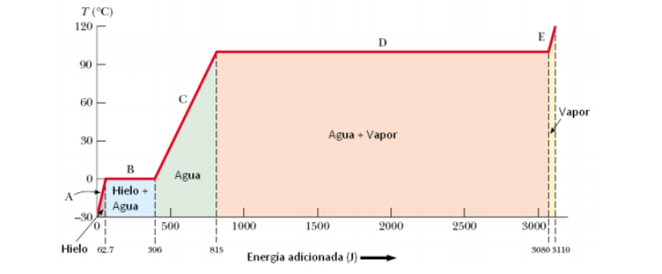

# Resumen de Física II — calor latente

Cuando una sustancia cambia de una fase a otra, la transferencia de energía no
resulta en un cambio de temperatura. Todos esos cambios de fase incluyen un
cambio en la energía interna del sistema pero no un cambio en su temperatura.

Si se requiere transferir una cantidad Q de energía para cambiar la fase de una
masa m de una sustancia, el calor latente de la sustancia se define como

```math
L=\frac Qm
```

El valor de L para una sustancia depende de la naturaleza del cambio de fase,
así como de las propiedades de la sustancia. La energía requerida para cambiar
la fase de una masa dada m de una sustancia pura es

```math
Q=\pm mL
```

El calor latente de fusión Lf es entre las fases solido-liquido, y calor latente
de vaporización Lv se da entre las fases liquido-gaseoso.

Considere la energía requerida para convertir un cubo de hielo de 1.00 g de
-30.0°C a vapor a 120.0°C



## Procedencia y observaciones

- Original: `2015/Resumen-Fisca-2.pdf`, páginas [75]; sectores delimitados por
  encabezados. SHA-256:
  `b9903f972224365c1a74b5d2732c9a34675c9b719da4c9c2d28e4a0f34e0b0cc`.
- PyMuPDF4LLM, Poppler y cotejo visual completo de los sectores; ecuaciones de
  imagen transcritas a LaTeX, figuras originales preservadas.
- Se conserva el ejemplo de1g de hielo sin resolver ni agregar pasos; la gráfica
  original contiene sus valores y fases.
