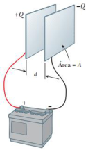
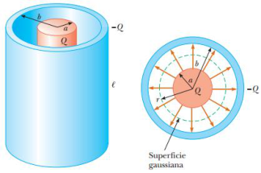
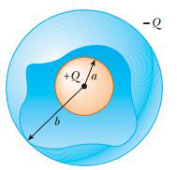

# Resumen de Física II — capacidad y geometrías de condensadores

Unidad Temática 3. Capacidad. Propiedades Eléctricas de la Materia

## Capacidad eléctrica

Un capacitor consiste un dos conductores de área A, separados por una distancia
d. Al aplicar una diferencia de potencial $`\Delta V`$ al capacitor este
comienza a cargarse hasta que las placas alcancen el mismo potencial eléctrico
que la batería. La capacitancia C de un capacitor se define como la relación de
la magnitud de la carga en cualquiera de los conductores a la magnitud de la
diferencia de potencial entre dichos conductores



```math
C\equiv\frac Q{\Delta V}
```

la capacitancia siempre es una cantidad positiva, en unidades del SI la
capacitancia se expresa en coulombs/volt llamada farad (F).

## Condensadores: planos

Dos placas metálicas paralelas de igual área A están separadas por una distancia
d, una placa tiene una carga +Qy la otra tiene una carga –Q. La densidad de
carga superficial en cada placa es s= Q/A. Las placas están muy juntas que se
puede suponer que el campo eléctrico es uniforme entre las placas y cero en
cualquier otra parte. El valor del campo eléctrico entre las placas es

```math
E=\frac\sigma{\epsilon_0}=\frac Q{\epsilon_0A}
```

Ya que el campo entre las placas es uniforme, la magnitud de la diferencia de
potencial entre las placas es igual a Ed, por lo tanto,

```math
\Delta V=Ed=\frac{Qd}{\epsilon_0A}
```

Al sustituir este resultado en la ecuación de capacitancia, se encuentra que C
es

```math
C=\frac Q{\Delta V}=\frac Q{Qd/\epsilon_0A}
```

```math
C=\frac{\epsilon_0A}d
```

La capacitancia de un capacitor de placas paralelas es proporcional al área de
sus placas e inversamente proporcional a la separación de las placas.

## Cilíndricos

Un conductor cilíndrico sólido, de radio ay carga Q, es coaxial con una cubierta
cilíndrica de grosor despreciable, radio b> ay carga –Q. Partimos de la ecuacion
de la diferencia de potencial.

```math
V_b-V_a=-\int_a^b\vec E\cdot d\vec s
```



Aplicamos la ecuación para el campo eléctrico fuera de una distribución de carga
con simetría cilíndrica

```math
V_b-V_a=-\int_a^b E_r\,dr=-2k_e\lambda\int_a^b\frac{dr}r=-2k_e\lambda\ln\left(\frac ba\right)
```

Sustituimos $`\lambda=Q/l`$ y remplazamos $`\Delta V`$ por el valor obtenido

```math
C=\frac Q{\Delta V}=\frac Q{(2k_eQ/\ell)\ln(b/a)}=\frac\ell{2k_e\ln(b/a)}
```

## Esféricos

Un capacitor esférico consiste en una cubierta conductora esférica de radio b y
carga –Q concéntrico con una esfera conductora más pequeña de radio a y carga Q.
Partimos de la ecuación de la diferencia de potencial.

```math
V_b-V_a=-\int_a^b\vec E\cdot d\vec s
```



Aplicamos el resultado para el campo eléctrico fuera de una distribución de
carga con simetría esférica

```math
V_b-V_a=-\int_a^b E_r\,dr=-k_eQ\int_a^b\frac{dr}{r^2}=\left.k_eQ\left[\frac1r\right]\right|_a^b
```

```math
k_eQ\left(\frac1b-\frac1a\right)=k_eQ\frac{a-b}{ab}
```

y emplazamos este valor en la ecuación de capacitancia

```math
C=\frac Q{\Delta V}=\frac Q{|V_b-V_a|}=\frac{ab}{k_e(b-a)}
```

## Procedencia y observaciones

- Original: `2015/Resumen-Fisca-2.pdf`, página12 y comienzo13 hasta «Asociación
  de condensadores». SHA-256:
  `b9903f972224365c1a74b5d2732c9a34675c9b719da4c9c2d28e4a0f34e0b0cc`.
- PyMuPDF4LLM, Poppler y cotejo visual completo de ambos sectores. Tres figuras
  originales; ecuaciones transcritas como LaTeX. Se conservan los signos y
  barras de fracción originales, incluido Qd/ε0A en el paso intermedio.
- Se mantienen «consiste un», «radio ay», «b> ay», «emplazamos», «ecuacion» y
  s=Q/A del texto; las fórmulas usan σ. No se corrige el texto por deducción.
- La igualdad esférica del original continúa en otro fragmento sin repetir el
  signo igual; se preservan sus dos fragmentos como bloques consecutivos.
