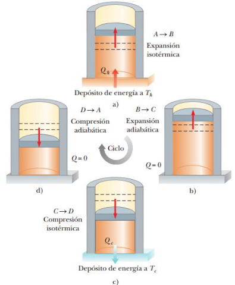

# Resumen de Física II — ciclo de Carnot y rendimiento

Un proceso es reversible cuando el sistema, sometido a un proceso, puede
regresar a sus condiciones iniciales a lo largo de la misma trayectoria sobre un
diagrama PV, y cada punto a lo largo de dicha trayectoria está en estado de
equilibrio. Un proceso que no satisface estos requisitos es irreversible.

La máquina de Carnot es una máquina teórica que funciona en un ciclo reversible
ideal, llamado ciclo de Carnot, entre dos depósitos de energía, siendo esta la
máquina más eficiente posible. Todas las máquinas reales son menos eficientes
que la máquina de Carnot porque no funcionan a través de un ciclo reversible.



1. El proceso A→B es una expansión isotérmica a temp. Th. El gas se coloca en
   contacto térmico con un depósito de energía a temperatura Th. Durante la
   expansión, el gas absorbe energía Qh del depósito a través de la base del
   cilindro y realiza trabajo $`W_{AB}`$ para elevar el pistón.

1. En el proceso B→C, la base del cilindro se sustituye por una pared
   térmicamente no conductora y el gas se expande adiabáticamente (no entra ni
   sale energía del sistema por calor). Durante la expansión, la temperatura del
   gas disminuye de Th a Tc y el gas realiza trabajo $`W_{BC}`$ para elevar el
   pistón.

1. En el proceso C→D, el gas se coloca en contacto térmico con un depósito de
   energía a temp. Tc y se comprime isotérmicamente a temp. Tc. Durante este
   tiempo, el gas expulsa energía Qc al depósito y el trabajo que el pistón
   realiza sobre el gas es $`W_{CD}`$ .

1. En el proceso final D→A, la base del cilindro se sustituye por una pared no
   conductora y el gas se comprime adiabáticamente. La temperatura del gas
   aumenta a Th y el trabajo que el pistón realiza sobre el gas es $`W_{DA}`$ .

La eficiencia térmica de la máquina está dada por

```math
e=\frac{W_{\mathrm{máq}}}{|Q_h|}=\frac{|Q_h|-|Q_c|}{|Q_h|}=1-\frac{|Q_c|}{|Q_h|}
```

En una máquina de Carnot se demuestra que $`|Q_c|/|Q_h|`$ es igual a $`T_c/T_h`$
, por lo tanto, la eficiencia térmica de una máquina de Carnot es

```math
e_C=1-\frac{T_c}{T_h}
```

Una máquina térmica con ciclo de Carnot en reversa constituye la bomba de calor
más efectiva posible. El máximo COP para una bomba de calor en modo
calentamiento es

```math
\mathrm{COP}_C\;(\text{modo de calentamiento})=\frac{|Q_h|}W=\frac{|Q_h|}{|Q_h|-|Q_c|}=\frac1{1-\frac{|Q_c|}{|Q_h|}}=\frac1{1-\frac{T_c}{T_h}}=\frac{T_h}{T_h-T_c}
```

```math
\mathrm{COP}_C\;(\text{modo de enfriamiento})=\frac{T_c}{T_h-T_c}
```

## Procedencia y observaciones

- Original: `2015/Resumen-Fisca-2.pdf`, páginas [79]; sectores delimitados por
  encabezados. SHA-256:
  `b9903f972224365c1a74b5d2732c9a34675c9b719da4c9c2d28e4a0f34e0b0cc`.
- PyMuPDF4LLM, Poppler y cotejo visual completo de los sectores; ecuaciones de
  imagen transcritas a LaTeX, figuras originales preservadas.
- La cadena de COP de calentamiento se recompone a partir de los dos fragmentos
  que la extracción invirtió; se preservan sus cinco igualdades y los cuatro
  procesos enumerados.
