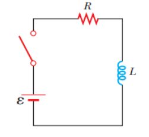
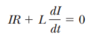

# Resumen de Física II — circuito LR

Un inductor en un circuito se opone a los cambios en la corriente dentro de
dicho circuito. Considere un circuito que contiene una batería un resistor y un
inductor. Suponga que el interruptor se cierra en t=0. La corriente en el
circuito comienza a aumentar y en el inductor se induce una fuerza
contraelectromotriz que se opone a la corriente creciente. Al aplicar la regla
de la espira de Kirchhoff a este circuito, recorriendo el circuito en el sentido
de las manecillas del reloj, obtenemos (1)



```math
\mathcal E-IR-L\frac{dI}{dt}=0
```

Ahora buscaremosr una solución para esta ecuación diferencial, que representa la
corriente en el circuito en función del tiempo. Para esto hacemos un cambio de
variables, haciendo que $`x=(\mathcal E/R)-I`$ , y $`dx=-dl`$ quedándonos la
ecuacion

```math
x+\frac LR\frac{dx}{dt}=0
```

Reordenando e integrando esta última expresión, tenemos

```math
\int_{x_0}^x\frac{dx}x=-\frac RL\int_0^t dt
```

```math
\ln\frac x{x_0}=-\frac RL t
```

donde x0 es el valor de x en el tiempo t=0. Si toma el antilogaritmo de este
resultado, obtiene

```math
x=x_0e^{-Rt/L}
```

Porque I=0 en t=0, observe a partir de la definición de x que
$`x_0=\mathcal E/R`$ . En consecuencia, esta última expresión es equivalente a

```math
\frac{\mathcal E}R-I=\frac{\mathcal E}R e^{-Rt/L}
```

```math
I=\frac{\mathcal E}R(1-e^{-Rt/L})
```

Esta expresión muestra cómo la corriente es afectada por el inductor. La
corriente no aumenta de manera instantánea hasta su valor de equilibrio final
cuando el interruptor se cierra, sino que aumenta de acuerdo con una función
exponencial. Si retira la inductancia del circuito, al hacer que L tienda a
cero, el término exponencial será cero y en este caso la corriente no depende
del tiempo; en ausencia de la inductancia la corriente aumenta de manera
instantánea a su valor de equilibrio final.

También escriba esta expresión como

```math
I=\frac{\mathcal E}R(1-e^{-t/\tau})
```

donde la constante t es la constante de tiempo del circuito RL:

```math
\tau=\frac LR
```

Físicamente, t es el intervalo de tiempo necesario para que la corriente en el
circuito alcance el 63.2% de su valor final.

Al inicio la corriente aumenta con mucha rapidez y después se acerca
gradualmente al valor de equilibrio conforme t tiende a infinito. Si tomando la
primera derivada de I con respecto al tiempo tenemos

Este resultado muestra que la rapidez de variación de la corriente es máximo en
t=0 y disminuye exponencialmente hasta cero conforme t tiende a infinito.

Ahora considere este circuito RL, el cual en un principio el interruptor estaba
conectado a a estuvo conectado a la batería el tiempo suficiente para que la
corriente alcance su valor de equilibrio., y luego el interruptor se movió a b.

Como no está la fem hacemos Ɛ=0 en la ecuación (1) y obtenemos



```math
IR+L\frac{dI}{dt}=0
```

La solución de esta ecuación diferencial es

```math
I=\frac{\mathcal E}R e^{-t/\tau}=I_i e^{-t/\tau}
```

donde Ɛ es la fem de la batería e $`I_i=`$ es la corriente inicial en el
instante en que el interruptor se coloca en b. Si el circuito no incluyera un
inductor, la corriente se reduciría de inmediato a cero al retirar la batería.

## Procedencia y observaciones

- Original: `2015/Resumen-Fisca-2.pdf`, páginas [39, 40]; sectores delimitados
  por encabezados. SHA-256:
  `b9903f972224365c1a74b5d2732c9a34675c9b719da4c9c2d28e4a0f34e0b0cc`.
- PyMuPDF4LLM, Poppler y cotejo visual completo de los sectores; ecuaciones de
  imagen transcritas a LaTeX, diagramas originales preservados.
- Se conservan «buscaremosr», dx=−dl del cambio de variable, t del texto frente
  a τ de las fórmulas y el campo incompleto Ii=. El original no contiene la
  fórmula después de «Si tomando la primera derivada… tenemos»; no se inventa.
