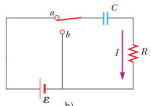
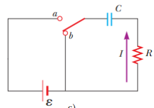

# Resumen de Física II — circuitos RC

## Carga de un capacitor



Se supone que el capacitor de este circuito está inicialmente descargado. No
existirá corriente en tanto el interruptor esté abierto. No obstante, si el
interruptor se mueve hacia a en t=0, la carga comenzará a fluir, estableciendo
una corriente en el circuito, y el capacitor comenzará a cargarse.

Conforme las placas se cargan, la diferencia de potencial aplicada al capacitor
aumenta hasta que se alcanza la carga máxima y no circula mas corriente en el
circuito. Ahora aplicamos la regla de la espira de Kirchhoff al circuito
recorriendo la espira en el sentido de las manecillas del reloj, da

```math
\mathcal E-\frac qC-IR=0
```

donde q/C es la diferencia de potencial aplicada al capacitor e IR es la
diferencia de potencial aplicada al resistor y Ɛ es la diferencia de potencial
de la batería. En el instante en que se cierra el interruptor (t=0), la carga
del capacitor es igual a cero, la corriente que aparece, es la corriente inicial
$`I_i`$ y tiene el valor máximo

```math
I_i=\frac{\mathcal E}R\quad(\text{corriente en }t=0)
```

Cuando el capacitor ha sido cargado a su valor máximo Q, las cargas dejan de
fluir y la corriente en el circuito es igual a cero. Al sustituir I=0 en la
primera ecuación se obtiene la carga máxima del capacitor:

```math
Q=C\mathcal E\quad(\text{carga máxima})
```

Ahora obtendremos las expresiones analíticas que muestren cómo la carga y la
corriente dependen del tiempo. Existe una única corriente en el circuito y esta
es igual a la rapidez de variación de la carga del capacitor $`I=dq/dt`$ por lo
tanto

```math
\frac{dq}{dt}=\frac{C\mathcal E}{RC}-\frac q{RC}=-\frac{q-C\mathcal E}{RC}
```

Multiplique por dt y divida entre q - CƐ

```math
\frac{dq}{q-C\mathcal E}=-\frac1{RC}\,dt
```

Integre esta expresión, donde q=0 en t=0,

```math
\int_0^q\frac{dq}{q-C\mathcal E}=-\frac1{RC}\int_0^t dt
```

```math
\ln\left(\frac{q-C\mathcal E}{-C\mathcal E}\right)=-\frac t{RC}
```

A partir de la definición de los logaritmos naturales, escriba esta expresión
como sigue

```math
q(t)=C\mathcal E(1-e^{-t/RC})=Q(1-e^{-t/RC})
```

donde es la base de los logaritmos naturales. Puede encontrar la corriente de
carga diferenciando la ecuación anterior respecto al tiempo. Utilizando I=dq/dt,
encuentre que

```math
I(t)=\frac{\mathcal E}R e^{-t/RC}
```

La carga es igual a cero en t=0 y se acerca al valor máximo CƐ en t → ∞. La
corriente tiene un valor máximo $`I_i=\mathcal E/R`$ en t=0, y decae
exponencialmente hasta cero en t → ∞. La cantidad RC, que aparece en los
exponentes de las ecuaciones, se llama la constante de tiempo τ del circuito.

```math
\tau=RC
```

## Descarga de un capacitor

Imagine que el capacitor en la figura está completamente cargado y el
interruptor ahora se mueve a la posición b en t=0, y este comienza a descargarse
a través del resistor. Ahora aplicamos la regla de la espira de Kirchhoff al
circuito recorriendo la espira en el sentido de las manecillas del reloj, da

```math
-\frac qC-IR=0
```



Cuando se sustituye I=dq/dt en esta expresión, se convierte en

```math
-R\frac{dq}{dt}=\frac qC
```

```math
\frac{dq}q=-\frac1{RC}\,dt
```

Al integrar esta expresión con q= Q en t= 0 se obtiene

```math
\int_Q^q\frac{dq}q=\frac1{RC}\int_0^t dt
```

```math
\ln\left(\frac qQ\right)=-\frac t{RC}
```

```math
q(t)=Qe^{-t/RC}
```

Al diferenciar esta ecuación respecto al tiempo se obtiene la corriente
instantánea como función del tiempo:

```math
I(t)=-\frac Q{RC}e^{-t/RC}
```

donde $`Q/RC=I_i`$ es la corriente inicial. El signo negativo indica que,
conforme el capacitor se descarga, la dirección de la corriente es opuesta a su
dirección cuando el capacitor se estaba cargando. Tanto la carga en el capacitor
como la corriente decaen exponencialmente a una cantidad caracterizada por la
constante de tiempo τ= RC.

## Procedencia y observaciones

- Original: `2015/Resumen-Fisca-2.pdf`, páginas [25, 26]; sectores delimitados
  por encabezados. SHA-256:
  `b9903f972224365c1a74b5d2732c9a34675c9b719da4c9c2d28e4a0f34e0b0cc`.
- PyMuPDF4LLM, Poppler y cotejo visual completo de los sectores; fórmulas de
  imagen transcritas a LaTeX, diagramas originales conservados.
- Se conserva el signo positivo del coeficiente 1/RC en la integral de descarga,
  aunque la ecuación previa y el logaritmo posterior llevan negativo. El
  original dice «donde es la base» sin e visible; no se completa.
