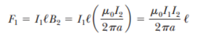

# Resumen de Física II — fuerza entre conductores paralelos

Imagine dos alambres largos, rectos, paralelos, separados por una distancia a y
que llevan corrientes I1 e I2 en la misma dirección. Es posible determinar la
fuerza ejercida sobre un alambre debido al campo magnético desplegado por el
otro alambre. El alambre 2 (fuente), que lleva una corriente I2 crea un campo
magnético B2 en la ubicación del alambre 1 (prueba). La dirección de B2 es
perpendicular al alambre 1. La fuerza magnética en un tramo de longitud _l_ del
alambre 1 es $`F_1=I_1L\times B`$ . Donde L y B son perpendiculares.

```math
F_1=I_1\ell B_2=I_1\ell\left(\frac{\mu_0 I_2}{2\pi a}\right)=\frac{\mu_0 I_1I_2}{2\pi a}\ell
```



La dirección de F1 es hacia el alambre 2. Si se calcula el campo establecido por
el alambre 1 sobre el alambre 2, se encontrará que la fuerza que actúa sobre el
alambre 2 es de igual magnitud y de dirección opuesta a F1. En consecuencia,
conductores paralelos que llevan corrientes en una misma dirección se atraen, y
conductores paralelos que llevan corrientes en direcciones opuestas se repelen.

Debido a que es igual la magnitud de las fuerzas en ambos alambres, simplemente
se señala la magnitud de la fuerza magnética entre alambres como FB

```math
\frac{F_B}\ell=\frac{\mu_0 I_1I_2}{2\pi a}
```

La fuerza entre dos alambres paralelos es utilizada para definir el amperede
esta manera:

“Cuando $`2\times10^{-7}`$ N/m es la magnitud de la fuerza por unidad de
longitud presente entre dos alambres largos y paralelos que llevan corrientes
idénticas y están separa-dos 1 m, se define la corriente en cada alambre como 1
A”.

## Procedencia y observaciones

- Original: `2015/Resumen-Fisca-2.pdf`, páginas [32, 33]; sectores delimitados
  por encabezados. SHA-256:
  `b9903f972224365c1a74b5d2732c9a34675c9b719da4c9c2d28e4a0f34e0b0cc`.
- PyMuPDF4LLM, Poppler y cotejo visual completo de los sectores; ecuaciones de
  imagen transcritas a LaTeX, figuras originales preservadas.
- La definición histórica del ampere se conserva como parte del documento, con
  «amperede» y «separa-dos».
