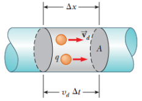
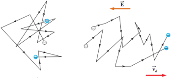

# Resumen de Física II — corriente y densidad de corriente

## Unidad Temática 4. Electrocinética

## Corriente eléctrica

Una corriente eléctrica es un flujo de carga neto a través de alguna región.
Suponga que las cargas tienen un movimiento perpendicular a una superficie A, la
corriente es la proporción a la cual circula la carga a través de esta
superficie. Si $`\Delta Q`$ es la cantidad de carga que pasa a través de esta
superficie en un intervalo de tiempo $`\Delta t`$ , la corriente promedio
$`I_{\mathrm{prom}}`$ es igual a la carga que pasa a través de A por unidad de
tiempo:

```math
I_{\mathrm{prom}}=\frac{\Delta Q}{\Delta t}
```

Si la proporción a la que circula la carga varía en el tiempo, entonces, la
corriente también varía en el tiempo; se define de la corriente instantánea I
como

```math
I=\frac{dQ}{dt}
```

La unidad del SI para la corriente es el ampere(A) C/s.

La dirección de la corriente es la opuesta a la dirección del flujo de los
electrones. A una carga en movimiento (positiva o negativa) se la denomina
portador de carga móvil.

Considere una sección de un conductor de área de sección transversal A y
longitud $`\Delta x`$ , cuyo volumen es $`A\Delta x`$ . Si n representa el
número de portadores de carga móviles por cada unidad de volumen, el total de
portadores en esta sección es $`nA\Delta x`$ . Por lo tanto, la carga total
$`\Delta Q`$ de esta sección es igual a

```math
\Delta Q=(nA\Delta x)q
```



donde q es la carga de cada portador. Si los portadores se mueven con una
rapidez $`v_d`$ , el desplazamiento que experimentan en la dirección x en un
intervalo de tiempo $`\Delta t`$ es $`\Delta x=v_d\Delta t`$ . Por lo tanto
$`\Delta Q`$ se escribe de la forma

```math
\Delta Q=(nAv_d\Delta t)q
```

Dividimos ambos lados de esta ecuación entre $`\Delta t`$ , y vemos que la
corriente promedio en el conductor es

```math
I_{\mathrm{prom}}=\frac{\Delta Q}{\Delta t}=nqv_dA
```

La rapidez de los portadores de carga $`v_d`$ es una rapidez promedio que se
conoce como rapidez de arrastre. En un conductor los electrones presentan un
movimiento irregular y aleatorio, pero al establecer una diferencia de potencial
se produce un campo eléctrico que los desplaza.



## Densidad de corriente

Piense en un conductor de área de sección transversal A que transporta una
corriente I. La densidad de corriente J en el conductor se define como la
corriente por unidad de área. Dado que la corriente es $`I=nqv_dA`$ , la
densidad de corriente es igual a

```math
J=\frac IA=nqv_d
```

donde J tiene unidades en el SI de $`A/m^2`$ . Esta expresión es válida sólo si
la densidad de corriente es uniforme y sólo si la superficie del área de sección
transversal A es perpendicular a la dirección de la corriente.

Tan pronto como se mantiene una diferencia de potencial a través del conductor
se establece una densidad de corriente y un campo eléctrico. En muchos
materiales la relación de la densidad de corriente al campo eléctrico es una
constante σ que es independiente del campo eléctrico que produce la corriente.

```math
J=\sigma E
```

donde la constante de proporcionalidad σ se conoce como conductividad del
conductor.

## Procedencia y observaciones

- Original: `2015/Resumen-Fisca-2.pdf`, páginas [18, 19]; sectores delimitados
  por encabezados. SHA-256:
  `b9903f972224365c1a74b5d2732c9a34675c9b719da4c9c2d28e4a0f34e0b0cc`.
- PyMuPDF4LLM, Poppler y cotejo visual completo de los sectores; fórmulas de
  imagen transcritas a LaTeX y figuras originales preservadas.
- Se conserva «se define de la corriente» y la unidad ampere(A) C/s del
  original.
