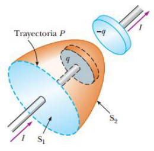

# Resumen de Física II — corriente de desplazamiento

## Unidad Temática 10. Ecuaciones de Maxwell

## Corriente de desplazamiento, corrección a la ley de Ampere

Consideremos un capacitor cargándose con el de la figura. Cuando una corriente
de conducción está presente, la carga sobre la placa positiva cambia pero no
existe corriente de conducción en el espacio entre las placas. Ahora considere
las dos superficies S1 y S2, limitadas por la misma trayectoria. La ley de
Ampère establece que $`\oint B\cdot ds`$ alrededor de esta trayectoria debe ser
igual a $`\mu_0I`$ , donde I es la corriente total a través de cualquier
superficie limitada por la trayectoria P. Si consideramos la frontera de S1
$`\oint B\cdot ds=\mu_0I`$ porque la corriente de conducción I pasa a través de
S1. Pero en la frontera de S2 $`\oint B\cdot ds=0`$ porque no pasa corriente de
conducción a través de S2, surgiendo una discontinuidad de la corriente.



Maxwell resolvió este problema postulando un término adicional a la ley de
Ampère, que incluye un factor llamado corriente de desplazamiento $`I_d`$ que se
define como

```math
I_d=\epsilon_0\frac{d\Phi_E}{dt}
```

donde $`\in_0`$ es la permitividad del espacio libre y $`\phi_E`$ es el flujo
eléctrico través de la superficie limitada por la trayectoria. Con este nuevo
término Id se expresa la forma general de la ley de Ampère como

```math
\oint\vec B\cdot d\vec s=\mu_0(I+I_d)=\mu_0I+\mu_0\epsilon_0\frac{d\Phi_E}{dt}
```

El flujo eléctrico a través de S2 es $`\phi_E=\int E\cdot dA=EA`$ , donde A es
el área de las placas del capacitor y E es el campo electro, donde
$`E=q/(\in_0 A)`$ . Por lo tanto el flujo eléctrico a través de S2 es

```math
\Phi_E=EA=\frac q{\epsilon_0}
```

Por esto, la corriente de desplazamiento a través de S2 es

```math
I_d=\epsilon_0\frac{d\Phi_E}{dt}=\frac{dq}{dt}
```

Es decir, la corriente de desplazamiento Id es igual a la corriente en el
conductor y tiene su origen físico en el campo eléctrico variable en el tiempo.

## Procedencia y observaciones

- Original: `2015/Resumen-Fisca-2.pdf`, páginas [53]; sectores delimitados por
  encabezados. SHA-256:
  `b9903f972224365c1a74b5d2732c9a34675c9b719da4c9c2d28e4a0f34e0b0cc`.
- PyMuPDF4LLM, Poppler y cotejo visual completo de los sectores; ecuaciones de
  imagen transcritas a LaTeX, figuras originales preservadas.
- Se conserva «con el de la figura», «campo electro» y ∈0 del texto frente a ε0
  de las ecuaciones.
