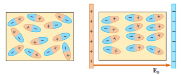

# Resumen de Física II — dieléctricos y polarización

Un dieléctrico es un material no conductor, como el hule, el vidrio o el papel
encerado. Consideremos un capacitor de placas paralelas que, sin dieléctrico,
tiene una carga $`Q_0`$ y una capacitancia $`C_0`$ . La diferencia de potencial
en las terminales del capacitor es $`V_0=Q_0/C_0`$ . Si ahora se inserta un
material dieléctrico entre las placas, el voltaje entre las placas disminuye un
valor V. Los voltajes con y sin dieléctrico están relacionados mediante el
factor k como sigue:

```math
\Delta V=\frac{\Delta V_0}{\kappa}
```

se ve que $`k\gt1`$. El factor adimensional k se llama constante dieléctrica del
material y varía de un material a otro.

Ya que la carga $`Q_0`$ en el capacitor no cambia, la capacitancia debe cambiar
al valor

```math
C=\frac{Q_0}{\Delta V}=\frac{Q_0}{\Delta V_0/\kappa}=\kappa\frac{Q_0}{\Delta V_0}
```

```math
C=\kappa C_0
```

Es decir, la capacitancia aumenta en un factor k cuando el material dieléctrico
llena por completo la región entre placas. Como $`C_0=e_0A/d`$ la ecuación
anterior nos queda

```math
C=\kappa\frac{\epsilon_0A}{d}
```

Para cualquier separación d conocida, el voltaje máximo que puede aplicarse a un
capacitor sin causar una descarga depende de la resistencia dieléctrica.

## Polarización y susceptibilidad eléctrica

Al insertar un material dieléctrico entre las placas de un capacitor la carga se
mantiene constante y la diferencia de potencial en el disminuye en un factor K.
Por lo tanto, el campo eléctrico entre las placas debe reducirse en el mismo
factor. Si $`E_0`$ es el valor con vacío y E es el valor con dieléctrico,
entonces (1)

```math
E=\frac{E_0}{K}
```

Como la magnitud del campo eléctrico es menor cuando el dieléctrico está
presente, la densidad superficial de carga en las placas también debe ser menor,
pero esta no cambia, sino que en cada superficie del dieléctrico aparece una
carga inducida de signo contrario. Las cargas superficiales inducidas surgen
como resultado de la redistribución de la carga positiva y negativa dentro del
material. Este fenómeno se llama polarización.



Ahora obtendremos una relación entre esta carga superficial inducida y la carga
en las placas. Se denotará como $`\sigma_i`$ la magnitud de la carga inducida
por unidad de área en las superficies del dieléctrico. La magnitud de la
densidad superficial de carga en cada lado del capacitor es σ. La magnitud de la
carga superficial neta en cada lado del capacitor es $`(\sigma-\sigma_i)`$ . Si
el campo entre las placas es $`E=\sigma_{\mathrm{neta}}/e_0`$ . Sin el
dieléctrico y con éste, respectivamente, se tiene

```math
E_0=\frac{\sigma}{\epsilon_0}\qquad E=\frac{\sigma-\sigma_i}{\epsilon_0}
```

Al usar estas expresiones en la ecuación (1) y reordenar el resultado, se
encuentra que

```math
\sigma_i=\sigma\left(1-\frac1K\right)
```

Cuando K es muy grande, $`\sigma_i`$ es casi tan grande como $`\sigma`$ .

El producto $`Ke_0`$ se llama permitividad del dieléctrico, y se denota con e,
como K es un número puro, e y $`e_0`$ tienen las mismas unidades:

```math
\epsilon=K\epsilon_0
```

En términos de e, el campo eléctrico dentro del dieléctrico se expresa como

```math
E=\frac\sigma\epsilon
```

La capacitancia cuando hay un dieléctrico presente está dada por

```math
C=KC_0=K\epsilon_0\frac Ad=\epsilon\frac Ad
```

La densidad de energía u en un campo eléctrico para el caso en que hay un
dieléctrico presente es

```math
u=\frac12K\epsilon_0E^2=\frac12\epsilon E^2
```

## Procedencia y observaciones

- Original: `2015/Resumen-Fisca-2.pdf`, páginas [14, 15, 16]; sectores
  delimitados por encabezados. SHA-256:
  `b9903f972224365c1a74b5d2732c9a34675c9b719da4c9c2d28e4a0f34e0b0cc`.
- PyMuPDF4LLM y Poppler; cotejo visual de todos los sectores. Ecuaciones de
  imagen transcritas en LaTeX y figura original conservada.
- Se conservan k, κ y K, y e0 del texto frente a ε0 de las ecuaciones; no se
  corrige la afirmación del original sobre la densidad de carga en las placas.
