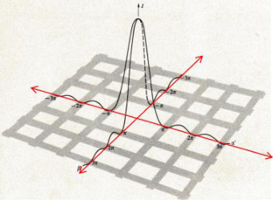
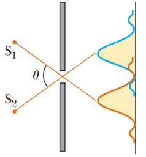
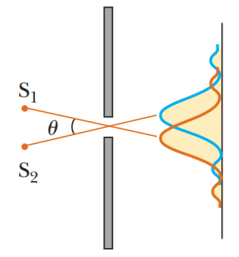
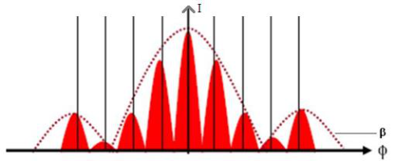
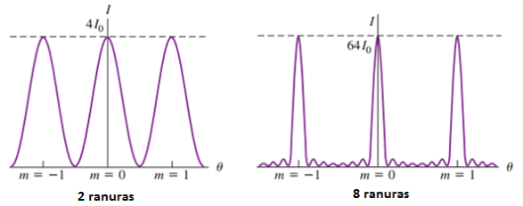

# Resumen de Física II — difracción en aberturas y múltiples ranuras

## Difracción de Fraunhofer producida por

### Una ranura rectangular

Si la rejilla es un rectángulo de lados a y b de longitud comparable, el
diagrama de difracción es la combinación de los dos diagramas, por lo tanto, la
intensidad en el punto P está dado por

```math
I_\theta=I_o\left[\frac{\mathop{\mathrm{sen}}\nolimits(\alpha/2)}{\alpha/2}\right]^2\left[\frac{\mathop{\mathrm{sen}}\nolimits(\beta/2)}{\beta/2}\right]^2
```

Donde α y β tiene los valores

```math
\alpha=\frac{\pi a\mathop{\mathrm{sen}}\nolimits(\theta)}\lambda\qquad\beta=\frac{\pi b\mathop{\mathrm{sen}}\nolimits(\theta)}\lambda
```



Donde $`I_0`$ es la intensidad registrada en x=0, y=0.

### Una abertura circular

Supongamos dos fuentes de luz puntuales no coherentes S1y S2 alejadas de una
rendija angosta de ancho a. Al no ser coherentes, no se presenta un patrón de
interferencia, pero si un patrón de difracción. uno desde S1y el otro desde S2.
Cuando el máximo central de una imagen coincide con el primer mínimo de otra
imagen, se dice que las imágenes están apenas resueltas. Si los dos máximos
centrales se sobreponen, y las imágenes no quedan resueltas (criterio de
Rayleigh).

El angulo en el cual los patrones están casi resueltos se presenta cuando



```math
\mathop{\mathrm{sen}}\nolimits\theta=\frac\lambda a
```

Como en la mayoría de las ocasiones $`\lambda\ll a`$, senϴ es pequeño y es
posible utilizar la aproximación senϴ = ϴ. Dos imágenes apenas resueltas, para
aberturas circulares de diámetro D, se presentan en el ángulo

```math
\theta_{min}=1.22\frac\lambda a
```

### Dos ranuras paralelas iguales



Cuando se tiene más de una rendija, es necesario considerar no sólo patrones de
difracción debido a las rendijas individuales, sino también los patrones de
interferencia debido a las dos rendijas. La intensidad debido a la interferencia
por dos ranuras está dada por

```math
I_\theta=I_1\cos^2(\phi)\quad\text{con}\quad\phi=\frac{\pi d\mathop{\mathrm{sen}}\nolimits(\theta)}\lambda
```

Y la intensidad debido a una ranura por la difracción es

```math
I_\theta=I_2\left[\frac{\mathop{\mathrm{sen}}\nolimits(\beta/2)}{\beta/2}\right]^2\quad\text{con}\quad\beta=\frac{\pi a\mathop{\mathrm{sen}}\nolimits(\theta)}\lambda
```

La combinación de estas dos ecuaciones establece la intensidad debido a dos
ranuras, donde participan ambos fenómenos, que es

```math
I_\theta=I_M\cos^2(\phi)\left[\frac{\mathop{\mathrm{sen}}\nolimits(\beta/2)}{\beta/2}\right]^2
```

Esta ecuación presenta el patrón de difracción de una sola rendija que actúa
como una “envolvente” para un patrón de interferencia de dos rendijas.



### Muchas ranuras

Cuando tenemos $`N\gt2`$ ranuras, sucede que los máximos grandes, llamados
máximos principales, están en la misma posición que en el caso del patrón de dos
ranuras aunque son mucho más angostos. La altura de cada máximo principal es
proporcional a $`N^2`$ y por la conservación de la energía, el ancho de cada
máximo principal debe ser proporcional a 1/N. Cuando hay N ranuras, hay (N-1)
mínimos entre cada par de los máximos principales, y se presenta un mínimo
siempre que φ sea un múltiplo entero de 2π/N, salvo cuando φ es un múltiplo
entero de 2π, en cuyo caso se tiene un máximo principal. Hay pequeños máximos
secundarios de intensidad entre los mínimos; éstos se reducen en comparación con
el máximo principal a medida que N aumenta.



## Procedencia y observaciones

- Original: `2015/Resumen-Fisca-2.pdf`, páginas [65, 66, 67]; sectores
  delimitados por encabezados. SHA-256:
  `b9903f972224365c1a74b5d2732c9a34675c9b719da4c9c2d28e4a0f34e0b0cc`.
- PyMuPDF4LLM, Poppler y cotejo visual completo de los sectores; ecuaciones de
  imagen transcritas a LaTeX, figuras originales preservadas.
- Se conserva a en el denominador de θmin aunque el párrafo llama D al diámetro,
  y las definiciones de α,β del original, sin añadir el factor2 que aparece en
  otra sección.
