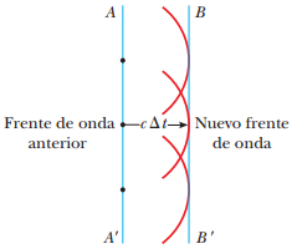
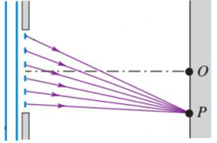
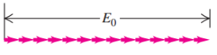
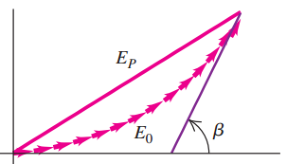
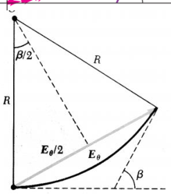
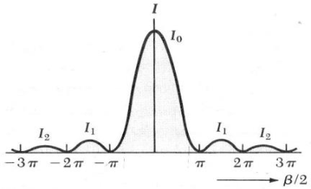

# Resumen de Física II — difracción, Huygens e intensidad de una ranura

## Unidad Temática 13. Difracción

De acuerdo con la óptica geométrica, cuando un objeto opaco se interpone entre
una fuente puntual de luz y una pantalla la sombra del objeto forma una línea
perfectamente definida. Sin embargo, la naturaleza ondulatoria de la luz origina
un efecto de interferencia que se forman en tales situaciones bajo el encabezado
de difracción.

## Principio de Huygens

Huygens supuso que todo punto de un frente de onda puede considerarse la fuente
de ondas secundarias que se dispersan en todas direcciones con rapidez igual a
la rapidez de la propagación de la onda original. El nuevo frente de onda en un
momento posterior se obtiene entonces construyendo una superficie tangente a las
ondas secundarias, conocida como envolvente de esas ondas.



## Difracción de Fraunhofer y de Fresnel

Cuando la fuente puntual de luz como la pantalla están relativamente cerca del
obstáculo que forma el patrón de difracción, decimos que es una difracción de
campo cercano o difracción de Fresnel. Si la fuente, el obstáculo y la pantalla
están lo suficientemente alejados para considerar paralelas todas las líneas de
la fuente al obstáculo y del obstáculo a un punto, el fenómeno se describe como
una difracción de campo lejano o difracción de Fraunhofer.



## Función de distribución de la intensidad

Imaginamos un frente de onda plano en la ranura, subdividido en un gran número
de tiras. Superponemos las contribuciones de las onditas de Huygens provenientes
de todas las tiras en un punto P sobre una pantalla distante, a un ángulo ϴ con
respecto a la normal al plano de la ranura. Para ello, representamos por medio
de un fasor el campo E sinusoidalmente variable

que corresponde a cada tira individual. La magnitud de la suma vectorial de los
fasores en cada punto P es la amplitud $`E_p`$ del campo total E en ese punto.
La intensidad en P es proporcional a $`E_p^2`$ .

En el punto O, que corresponde al centro del patrón donde ϴ=0 los fasores están
todos prácticamente en fase, es decir, tienen la misma dirección, cuya amplitud
resultante es $`E_0`$ .



Considere ahora las onditas que llegan desde diferentes tiras al punto P, a un
ángulo ϴ del punto O. Debido a las diferencias de longitud de trayecto, hay
diferencias de fase entre las onditas que llegan de tiras adyacentes. La suma
vectorial de los fasores es ahora parte del perímetro de un polígono de muchos
lados, y $`E_p`$ , la amplitud del campo eléctrico resultante en P, es la
cuerda. El ángulo β es la diferencia de fase total entre la onda superior y la
del extremo inferior.

Imaginemos que dividimos la ranura en tiras cada vez más angostas. En el límite,
se tiene un número infinito de tiras infinitamente angostas, la curva que
describen los fasores se convierte en un arco de círculo, con una longitud de
arco igual a la longitud $`E_0`$ . Con base en la relación entre longitud de
arco, radio y ángulo, el radio del arco es $`E_0/\beta`$ ; la amplitud $`E_p`$
del campo eléctrico resultante en P es





```math
E_P=E_0\frac{\mathop{\mathrm{sen}}\nolimits(\beta/2)}{\beta/2}
```

La intensidad en cada punto de la pantalla es proporcional al cuadrado de la
amplitud dada por la ecuación anterior. Si $`I_0`$ es la intensidad en la
dirección hacia el frente donde ϴ=0 y β=0, entonces, la intensidad I en
cualquier punto es

```math
I=I_0\left[\frac{\mathop{\mathrm{sen}}\nolimits(\beta/2)}{\beta/2}\right]^2
```

La diferencia de trayecto entre los rayos procedentes del extremo superior y del
extremo inferior está dado por:

```math
\beta=\frac{2\pi}\lambda a\mathop{\mathrm{sen}}\nolimits\theta
```

Por lo tanto la intensidad en la difracción de una sola ranura queda escrita
como

```math
I=I_0\left\{\frac{\mathop{\mathrm{sen}}\nolimits[\pi a(\mathop{\mathrm{sen}}\nolimits\theta)/\lambda]}{\pi a(\mathop{\mathrm{sen}}\nolimits\theta)/\lambda}\right\}^2
```



## Procedencia y observaciones

- Original: `2015/Resumen-Fisca-2.pdf`, páginas [64, 65]; sectores delimitados
  por encabezados. SHA-256:
  `b9903f972224365c1a74b5d2732c9a34675c9b719da4c9c2d28e4a0f34e0b0cc`.
- PyMuPDF4LLM, Poppler y cotejo visual completo de los sectores; ecuaciones de
  imagen transcritas a LaTeX, figuras originales preservadas.
- Se elimina el exponente2 duplicado por la extracción: el original contiene una
  sola expresión Ep².
