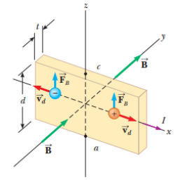

# Resumen de Física II — efecto Hall



“Un conductor de corriente en un campo magnético, genera una diferencia de
potencial en una dirección perpendicular tanto a la corriente como al campo
magnético”.

A un conductor plano que transporta una corriente I en la dirección x, se le
aplica un campo magnético uniforme B. Los portadores de carga, experimentan una
fuerza magnética $`F_B=qv_d\times B`$ , y son desviados, acumulándose en un
borde del conductor plano, dejando en el otro borde inferior un exceso de carga
del otro signo. Esta acumulación de carga en los bordes establece un campo
eléctrico en el conductor y se incrementa hasta que la fuerza eléctrica en los
portadores que quedan en el resto del conductor equilibra la fuerza magnética
que actúa sobre los portadores. Cuando se alcanza el equilibrio, los electrones
ya no son desviados. Se puede medir la diferencia de potencial, conocida como el
voltaje Hall $`\Delta V_H`$ , generado en el conductor, mediante un voltímetro
sensible.

La fuerza magnética ejercida sobre los portadores tiene una magnitud igual a
$`qv_dB`$ . En reposo, esta fuerza está equilibrada por la fuerza eléctrica
$`qE_h`$ , donde $`E_h`$ es la magnitud del campo eléctrico debido a la
separación de las cargas

```math
qv_dB=qE_H\qquad E_H=v_dB
```

Si des el ancho del conductor, el voltaje Hall es igual a

```math
\Delta V_H=E_Hd=v_dBd
```

Si reemplazamos vd=I/nqA en la ecuación anterior tenemos

```math
\Delta V_H=\frac{IBd}{nqA}
```

Como A=td, siendo t el espesor del conductor, el voltaje Hall nos queda

```math
\Delta V_H=\frac{IB}{nqt}
```

donde $`R_H=1/nq`$ es el coeficiente de Hall

```math
\Delta V_H=\frac{R_HIB}{t}
```

## Procedencia y observaciones

- Original: `2015/Resumen-Fisca-2.pdf`, páginas [31]; sectores delimitados por
  encabezados. SHA-256:
  `b9903f972224365c1a74b5d2732c9a34675c9b719da4c9c2d28e4a0f34e0b0cc`.
- PyMuPDF4LLM, Poppler y cotejo visual completo de los sectores; ecuaciones de
  imagen transcritas a LaTeX, figuras originales preservadas.
- Se conserva «Si des el ancho», Eh del párrafo frente a EH de las fórmulas, y
  1/nq sin añadir agrupación al cociente lineal del original.
