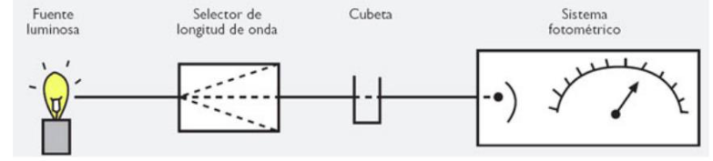

# Resumen de Física II — fotómetros y espectrofotómetros

Un espectrofotómetro es un instrumento que tiene la capacidad de manejar un haz
de Radiación Electromagnética (REM), comúnmente denominado Luz, separándolo en
facilitar la identificación, calificación y cuantificación de su energía. Su
eficiencia, resolución, sensibilidad y rango espectral, dependerán de las
variables de diseño y de la selección de los componentes ópticos que lo
conforman.

Cuando la luz atraviesa una sustancia, parte de la energía es absorbida. El
color de las sustancias se debe a que estas absorben ciertas longitudes de onda
de la luz blanca que incide sobre ellas, y sólo vemos aquellas longitudes de
onda que no fueron absorbidas.

## Componentes de un espectrofotómetro

1º Fuente de luz: La misma ilumina la muestra. Debe cumplir con las condiciones
de estabilidad, direccionabilidad, distribución de energía espectral continua y
larga vida. Las fuentes empleadas son lámpara de tungsteno y lámpara de arco de
xenón.

2 º Monocromador: Para obtener luz monocromática, constituido por las rendijas
de entrada y salida, colimadores y el elemento de dispersión. El monocromador
aísla las radiaciones de longitud de onda deseada que inciden o se reflejan
desde el conjunto.

3° Fotodetectores: En los instrumentos modernos se encuentra una serie de 16
fotodetectores para percibir la señal en forma simultánea en 16 longitudes de
onda, cubriendo el espectro visible. Esto reduce el tiempo de medida, y minimiza
las partes móviles del equipo.

## Procedencia y observaciones

- Original: `2015/Resumen-Fisca-2.pdf`, páginas [60]; sectores delimitados por
  encabezados. SHA-256:
  `b9903f972224365c1a74b5d2732c9a34675c9b719da4c9c2d28e4a0f34e0b0cc`.
- PyMuPDF4LLM, Poppler y cotejo visual completo de los sectores; ecuaciones de
  imagen transcritas a LaTeX, figuras originales preservadas.
- Se conserva «separándolo en facilitar» del texto y los tres componentes
  enumerados, sin agregar componentes no presentes.
