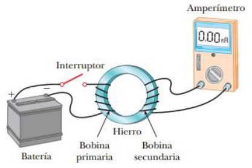
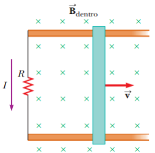

# Resumen de Física II — experimentos de Faraday y ley de Lenz

## Unidad Temática 7. Fenómenos de inducción electromagnética

## Experimentos de Faraday. Ley de Faraday

Una bobina primaria se enrolla alrededor de un anillo de hierro, y se conecta a
un interruptor y a una batería. Una corriente en la bobina produce un campo
magnético al cerrarse el interruptor. Una bobina secundaria también está
enrollada alrededor del anillo y se encuentra conectada a un amperímetro
sensible. En el circuito secundario no hay batería alguna, y la bobina
secundaria no está conectada eléctricamente con la bobina primaria. Cualquier
corriente que se detecte en el circuito secundario deberá haber sido inducida
por algún agente externo.



En el momento en que se cierra el interruptor, la lectura del amperímetro cambia
de cero en una dirección y después regresa a cero. En el instante en que el
interruptor se abre, el amperímetro cambia en la dirección opuesta y de nuevo
vuelve a cero. Por último, el amperímetro marca cero cuando existe una corriente
estable o no existe corriente en el circuito primario. Cuando el interruptor es
cerrado, el campo magnético producido por la corriente en el circuito primario
cambia de cero hacia algún valor durante un tiempo finito, y este campo
cambiante induce una corriente en el circuito secundario. Como resultado de
estas observaciones, Faraday concluyó que es posible inducir una corriente
eléctrica en una espira mediante un campo magnético cambiante. La corriente
inducida existe sólo mientras el campo magnético que pasa a través de la espira
cambia. En cuanto el campo magnético alcanza un valor estable, la corriente en
la espira secundaria desaparece.

La ley de inducción de Faraday se escribe como

```math
\mathcal E=-\frac{d\Phi_B}{dt}
```

donde $`\phi_B=\oint B\cdot dA`$ es el flujo magnético a través de la espira. La
fem inducida en una bobina de N espiras, es la suma de las fem inducidas en cada
espira. Si estas tienen la misma área y flujo magnético, entonces

```math
\mathcal E=-N\frac{d\Phi_B}{dt}
```

El flujo magnético a través de una espira de superficie A que se encuentra en un
campo magnético uniforme B es igual a BA cos u; por esto, la fem inducida puede
expresarse como

```math
\mathcal E=-\frac d{dt}(BA\cos\theta)
```

A partir de esta expresión observe que una fem puede ser inducida en el circuito
de varias formas:

- La magnitud de B cambia con el tiempo.

- El área encerrada por la espira cambia con el tiempo.

- El ángulo u existente entre B y la normal a la espira puede cambiar con el
  tiempo.

- Cualquier combinación puede presentarse de lo anterior

## Ley de Lenz

“La corriente inducida en una espira está en la dirección que crea un campo
magnético que se opone al cambio en el flujo magnético en el área encerrada por
la espira”.

La corriente inducida tiende a mantener el flujo magnético original a través de
la espira. Considere una barra que se mueve hacia la derecha sobre dos rieles
paralelos en presencia de un campo magnético uniforme. Conforme se mueve la
barra el flujo magnético a través del área encerrada por el circuito se
incrementa con el tiempo. Ya que el flujo magnético debido a un campo externo
dirigido hacia adentro de la página está en aumento, la corriente inducida, debe
oponerse a este cambio produciendo un campo dirigido hacia afuera de la página.
En consecuencia, la corriente inducida debe dirigirse en dirección opuesta a las
manecillas del reloj.



Suponga que a la barra se le da un ligero impulso hacia la derecha. Se establece
una corriente en la espira en dirección contraria a las manecillas del reloj.
Pero si se produjera una corriente en la dirección de las manecillas de un
reloj, sobre la barra deslizante aparecería una fuerza magnética que aceleraría
la barra e incrementaría su velocidad, lo que a su vez haría que el área
encerrada por la espira se incrementara con mayor rapidez, lo cual daría como
resultado un incremento en la corriente inducida, provocando un incremento en la
fuerza, y así sucesivamente, violando la ley de la conservación de la energía.

## Procedencia y observaciones

- Original: `2015/Resumen-Fisca-2.pdf`, páginas [35, 36]; sectores delimitados
  por encabezados. SHA-256:
  `b9903f972224365c1a74b5d2732c9a34675c9b719da4c9c2d28e4a0f34e0b0cc`.
- PyMuPDF4LLM, Poppler y cotejo visual completo de los sectores; ecuaciones de
  imagen transcritas a LaTeX, figuras originales preservadas.
- Se conserva u del texto frente a θ en la fórmula y la integral cerrada de
  flujo del original.
