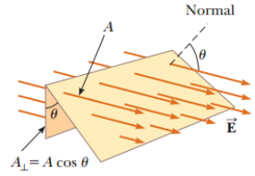

# Resumen de Física II — flujo eléctrico

Considere un campo eléctrico E que es uniforme cuyas líneas de campo penetran en
una superficie rectangular de área A perpendicularmente. El total de líneas que
penetran en la superficie es proporcional al producto EA. A este producto de la
magnitud del campo eléctrico E y al área superficial A, perpendicular al campo,
se le conoce como flujo eléctrico $`\phi_E`$



```math
\Phi_E=EA
```

En el SI $`\phi_E`$ se expresa en (N.m2/C). El flujo eléctrico es proporcional
al número de las líneas de campo eléctrico que penetran en una superficie.

Si la superficie en cuestión no es perpendicular al campo, el flujo que pasa a
través de él debe ser menor. El número de líneas que atraviesan el área A es
igual al número que atraviesa el área $`A_\perp`$ , la cual es una proyección
del área $`A_\perp`$ a un plano con orientación perpendicular al campo, donde
$`A_\perp`$= A cos u. Por lo tanto la ecuación del flujo queda

```math
\Phi_E=EA_\perp=EA\cos\theta
```

A partir de este resultado, se observa que el flujo que atraviesa una superficie
de área A fija tiene un valor máximo EA cuando la superficie es perpendicular al
campo, y el flujo es cero si la superficie es paralela al campo.

En situaciones más generales, el campo eléctrico varía a lo largo de una
superficie. Por lo tanto, la ecuacion de flujo tiene significado sólo para un
elemento de área pequeño.

Considere una superficie dividida en un gran número de elementos pequeños, cada
uno de área A. Definimos un vector Ai cuya magnitud representa el área del
elemento i-ésimo sobre la superficie y cuya dirección está definida como
perpendicular al elemento de superficie. El campo eléctrico Ei en la ubicación
de este elemento forma un ángulo ui con el vector Ai. El flujo eléctrico
$`\phi_E`$ a través de este elemento es

```math
\Delta\Phi_E=E_i\Delta A_i\cos\theta_i=\vec E_i\cdot\Delta\vec A_i
```

donde se utiliza la definición de producto escalar de dos vectores. Al sumar las
contribuciones de todos los elementos, obtiene el flujo total a través de la
superficie.

```math
\Phi_E\approx\sum\vec E_i\cdot\Delta\vec A_i
```

Si supone que el área de cada elemento se acerca a cero, en tal caso el número
de elementos se acercaría al infinito y la suma se reemplaza por una integral.
Por tanto la definición general del flujo eléctrico es

```math
\Phi_E\equiv\int\vec E\cdot d\vec A
```

## Procedencia

- Original: `2015/Resumen-Fisca-2.pdf`, página4 de80. SHA-256:
  `b9903f972224365c1a74b5d2732c9a34675c9b719da4c9c2d28e4a0f34e0b0cc`.
- PyMuPDF4LLM, Poppler y cotejo visual de la página completa. Cinco ecuaciones
  originalmente en imágenes transcritas como LaTeX; diagrama original
  conservado.
- Se preservan «cos u» y «ángulo ui» del texto, aunque las fórmulas usen θ y θi;
  también la proyección del «área A⊥» y «ecuacion» sin acento. No se corrigen.
