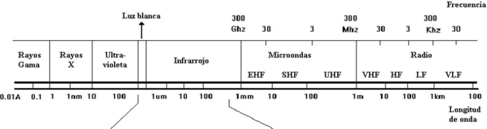
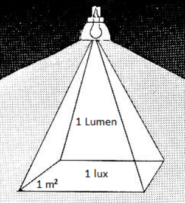
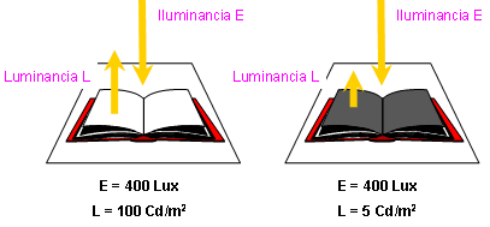
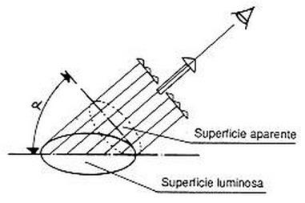

# Resumen de Física II — fotometría y magnitudes luminosas

## Unidad Temática 11. Fotometría (filminas)

## Fotometría. Sensibilidad espectral del ojo

La luz es energía electromagnética emitida dentro de la porción visible del
espectro. El ojo responde a las longitudes de onda de energía electromagnética
en el rango entre la radiación ultra violeta y la infrarroja. La longitud de
onda (distancia entre sucesivas crestas) de luz varía entre los 380 nm
(nanometros) a los 780 nm. (1 nanometro es la mil millonísima parte de un
metro.)La longitud de onda donde el ojo tiene su mejor respuesta es en la
porción amarillo verdoso del espectro, es decir, en los 555 nm. Luego decrece
tanto hacia las longitudes más cortas como hacia las más largas.



## Magnitudes y unidades de medida: Flujo e intensidad luminosa

El flujo luminoso es la cantidad de luz emitida por una fuente en todas las
direcciones. Se la simboliza con φ, y en el SI esta en unidades de Lumen (Lm)

**La intensidad luminosa** es la parte del flujo emitido por una fuente luminosa
en una dirección dada, por el ángulo solido que lo contiene. Se lo simboliza con
I y su unidad en el SI es la Candela (cd).

```math
I=\frac\phi\alpha
```

Donde φ es el flujo luminoso y α es el ángulo solido.

## Iluminación y luminancia Rendimiento luminoso

**El rendimiento luminoso** es el cociente entre el flujo luminoso producido y
la potencia eléctrica consumida.

```math
\eta=\frac\phi W
```

**La iluminación** es el flujo luminoso por unidad de superficie, la densidad de
luz sobre una superficie dada. Se la simboliza con E y en el SI la unidad de
medida es el lux.

```math
E=\frac\phi{Sup}
```



**La luminancia** es la intensidad luminosa emitida por una superficie iluminada
por una fuente de luz, en una dirección dada. Esta produce el efecto del
“brillo” que una superficie produce en el ojo. Se lo simboliza con la letra L, y
su unidad es la cd/m<sup>2</sup> .

```math
L=\frac IS
```



Cuando la superficie considerada S no es perpendicular a la dirección de la luz,
habrá que considerar la superficie que resulta de proyectar S sobre dicha
perpendicular, por lo tanto la ecuación queda como

```math
L=\frac I{S\cos\alpha}
```



## Procedencia y observaciones

- Original: `2015/Resumen-Fisca-2.pdf`, páginas [58, 59]; sectores delimitados
  por encabezados. SHA-256:
  `b9903f972224365c1a74b5d2732c9a34675c9b719da4c9c2d28e4a0f34e0b0cc`.
- PyMuPDF4LLM, Poppler y cotejo visual completo de los sectores; ecuaciones de
  imagen transcritas a LaTeX, figuras originales preservadas.
- Se conservan «nanometros», «mil millonísima», «solido» y las unidades y
  símbolos del original.
