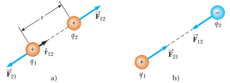

# Resumen de Física II — fuerza eléctrica y campo eléctrico

Unidad Temática 1. Fuerza eléctrica y campo eléctrico

## Carga eléctrica. Propiedades. Electrizacion

Supongamos una varilla rígida de hule que ha sido frotada contra un trozo de
piel y una varilla de vidrio que ha sido frotada con seda. Al acercarlas notamos
que ambas se atraen. Por otra parte, si acerca dos varillas de hule con carga
ambas se repelen. Se concluyó que cargas de un mismo signo se repelen y cargas
de signos opuestos se atraen. La carga en los objetos surge por el exceso o
defecto de electrones. Esto se da por la transferencia de electrones de un
objeto a otro, este proceso se llama electrización. Otra propiedad de estas
cargas es que en un sistema aislado la carga eléctrica siempre se conserva,
además la carga eléctrica q está cuantizada.

## Conductores y aisladores

Los conductores eléctricos son aquellos materiales en los cuales algunos de los
electrones son libres, no están unidos a átomos y pueden moverse con libertad a
través del material. Cuando están con carga en alguna pequeña zona, la carga se
distribuye de inmediato en toda la superficie del material.

Los aislantes eléctricos son aquellos materiales en los cuales todos los
electrones están unidos a átomos y no pueden moverse libremente a través del
material. Cuando estos materiales son frotados sólo la zona frotada se carga, y
las partículas con carga no pueden moverse hacia otras zonas del material.

## Ley de Coulomb

Coulomb midió las magnitudes de las fuerzas eléctricas entre objetos con carga;
haciendo usó de la balanza de torsión. La fuerza eléctrica entre las esferas A y
B provoca que se atraigan o se repelan, y el movimiento resultante provoca que
la fibra suspendida se tuerza. Como el momento de torsión de recuperación de la
fibra torcida es proporcional al ángulo de rotación de la fibra, una lectura de
este ángulo da una medida cuantitativa de la fuerza eléctrica.

La fuerza eléctrica entre dos partículas inmóviles con carga está dada por la
ecuación:

```math
F_e=k_e\frac{|q_1|\,|q_2|}{r^2}
```

donde ke es una constante conocida como constante de Coulomb, en unidades del SI
tiene el valor de

```math
k_e=8{,}9876\times10^9\;\mathrm N\cdot\mathrm m^2/\mathrm C^2
```

Además esta constante se expresa como

```math
k_e=\frac1{4\pi\epsilon_0}
```

donde la constante e0 se conoce como la permitividad del vacío, cuyo valor es

```math
\epsilon_0=8{,}8542\times10^{-12}\;\mathrm C^2/\mathrm N\cdot\mathrm m^2
```

Cuando se relaciona con la ley de Coulomb, es necesario recordar que la fuerza
es una cantidad vectorial que deberá ser tratada como corresponde. La ley de
Coulomb, expresada en forma vectorial para una fuerza eléctrica ejercida por una
carga q1 sobre una segunda carga q2, rescrita como $`\vec F_{12}`$, donde
$`\hat r_{12}`$ es un vector unitario dirigido de q1 hacia q2.

```math
\vec F_{12}=k_e\frac{q_1q_2}{r^2}\hat r_{12}
```

Si q1 y q2 son del mismo signo, el producto q1q2 es positivo, fuerza de
repulsión. Si q1 y q2 son de signos opuestos, el producto q1q2 es negativo,
fuerza de atracción.



Cuando hay más de dos cargas presentes, la fuerza resultante sobre una carba,
debido a las restantes, es igual a la suma vectorial de las fuerzas ejercidas
por cada carga individual.

```math
\vec F_1=\vec F_{21}+\vec F_{31}+\vec F_{41}
```

(Fuerza resultante ejercida por las partículas 2, 3 y 4 sobre la partícula 1)

## Campo eléctrico

“Existe un campo eléctrico en la región del espacio que rodea a un objeto con
carga: la carga fuente; cuando otro objeto con carga: la carga de prueba; entra
en este campo eléctrico, y una fuerza eléctrica actúa sobre él”

El vector $`\vec E`$ del campo eléctrico en un punto en el espacio se define
como la fuerza eléctrica $`\vec F_e`$, que actúa sobre una carga de prueba
positiva $`q_0`$ colocada en ese punto, dividida entre la carga de prueba:

```math
\vec E=\frac{\vec F_e}{q_0}
```

El vector $`\vec E`$ está en unidades del SI, newtons por cada coulomb (N/C). La
dirección de $`\vec E`$ es la dirección de la fuerza que experimenta una carga
de prueba positiva cuando es colocada en el campo. Esta ecuación también puede
escribirse como

```math
\vec F_e=q\vec E
```

Esta ecuación proporciona la fuerza ejercida sobre una partícula con carga q
colocada en un campo eléctrico. Si $`q_0`$ es positiva, la fuerza tiene la misma
dirección que el campo. Si es negativa, la fuerza y el campo tienen direcciones
opuestas. Por lo tato podemos expresar el campo eléctrico generado por una carga
fuente q como

```math
\vec E=k_e\frac q{r^2}\hat r
```

En cualquier punto P, el campo eléctrico total debido a un grupo de cargas
fuente es igual a la suma vectorial de los campos eléctricos de todas las
cargas. Este es el principio de sobreposición aplicado a los campos.

```math
\vec E=k_e\sum_i\frac{q_i}{r_i^2}\hat r_i
```

## Campo eléctrico de una distribución de carga continua

Un sistema de cargas se modela como si fuera continuo cuando la distancia
existente entre ellas es mucho más reducida que la distancia entre el grupo y el
punto donde se desea calcular el campo eléctrico.

El campo eléctrico en P debido a un elemento de carga con una carga q es

```math
\Delta\vec E=k_e\frac{\Delta q}{r^2}\hat r
```

donde r es la distancia desde el elemento de carga hasta el punto P y $`\hat r`$
es el vector unitario dirigido desde el elemento de carga hasta P. El campo
eléctrico total en P debido a todos los elementos en la distribución de carga es
aproximadamente

```math
\vec E\approx k_e\sum_i\frac{\Delta q_i}{r_i^2}\hat r_i
```

donde el índice i se refiere al i-ésimo elemento de orden i en la distribución.
Ya que la distribución de carga ha sido modelada como continua, el campo total
en P en el límite qi →0 es

```math
\vec E=k_e\lim_{\Delta q_i\to0}\sum_i\frac{\Delta q_i}{r_i^2}\hat r_i=k_e\int\frac{dq}{r^2}\hat r
```

donde la integración es sobre toda la distribución de carga. Para realizar estos
cálculos es conveniente que use el concepto de densidad de carga. Si una carga Q
tiene una distribución uniforme en un volumen V, la densidad de carga
volumétrica ρ se define como donde ρ está en coulombs por metro cúbico (C/m3).

```math
\rho\equiv\frac QV
```

Si una carga Q tiene una distribución uniforme sobre una superficie de área A,
la densidad de carga superficial σ se define como donde σ está en coulombs por
metro cuadrado (C/m2).

```math
\sigma\equiv\frac QA
```

Si una carga Q tiene una distribución uniforme a lo largo de una línea de
longitud, la densidad de carga lineal λ se define como donde λ está en coulombs
por metro (C/m).

```math
\lambda\equiv\frac Q\ell
```

Si la carga no tiene distribución uniforme en un volumen, superficie o línea,
las cantidades de cargas dq en un elemento pequeño de volumen, superficie o
longitud son

```math
dq=\rho\,dV\qquad dq=\sigma\,dA\qquad dq=\lambda\,d\ell
```

## Líneas del campo eléctrico

Las líneas de campo eléctrico relacionan el campo eléctrico con una región del
espacio de la manera siguiente:

1\. El vector E del campo eléctrico es tangente a la línea del campo eléctrico en
cada punto. La dirección de la línea, indicada por una punta de flecha, es igual
al vector del campo eléctrico. La dirección de la línea es la fuerza sobre una
carga de prueba positiva colocada en el campo.

2\. El número de líneas por unidad de área que pasan a través de una superficie
perpendicular a dichas líneas es proporcional a la magnitud del campo eléctrico
en dicha región. Las líneas de campo estarán cercanas donde el campo eléctrico
sea intenso y separadas donde el campo sea débil

Las reglas para dibujar las líneas de un campo eléctrico son las siguientes:

- Las líneas deben empezar en una carga positiva y terminar en una carga
  negativa o terminarán en el infinito.

- El número de líneas dibujadas que salen de una carga positiva o se acercan a
  una carga negativa será proporcional a la magnitud de dicha carga.

- Dos líneas de campo no se pueden cruzar

## Movimiento de cargas eléctricas en campos eléctricos uniformes

Cuando una partícula con carga **q** y masa **m** se coloca en un campo
eléctrico **E** , la fuerza eléctrica ejercida sobre la carga es **qE** , la
cual provoca que la partícula se acelere. Así,

```math
\vec F_e=q\vec E=m\vec a
```

la aceleración de la partícula es, por tanto,

```math
\vec a=\frac{q\vec E}m
```

**E** es uniforme (constante en magnitud y dirección), la fuerza eléctrica sobre
la partícula es constante y se puede aplicar el modelo de partícula bajo
aceleración constante. Si la partícula tiene carga positiva, su aceleración se
produce en dirección del campo eléctrico. Si tiene carga negativa, su
aceleración será en dirección opuesta al campo eléctrico.

## Procedencia y observaciones

- Original: `2015/Resumen-Fisca-2.pdf`, páginas1–3 de80. Autor y año no constan
  en estas páginas;2015 es la carpeta. SHA-256:
  `b9903f972224365c1a74b5d2732c9a34675c9b719da4c9c2d28e4a0f34e0b0cc`.
- PyMuPDF4LLM con extracción de imágenes, Poppler y cotejo visual de las tres
  páginas. Las fórmulas originales son imágenes: se transcriben como LaTeX; se
  conserva el diagrama de cargas. Se restituyen los símbolos en línea que la
  extracción omitió, cotejados en el render.
- Se conservan las erratas «carba», «Por lo tato», «Electrizacion» y «rescrita»,
  y las frases «se define como donde» de densidad con las ecuaciones debajo. La
  unidad de ε0 conserva la disposición literal C²/N·m², sin añadir paréntesis.
- Este apunte cubre las páginas 1–3; las páginas 4–80 están distribuidas entre
  los restantes apuntes del mismo resumen, según el
  [registro de cobertura](../../../resources/common/cobertura.json).
