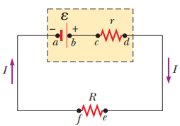

# Resumen de Física II — fuerza electromotriz



A la batería se le conoce como fuente de fuerza electromotriz (fem), esta
produce en el circuito una corriente constante en magnitud y dirección que
recibe el nombre de corriente directa. La fem Ɛ de una batería es el voltaje
máximo posible que ésta puede suministrar entre sus terminales. La fuente mueve
las cargas del potencial más reducido al más elevado y se considera que los
alambres en un circuito no tienen resistencia. Existe una resistencia al flujo
de las cargas dentro de la batería, la resistencia interna r. En el caso de una
batería ideal la resistencia interna es igual a cero y la diferencia de
potencial a través de la batería es igual a su fem.

En una batería el voltaje entre las terminales no es igual a su fem.
Consideremos la batería como el rectángulo en línea discontinua que contiene una
fem Ɛ ideal conectada en serie con una resistencia interna r. Un resistor de
resistencia R es conectado en las terminales de la batería. Conforme pasa de la
terminal negativa a la positiva, el potencial aumenta en una cantidad Ɛ al
moverse a través de la resistencia r, el potencial disminuye una cantidad Ir,
donde I es la corriente del circuito. Donde el voltaje entre las terminales de
la batería es:

```math
\Delta V=\mathcal E-Ir
```

Ɛ es equivalente al voltaje en circuito abierto, es decir, cuando la corriente
es igual a cero. La diferencia de potencial real entre las terminales de la
batería depende de la corriente en la misma. El voltaje entre las terminales
$`\Delta V`$ debe ser igual a la diferencia de potencial de un extremo a otro de
la resistencia externa R, conocida como resistencia de carga. Por lo tanto la
diferencia de potencial de un extremo a otro de la resistencia de carga es
$`\Delta V=IR`$ . Al combinar esta expresión con la anterior

```math
\mathcal E=IR+Ir
```

(1)

Al resolver en función de la corriente,

```math
I=\frac{\mathcal E}{R+r}
```

Esta ecuación muestra que la corriente en este circuito simple depende tanto de
la resistencia de carga R externa a la batería como de la resistencia interna r.
Si R es mucho mayor que r, se la ignora. Si multiplica la ecuación (1) por la
corriente I

```math
I\mathcal E=I^2R+I^2r
```

Ya que la potencia es P = I $`\Delta V`$ , esta ecuación nos indica la potencia
total de salida IƐ de la batería que es entregada.

## Procedencia y observaciones

- Original: `2015/Resumen-Fisca-2.pdf`, páginas [23, 24]; sectores delimitados
  por encabezados. SHA-256:
  `b9903f972224365c1a74b5d2732c9a34675c9b719da4c9c2d28e4a0f34e0b0cc`.
- PyMuPDF4LLM, Poppler y cotejo visual completo de los sectores; fórmulas de
  imagen transcritas a LaTeX, diagramas originales conservados.
- El diagrama de batería omitido por la extracción se recuperó del objeto de
  imagen original del PDF.
